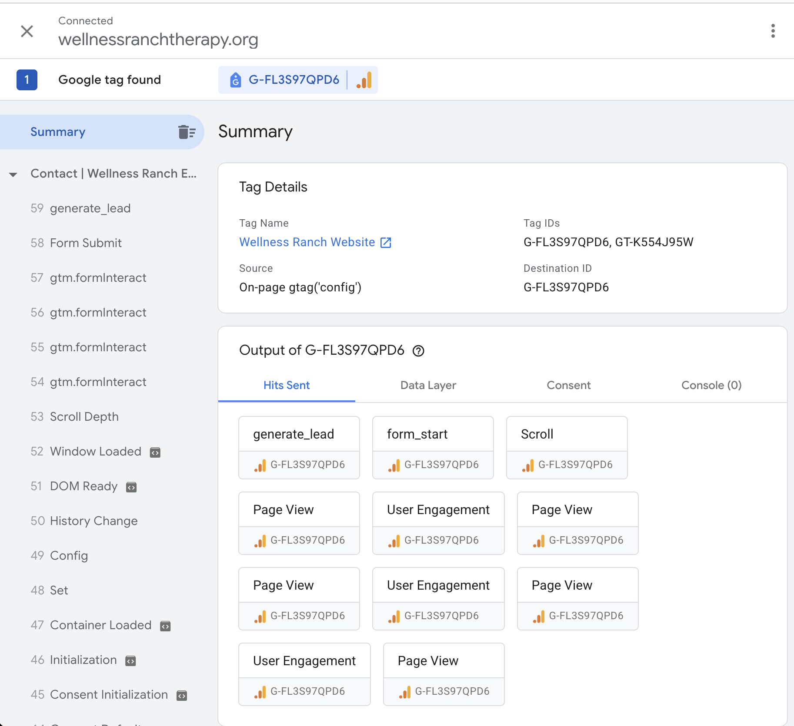
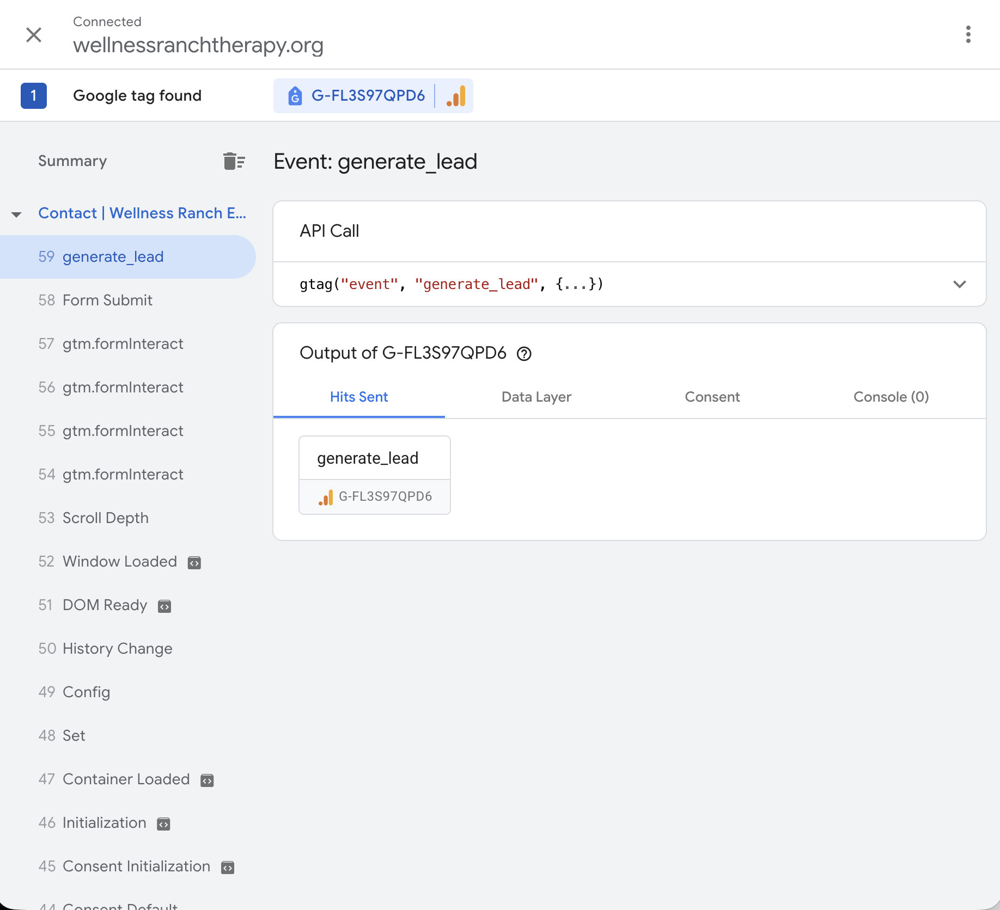
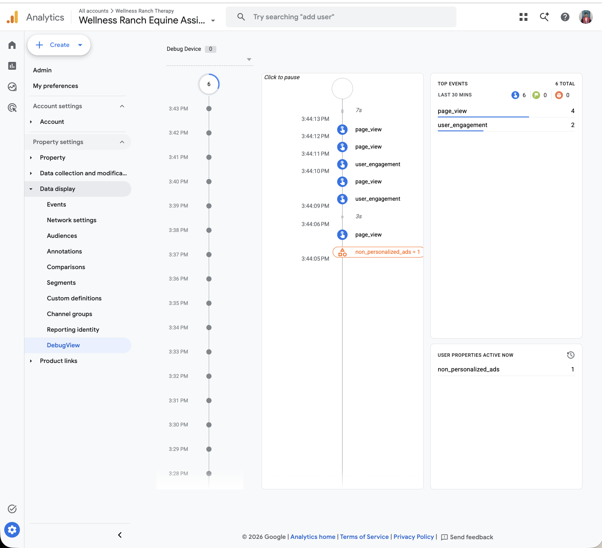
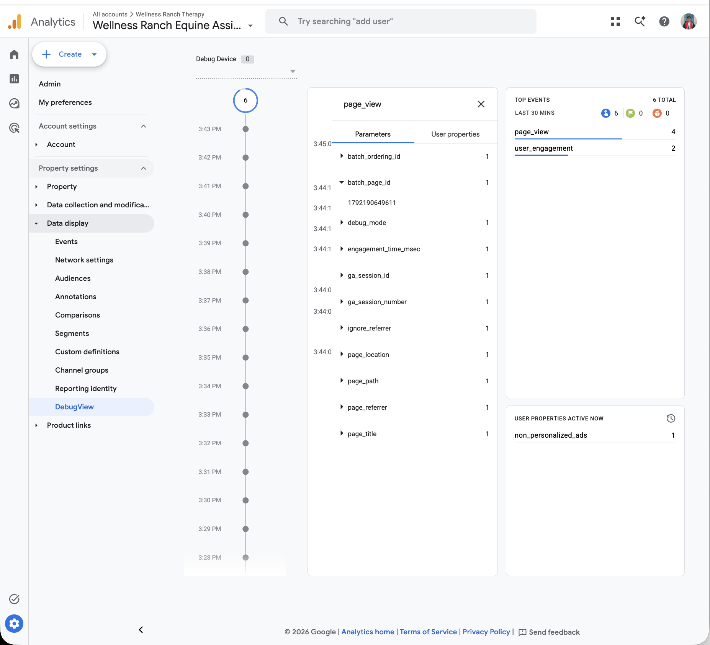
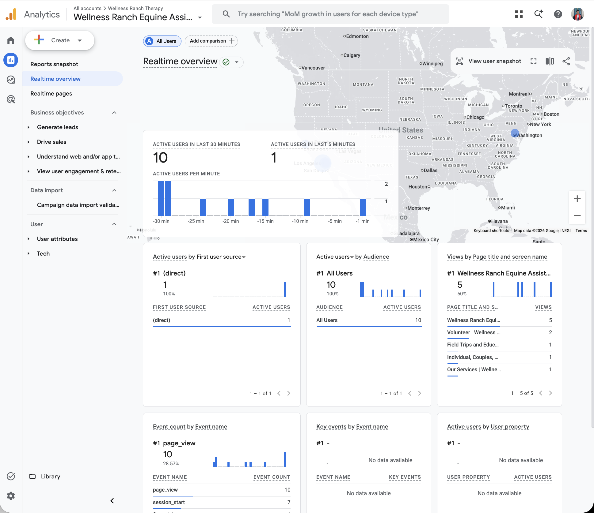
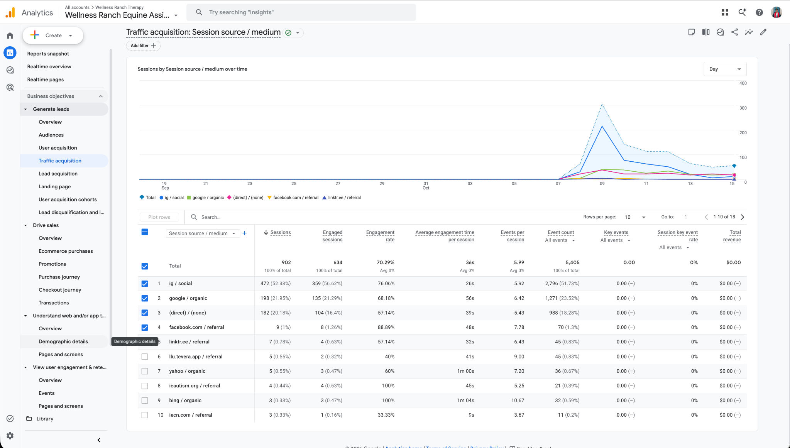
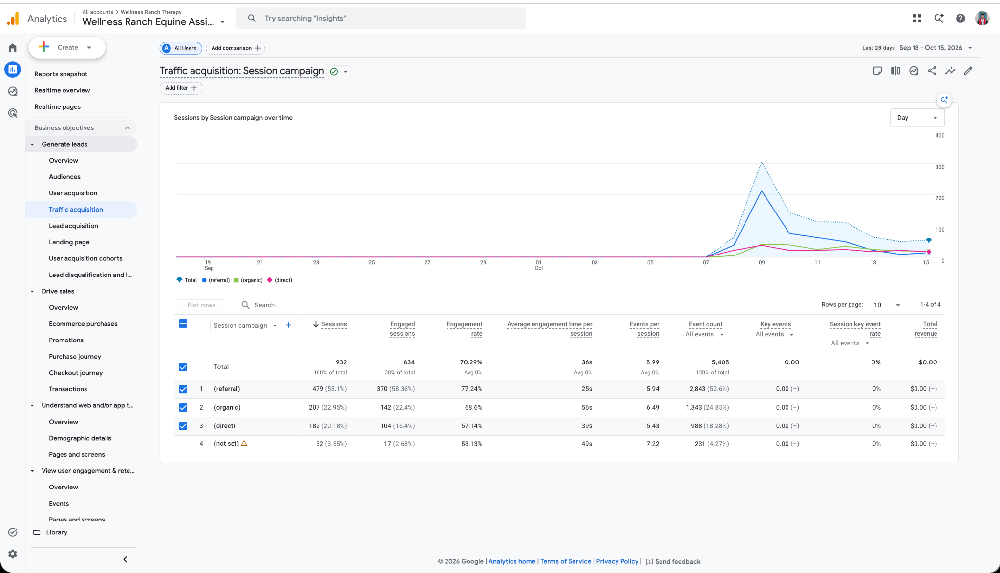
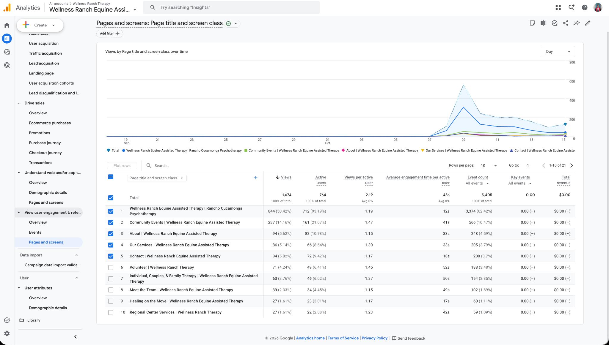
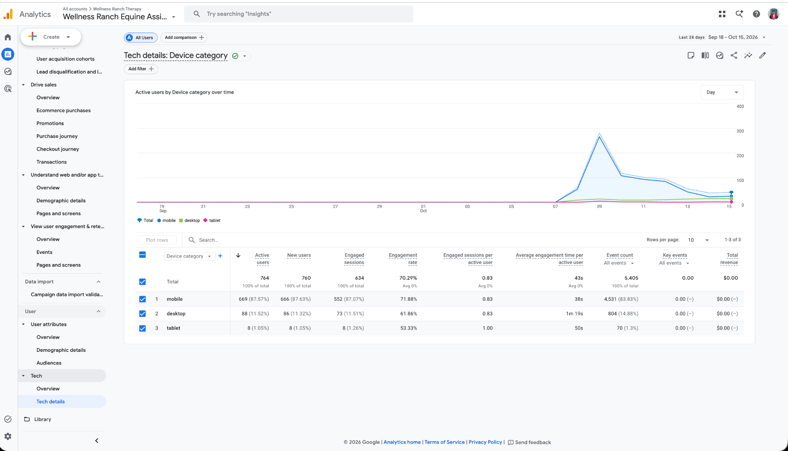

# Screenshot-Backed QA Checklist

## Testing Overview

This tracking quality assurance (QA) assessment evaluates the
Google Analytics 4 (GA4) implementation for Wellness Ranch
Equine Assisted Therapy. The purpose is to verify that website
interactions are accurately collected, processed, and reported
to support marketing performance measurement and future
analytics activities.

Testing was conducted on October 16, 2026, using the live
Wellness Ranch Therapy website. Google Tag Assistant and GA4
DebugView were used to verify event collection, trigger
behavior, and event parameters. GA4 standard reports were
reviewed to assess traffic acquisition, device categories,
page titles, and campaign attribution.

The validation confirmed that page views, user engagement,
form interactions, and lead generation events were received
by GA4. Contact form testing also confirmed that the
`generate_lead` event was associated with the website's
contact form and contained relevant event parameters.

Several limitations were identified. The `generate_lead`
event was initially not designated as a key event, but this
configuration was updated during testing. Campaign
attribution requires further validation, and the GA4
property does not currently have an active BigQuery export
connection.

The following sections document the validation procedures,
supporting screenshots, observed results, and remaining
limitations.


## GTM / Collection Layer

### Collection Layer Validation

Google Tag Assistant was used on October 16, 2026,
to verify that the Google tag was installed and sending
events from the live Wellness Ranch Therapy website.

The testing confirmed that the website was connected
to Google Tag Assistant and that the Google tag with
measurement ID `G-FL3S97QPD6` was detected.

The Tag Assistant results also showed that page views,
user engagement, form interactions, and lead generation
events were being transmitted to GA4.

### Tag Assistant Connection



### Lead Event Validation

A test contact form submission generated a
`generate_lead` event. Tag Assistant showed one
`generate_lead` hit sent to the GA4 measurement ID
during the selected submission event.



### QA Results

| Test | Expected Result | Observed Result | Status |
|---|---|---|---|
| Google tag installation | Correct tag detected | G-FL3S97QPD6 detected | Pass |
| Page view tracking | Page views sent to GA4 | Page view hits observed | Pass |
| Form interaction tracking | Form start event sent | form_start observed | Pass |
| Lead generation tracking | generate_lead sent after submission | One lead hit observed | Pass |
| Duplicate lead tracking | One event per submission | One hit observed in selected test | Pass (limited test) |

The collection-layer tests confirmed that the Google
tag was sending the expected events. However, additional
testing across multiple submissions and devices is
recommended to rule out intermittent duplicate events.

## GA4 DebugView and Realtime Validation

After confirming the Google tag was sending events in Tag Assistant, we checked that those events were actually being received and processed in GA4. We turned on debug mode, browsed the live Wellness Ranch site, and reviewed the results in two places: DebugView (Admin → Data display → DebugView) and the Realtime overview. For each event, we checked three things: did it show up, were the parameters filled in, and did the values make sense.

### Do the events show up in DebugView?

{width=100%}

Yes. Once we started browsing the site, events showed up in the DebugView timeline within a few seconds (around 3:44 PM). Both `page_view` and `user_engagement` fired like they're supposed to, and the Top Events panel shows 6 total events in the last 30 minutes, which were 4 page views and 2 user engagement events. The user property `non_personalized_ads` also came through, so GA4 is receiving user-level data along with events.

### Are the required parameters there?

{width=100%}

Next we clicked into one of the `page_view` events to see what parameters came with it. All the main ones we need were there:

| Parameter | What it's for |
|---|---|
| `page_location` | the full URL of the page |
| `page_path` | just the path part of the URL |
| `page_title` | the name of the page |
| `page_referrer` | where the user came from |
| `ga_session_id` | links the event to a session |
| `ga_session_number` | shows if it's a new or returning session |
| `engagement_time_msec` | how long the user was engaged |
| `debug_mode` | shows the hit came from our debug testing |

There were also a couple of GA4 internal parameters like `batch_page_id` (expanded in the screenshot, value 1792190649611…) and `batch_ordering_id`. Each parameter only showed up once per event, so nothing was missing or duplicated.

### Do the values make sense?

{width=100%}

To double check the values, we looked at the Realtime overview. Everything lined up with how we tested the site:

- There were 10 active users in the last 30 minutes and 1 in the last 5 minutes.
- `page_view` had 10 events and `session_start` had 7. That makes sense since people usually view more than one page per session.
- The page titles came through clean and match the real pages on the site: the homepage (*Wellness Ranch Equine Assisted…*) had the most views at 5, then *Volunteer* (2), *Field Trips and Education* (1), *Individual, Couples…* (1), and *Our Services* (1).
- The traffic source showed up as `(direct)`, which is right since we typed the URL in directly to test. This also shows why consistent UTMs matter later on (see Risks 5 and 9), because untagged traffic gets grouped as direct.

Since the page titles match the actual pages and follow the same format every time, `page_title` and `page_location` are being sent correctly across the site.

### Key event status

One thing we noticed is that the "Key events by Event name" card in Realtime showed no data at the time of capture. This lines up with what we found in the collection layer: `generate_lead` was already firing (see the Tag Assistant lead validation above), but it **had not been marked as a key event yet**, so GA4 wasn't counting it as one. We updated the key event configuration during testing, which is also why we flagged key event changes as a risk (Risk 8).

### Summary

| Check | Result | Status |
|---|---|---|
| Events appear in DebugView | `page_view`, `user_engagement`, and `session_start` received | Pass |
| Required parameters populated | All page and session parameters present on `page_view` | Pass |
| Values sensible and consistent | Page titles and source match real site pages and test behavior | Pass |
| Key events reporting | `generate_lead` not yet marked as key event at time of capture; updated during testing | Fixed during testing |

## Reporting Sanity Checks

For this part, we checked that GA4's standard dimensions were filling in correctly in the regular reports. We looked at four things: source / medium, campaign, page title, and device category. For each one, we checked whether the values made sense for Wellness Ranch and looked for any `(not set)` values or numbers that didn't line up. All reports use the same date range (last 28 days, Sep 18 – Oct 15, 2026), and the totals match across reports (902 sessions and 5,405 events), so they're all looking at the same data.

One thing to know up front: in every report, the trend line is flat until around October 7 and then jumps up. This suggests GA4 only started collecting data around then, so even though the range says 28 days, it's really about a week and a half of data. That also explains why almost every user shows up as a new user (760 new out of 764 active users).

### Source / Medium

{width=100%}

Source / medium filled in correctly, with no `(not set)` values in the top 10. The top sources were:

| Source / medium | Sessions | Share |
|---|---|---|
| ig / social | 472 | 52.3% |
| google / organic | 198 | 22.0% |
| (direct) / (none) | 182 | 20.2% |
| facebook.com / referral | 9 | 1.0% |
| linktr.ee / referral | 7 | 0.8% |

These make sense for Wellness Ranch. Instagram is their biggest channel, and `ig / social` is the tag Instagram adds automatically to link-in-bio clicks, so it's being labeled correctly. Google organic being second shows people are finding the site through search. The smaller referral sources (like ieautism.org, iecn.com, and llu.tevera.app) look like real community and partner sites, not spam, which is a good sign.

### Campaign

{width=100%}

Since Wellness Ranch isn't running any paid or named campaigns yet (the Google Ad Grants account hasn't launched), we didn't expect to see real campaign names. GA4 just used its default labels, which is normal:

| Session campaign | Sessions | Share |
|---|---|---|
| (referral) | 479 | 53.1% |
| (organic) | 207 | 23.0% |
| (direct) | 182 | 20.2% |
| (not set) | 32 | 3.6% |

The `(organic)` and `(direct)` numbers line up with the source / medium report. Direct is exactly 182 in both, and organic (207) matches Google + Yahoo + Bing organic plus a few smaller search engines further down the list.

**Explaining the `(not set)`:** 32 sessions (3.6%) came in as `(not set)`. GA4 uses this when it can't figure out where a session came from. Likely reasons are links that had a UTM source and medium but no campaign name, or sessions that continued after a timeout without a new page view to attach source info to. At 3.6% it's small and not a big concern, but it's another reason to set up a consistent UTM naming standard before the Ad Grants campaigns go live (see Risks 5 and 9).

### Page Title

{width=100%}

Page titles came through clean, with no `(not set)` values, and they match the real pages on the site. There are 21 page titles total, and the top ones were:

| Page title | Views | Share |
|---|---|---|
| Wellness Ranch Equine Assisted Therapy \| Rancho Cucamonga Psychotherapy (homepage) | 844 | 50.4% |
| Community Events | 237 | 14.2% |
| About | 94 | 5.6% |
| Our Services | 86 | 5.1% |
| Contact | 84 | 5.0% |

This makes sense, since the homepage is where most Instagram link-in-bio traffic lands. Community Events being second is interesting, though, and probably connects to event posts on Instagram.

**Small discrepancy:** The page titles aren't fully consistent. Most end with "| Wellness Ranch **Equine Assisted** Therapy," but a few (Volunteer and Regional Center Services) end with "| Wellness Ranch Therapy." This isn't a tracking error, since GA4 is just reporting whatever title the page has. But it makes reports a little messier, and it's something the Website & SEO side could clean up.

**Note on page location:** This report shows page titles, not full URLs. We confirmed in the DebugView section that `page_location` is being sent with every `page_view`, so the URL data is there, it just isn't shown in this report.

### Device Category

{width=100%}

Device category filled in correctly with no `(not set)` values:

| Device | Active users | Share | Engagement rate | Avg. engagement time |
|---|---|---|---|---|
| mobile | 669 | 87.6% | 71.9% | 38s |
| desktop | 88 | 11.5% | 61.9% | 1m 19s |
| tablet | 8 | 1.1% | 53.3% | 50s |

Mobile being almost 88% of users lines up with Instagram being the top traffic source, since most people click through from their phones. Desktop users are a lot fewer but spend about twice as long on the site (1m 19s vs 38s), which might mean desktop visitors are doing more research.

**Small discrepancy:** The device rows add up to 765 users, but the total says 764. That's normal in GA4, because if one person visits on two different devices, they get counted once in each device row but only once in the total.

### Summary

| Dimension | Populated correctly? | (not set) / discrepancies | Status |
|---|---|---|---|
| Source / medium | Yes, values match real channels | None in top 10 | Pass |
| Campaign | Yes, default labels as expected (no campaigns running yet) | 32 sessions (3.6%) `(not set)`, likely missing UTM campaign or timed-out sessions | Pass (needs UTM standard) |
| Page title | Yes, matches real site pages | Inconsistent title suffixes on some pages | Pass |
| Page location | Confirmed in DebugView | Not shown in this report | Pass |
| Device category | Yes | Device rows sum to 765 vs 764 total (users on multiple devices) | Pass |

Also worth noting: **Key events show 0 in every report.** This matches what we found earlier, where `generate_lead` was firing but hadn't been marked as a key event yet during this date range.

## BigQuery Export Validation

BigQuery export sends GA4's raw, event-level data into a BigQuery
dataset, where it can be queried directly with SQL. This matters
because the standard GA4 reports are aggregated and can be
sampled or thresholded, while the export gives access to every
event and parameter. For this project, it would let the team
check `generate_lead` events individually and build attribution
analysis that can be reproduced later.

### Export Status

According to the team's review of the GA4 property, there is no
active BigQuery export connection. This would be confirmed under
Admin → Product links → BigQuery links. A screenshot of this
page was not captured during testing.

Because the export is not set up, we were not able to complete
the following checks:

- Confirm that daily `events_YYYYMMDD` tables are being created
- Compare event counts in BigQuery to the GA4 interface
- Confirm that `generate_lead` parameters can be pulled out at
  the event level
- Check for duplicate lead events using raw timestamps and
  session IDs

### Planned Validation Once Export Is Enabled

If the team gets the required permissions and turns on the
export, these are the checks we would run:

| Check | How we would test it | What would count as a pass |
|---|---|---|
| Daily tables created | Look for `events_` tables in the `analytics_<property_id>` dataset | A new table appears each day |
| Event counts match | Compare daily `page_view` and `generate_lead` counts to GA4 reports | Counts are close (small differences are normal) |
| Lead parameters present | Query `event_params` on `generate_lead` events | Expected parameters are populated |
| Duplicate leads | Look for multiple `generate_lead` events in the same session within a few seconds | One lead event per submission |

A simple starting query for the count comparison would look
like this:

```sql
SELECT
  event_date,
  event_name,
  COUNT(*) AS event_count
FROM `project_id.analytics_property_id.events_*`
WHERE event_name IN

# Issues Log: Findings and Fixes Attempted

## Issues Identified

The table below pulls together the issues found across the
collection layer, DebugView, reporting, and BigQuery checks.

| # | Issue | Where it was found | Severity | Status |
|---|---|---|---|---|
| 1 | `generate_lead` was firing but was not marked as a key event | Realtime and standard reports (key events showed 0) | High | Fixed during testing |
| 2 | Duplicate lead testing was limited to one submission | Tag Assistant | Medium | Open |
| 3 | 32 sessions (3.6%) had a `(not set)` campaign | Campaign report | Low | Open |
| 4 | Page title suffixes are inconsistent across pages | Pages and screens report | Low | Open |
| 5 | BigQuery export is not active | GA4 BigQuery links | High | Open |
| 6 | Data collection appears to have started around October 7, so the 28-day range only has about a week and a half of data | All standard reports | Medium | Limitation |

## Fixes Attempted and Current Status

**Issue 1: Key event configuration.** This was the only issue
fixed during testing. We marked `generate_lead` as a key event
in GA4 on October 16, 2026. GA4 does not apply key event changes
to past data, so conversions will only start showing up in
reports from that date forward. That is why key events still
show 0 for the Sep 18 to Oct 15 range. Any future reporting
should note the October 16 change date (see Risk 8).

**Issue 2: Duplicate lead testing.** No fix needed yet, since
the one test submission produced one event. More tests across
desktop and mobile, including double clicks and page refreshes,
are needed before we can rule out duplicates (see Risk 1).

**Issue 3: `(not set)` campaign values.** No fix attempted. At
3.6% it is small, but it should be addressed with a UTM naming
standard before the Google Ad Grants campaigns launch
(see Risk 5).

**Issue 4: Inconsistent page titles.** This is a website issue,
not a tracking error. We are passing it to the Website & SEO
side to standardize the title suffixes.

**Issue 5: BigQuery export.** No fix attempted, since enabling
the export requires permissions on a Google Cloud project. The
next step is to confirm who owns the GA4 property and request
access (see Risk 7).

**Issue 6: Short data window.** This cannot be fixed after the
fact. Future reports should use date ranges that start on or
after October 7 so the numbers are not misread as a full month.
Although the QA testing confirmed that the Google tag, page views, form interactions, and `generate_lead` events are being received by GA4, several risks could affect data quality over time. These risks should be monitored as the Wellness Ranch website, campaigns, and tracking configuration change.

## Risk 1: Duplicate Lead Events

**Risk description:** A single contact-form submission could generate more than one `generate_lead` event because of repeated clicks, page refreshes, confirmation-page reloads, or overlapping tags.

**Why it matters:** Duplicate lead events would inflate the number of conversions and make conversion rates, campaign comparisons, and lead-generation reports inaccurate.

**Likely impact:** Medium

**Mitigation strategy:** Test multiple form submissions across desktop and mobile devices. Use a unique submission or confirmation-state trigger, prevent repeated event firing, and compare form-submission records with GA4 event counts. Review unusual spikes in `generate_lead` events.

## Risk 2: Embedded or Third-Party Form Tracking Limitations

**Risk description:** If the contact form is embedded from a third-party provider, GA4 or Google Tag Manager may not consistently detect form starts, successful submissions, or confirmation states.

**Why it matters:** Missing or incomplete form events could undercount meaningful conversions and make the website appear less effective than it actually is.

**Likely impact:** High

**Mitigation strategy:** Confirm whether the form is hosted on the Wellness Ranch website or an external platform. Test successful submissions, validation errors, abandoned forms, and confirmation messages. If necessary, use a reliable data-layer event, thank-you-page trigger, or server-side confirmation from the form provider.

## Risk 3: Consent Settings May Suppress Events

**Risk description:** Consent choices, browser privacy settings, or ad blockers may prevent some users and events from being recorded.

**Why it matters:** GA4 reports may undercount users, sessions, engagement, and conversions. Suppression may also vary by device, browser, or audience segment, which can create biased comparisons.

**Likely impact:** Medium

**Mitigation strategy:** Test tracking with analytics consent accepted and declined. Document which events are expected to be blocked under each consent state. Interpret trends as observed activity rather than a complete count of all website activity, and monitor consent rates over time.

## Risk 4: Cross-Domain Tracking Limitations

**Risk description:** If users move from the Wellness Ranch website to an external form, scheduling system, donation platform, or payment page, the user journey may not remain connected across domains.

**Why it matters:** Conversions may be attributed to direct traffic or a referral instead of the original campaign, keyword, or landing page. This could weaken attribution analysis and distort campaign performance.

**Likely impact:** High

**Mitigation strategy:** Identify all external domains used in the user journey. Configure cross-domain measurement when supported, exclude trusted domains from unwanted-referral lists, and test the complete path from advertisement or landing page through the final conversion. If cross-domain tracking is not possible, report external conversions separately and document the limitation.

## Risk 5: Incomplete or Inconsistent UTM Parameters

**Risk description:** Campaign links may be created without UTMs or may use inconsistent capitalization, abbreviations, or naming conventions.

**Why it matters:** Traffic may be grouped into `(not set)`, direct traffic, or inconsistent campaign categories. This makes it difficult to compare channels, campaigns, advertisements, and keyword-intent groups.

**Likely impact:** Medium

**Mitigation strategy:** Create a shared UTM naming standard for source, medium, campaign, content, and term. Use a campaign URL builder or tracking template, review links before launch, and periodically audit GA4 acquisition reports for missing or inconsistent values.

## Risk 6: Low Traffic and Conversion Volume

**Risk description:** Wellness Ranch may receive a limited number of website visitors, advertisement clicks, and conversions during the measurement period.

**Why it matters:** Small sample sizes can cause large percentage changes from only a few users. Low volume also makes it difficult to determine whether differences between campaigns or keyword groups are meaningful.

**Likely impact:** Medium

**Mitigation strategy:** Report counts together with rates and avoid drawing strong conclusions from very small groups. Use longer observation periods, combine closely related categories when appropriate, and clearly label results as directional when sample sizes are limited.

## Risk 7: BigQuery Export Is Not Currently Active

**Risk description:** The GA4 property does not currently have an active BigQuery export connection.

**Why it matters:** Without BigQuery, the team cannot independently query raw event-level data, extract parameters at scale, or build reproducible attribution analyses from the exported event data.

**Likely impact:** High

**Mitigation strategy:** Confirm whether BigQuery export is available and obtain the required project permissions. If export cannot be enabled, document GA4 as the primary source, preserve regular report exports, and maintain a consistent data dictionary for events and parameters. Avoid presenting GA4 interface totals as equivalent to a complete raw-data export.

## Risk 8: Changes to Key Event Configuration

**Risk description:** The `generate_lead` event was initially not designated as a key event and could be changed, renamed, or removed from the key-event configuration in the future.

**Why it matters:** Changes to key-event settings can create breaks in conversion reporting and make results from different time periods difficult to compare.

**Likely impact:** Medium

**Mitigation strategy:** Maintain a change log for GA4 events and key-event settings. Review the configuration before each reporting period and verify that `generate_lead` remains active. Document the date of any configuration change and avoid comparing periods without noting the change.

## Risk 9: Attribution and Source Classification Errors

**Risk description:** Referral exclusions, browser privacy controls, direct traffic, or inconsistent campaign settings may cause GA4 to assign users to the wrong source, medium, campaign, or keyword-intent group.

**Why it matters:** Incorrect attribution could lead the team to recommend ineffective campaigns or overlook channels that are generating qualified leads.

**Likely impact:** Medium

**Mitigation strategy:** Compare GA4 acquisition information with Google Ads campaign records and available form or CRM records. Review source, medium, campaign, and landing-page values regularly. Treat attribution as an estimate and document the attribution model and reporting window used.

## Risk Monitoring Plan

The team should review the tracking configuration at regular intervals and whenever the website, forms, advertising campaigns, or consent settings change. At minimum, the following checks should be completed before each major reporting period:

- Confirm that the Google tag is still active.
- Test one contact-form submission on desktop and mobile.
- Verify that one intended `generate_lead` event is recorded per submission.
- Confirm that required event parameters are populated.
- Review acquisition data for missing or inconsistent source, medium, and campaign values.
- Check whether external domains or embedded forms have changed.
- Review event and key-event configuration changes.
- Document any limitations that affect interpretation of the KPI results.

These mitigation steps will help the team distinguish actual changes in Wellness Ranch performance from changes caused by tracking limitations, attribution problems, or incomplete data collection.

# Appendix

## Supporting Screenshots

## GitHub Repository

Repo: https://github.com/brianvuong1/CEP-Group-4

## GitHub Pages

Repo file: https://github.com/brianvuong1/CEP-Group-4/blob/main/GA4-2-Tracking-QA-Log.qmd
Live page: https://brianvuong1.github.io/CEP-Group-4/GA4-2-Tracking-QA-Log.html
