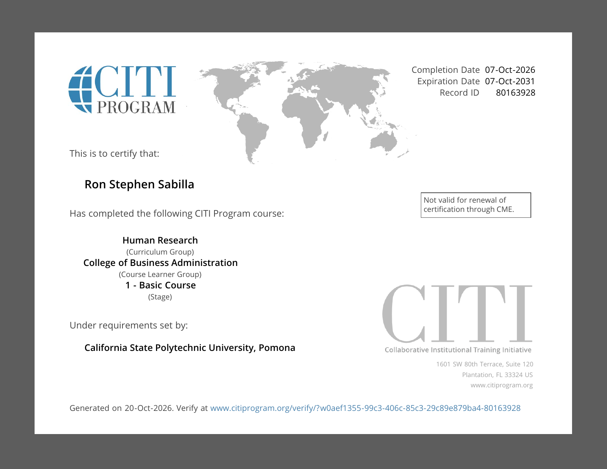
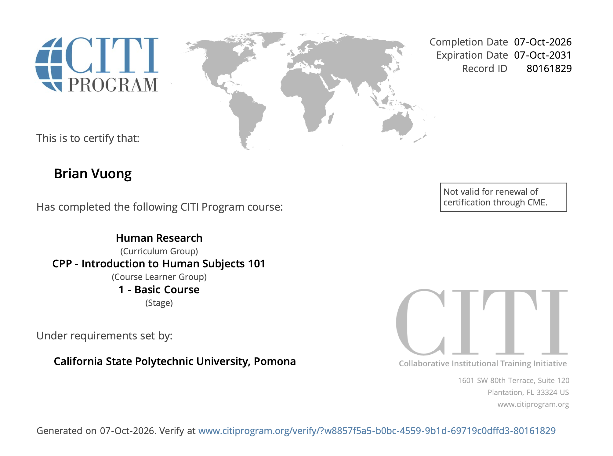

# Purpose

This report documents the team's IRB status for the Culminating Experience Project with Wellness Ranch Equine-Assisted Therapy. After reviewing the project's analytics objectives, the team determined that the project does not require survey data. Following faculty guidance not to collect data for the sake of data collection, the team will not administer a questionnaire or submit a protocol to the IRB.

# Study Information

- **Project title:** Culminating Experience Project for Wellness Ranch Equine-Assisted Therapy
- **Team members:** Kevin Bachez, Alexa Bueno, Ron Sabilla, Brian Vuong
- **Faculty mentor:** Dr. Sonya Zhang
- **Client:** Wellness Ranch Equine-Assisted Therapy (nonprofit, Rancho Cucamonga, CA)
- **Research method:** Analysis of existing secondary platform data
- **Survey data collection:** Not planned
- **IRB submission:** Not planned unless the project scope changes

# Why Survey Data Is Not Needed

Each analytics objective can be fully answered with existing platform data. None of the research questions requires collecting new data from individuals.

| Analytics Objective | Data Sources | Survey Needed? |
|---|---|---|
| AO1. SEO Performance Analysis (Alexa) | Semrush site audit, Google Search Console, backlink audit, Google Business Profile | No |
| AO2. Conversion & Engagement Measurement (Kevin) | Google Analytics 4, Google Search Console, Wix, Google Tag Assistant | No |
| AO3. Google Ad Grants Readiness (Brian) | Official Ad Grants requirements, website and GA4 audits, client documentation | No |
| AO4. Google Ad Grants Campaign Optimization (Ron) | Google Ads, GA4, Google Keyword Planner, Google Search Console | No |

# Human Subjects Considerations

The project analyzes aggregated website, search, and advertising metrics such as sessions, clicks, impressions, click-through rate, and conversions. The team will not collect names, contact information, or other identifiable information from website visitors. The team will not interact with individuals to gather research data.

Client information, such as staffing and account ownership for AO3, will come from normal project meetings with the client organization, not from research participants.

No data will be collected from human participants, the team does not plan to submit a protocol to the IRB. If the project scope changes and survey or interview data become necessary, the team will complete the full IRB package and obtain faculty and IRB approval before any data collection begins.

# IRB Application Package

## CITI Training Certificates

The following CITI training certificates document completion of the required research-ethics training by the principal investigator and co-principal investigators.

### Principal Investigator

- **Name:** [Insert PI name]
- **Role:** Principal Investigator
- **Certificate:** [View PI CITI Certificate](INSERT-SECURE-LINK)

### Co-Principal Investigator 1

- **Name:** [Insert name]
- **Role:** Co-Principal Investigator
- **Certificate:** [View Co-PI 1 CITI Certificate](INSERT-SECURE-LINK)

### Co-Principal Investigator 2

- **Name:** Ron Stephen Sabilla
- **Role:** Co-Principal Investigator
- **Certificate:** CITI Training Certificate

{width="80%"}

### Co-Principal Investigator 3

- **Name:** Brian V
- **Role:** Co-Principal Investigator
- **Certificate:** ## CITI Training Certificate

{fig-alt="CITI training completion certificate for Brian Vuong" width=85%}

## IRB Application Draft

The team prepared a written draft of the IRB application before entering the information into Cayuse. The draft allows the team and faculty advisor to review the protocol language, research procedures, recruitment plan, risks, confidentiality protections, and informed-consent process.

- **Document:** [View IRB Application Draft](INSERT-SECURE-LINK)
- **Document format:** [Word or Google Docs]
- **Last updated:** [Insert date]
- **Status:** Draft awaiting faculty feedback

## Cayuse IRB Application Draft

The research protocol has been entered into Cayuse IRB and remains in draft status. The application will not be submitted to the IRB until the professor has reviewed and approved it.

- **Cayuse draft:** [Open Cayuse IRB Application](INSERT-CAYUSE-DRAFT-URL)
- **Cayuse system:** [Open the CPP Cayuse IRB website](https://cpp.cayuse424.com/)
- **Current status:** Draft—not submitted
- **Last updated:** [Insert date]

Because Cayuse access may require Bronco authentication, the faculty reviewer may need to sign in with authorized university credentials before opening the draft.

## Informed Consent Form

The informed-consent form appears on the opening page of the Qualtrics questionnaire. It explains the study’s purpose, participation requirements, anticipated time commitment, possible risks and benefits, confidentiality protections, voluntary-participation statement, withdrawal rights, and researcher contact information.

- **Document:** [View Informed Consent Form](INSERT-SECURE-LINK)
- **Location in survey:** Opening page
- **Status:** [Draft, revised, or faculty reviewed]
- **Last updated:** [Insert date]

## Qualtrics Questionnaire

The questionnaire was prepared in Qualtrics using an anonymous distribution link. The question order follows a funneling approach, beginning with broader questions and progressing to more specific questions. The questionnaire has been reviewed for clear wording, logical sequencing, response-option quality, and alignment with the Construct and Measurement Table.

- **Questionnaire:** [Open Qualtrics Questionnaire](INSERT-ANONYMOUS-QUALTRICS-LINK)
- **Distribution method:** Anonymous Qualtrics link
- **Estimated completion time:** [Insert number] minutes
- **Questionnaire status:** [Draft or ready for faculty review]
- **Target participants:** [Insert intended participant population]
- **Data collection status:** Not started

# Construct and Measurement Alignment

The Construct and Measurement Table was reviewed alongside the Qualtrics questionnaire to ensure that each construct is represented by appropriate measures. Faculty feedback from presentations and Canvas submissions was incorporated where applicable.

| Construct | Questionnaire Items | Measurement Scale | Revision Status |
|---|---|---|---|
| [Construct 1] | [Q1–Q4] | [Scale type] | [Complete or needs revision] |
| [Construct 2] | [Q5–Q8] | [Scale type] | [Complete or needs revision] |
| [Construct 3] | [Q9–Q12] | [Scale type] | [Complete or needs revision] |
| [Outcome variable] | [Q13–Q15] | [Scale type] | [Complete or needs revision] |

# Questionnaire Design Review

The team reviewed the questionnaire using the required Qualtrics design guidelines and checkpoints.

- [ ] The informed-consent information appears on the opening page.
- [ ] Participation is clearly described as voluntary.
- [ ] The study’s purpose is explained without misleading participants.
- [ ] Risks, benefits, confidentiality, and researcher contact information are provided.
- [ ] Questions follow a logical funneling sequence.
- [ ] Question wording is clear, neutral, and appropriate for the intended participants.
- [ ] Double-barreled and leading questions have been removed.
- [ ] Response options are complete and mutually appropriate.
- [ ] Questionnaire items correspond with the Construct and Measurement Table.
- [ ] Skip logic and display logic have been tested.
- [ ] Required questions have been reviewed for appropriateness.
- [ ] The survey has been previewed on desktop and mobile devices.
- [ ] The anonymous questionnaire link has been tested.
- [ ] No actual participant data have been collected.

# Package Status

| Required component | Status | Link or location | Remaining action |
|---|---|---|---|
| PI CITI certificate | [Status] | [Link] | [Action or None] |
| Co-PI CITI certificates | [Status] | [Link] | [Action or None] |
| IRB application draft | [Status] | [Link] | [Action or None] |
| Cayuse IRB draft | [Status] | [Link] | Obtain faculty approval before submission |
| Informed-consent form | [Status] | [Link] | [Action or None] |
| Qualtrics questionnaire | [Status] | [Link] | [Action or None] |
| Construct and Measurement Table | [Status] | [Link] | [Action or None] |

# Items Requiring Faculty Feedback

The team requests feedback on the following items before submitting the Cayuse application:

1. [Insert question or area requiring feedback]
2. [Insert question or area requiring feedback]
3. [Insert question or area requiring feedback]
4. [Insert question or area requiring feedback]

# Next Steps

1. Submit this `.qmd` file and the rendered HTML report to Canvas.
2. Obtain faculty feedback on the IRB package.
3. Revise the IRB application, informed-consent form, and Qualtrics questionnaire as needed.
4. Receive faculty approval to submit the Cayuse application.
5. Submit the finalized protocol through Cayuse IRB.
6. Respond to any revision requests from the IRB.
7. Wait for the official IRB approval or exempt determination before collecting participant data.

# Submission Files

The following files will be submitted to Canvas:

- `irb-application-package.qmd`
- `irb-application-package.html`

# Confidentiality and Access Note

Links containing CITI certificates, application materials, or personally identifiable information should be restricted to the professor and authorized team members. Before submission, the team should test each link using an appropriate viewer account to confirm that the professor can access the material without making the documents publicly available.