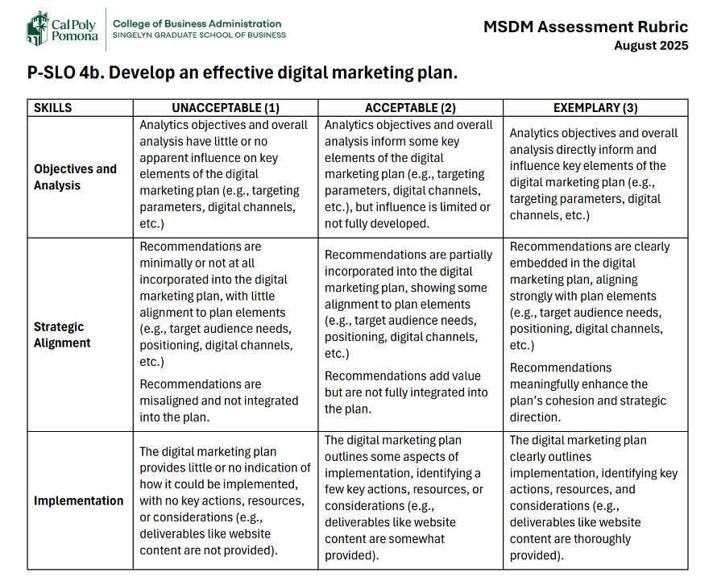

# TITLE PAGE {#sec-title-page .unnumbered}

------------------------------------------------------------------------

<br>



# SIGNATURE PAGE {#sec-signature-page .unnumbered}

------------------------------------------------------------------------

<br>



# ACKNOWLEDGMENTS PAGE {#sec-acknowledgments-page .unnumbered}

------------------------------------------------------------------------

<br>



# ABSTRACT {#sec-abstract .unnumbered}

# SUMMARY OF INDIVIDUAL CONTRIBUTION {#sec-summary-of-individual-contribution .unnumbered}

------------------------------------------------------------------------

<br>



# TABLE OF CONTENTS {#sec-table-of-contents .unnumbered}

# CHAPTER 1: INTRODUCTION {#sec-ch1-introduction}

Wellness Ranch Equine Assisted Therapy is a nonprofit organization that provides equine-assisted psychotherapy and wellness-focused services in Rancho Cucamonga, California [@wellnessranch2026]. This Culminating Experience Project focuses on strengthening the organization’s digital marketing foundation through improvements in search visibility, website performance, analytics, and paid search readiness. Building on recommendations developed by a Cal Poly Pomona search engine marketing class in Spring 2026, the project will move from identifying digital marketing opportunities to implementing, measuring, and evaluating selected strategies.

## Background and Problem Statement

Wellness Ranch Equine Assisted Therapy is a nonprofit based in Rancho Cucamonga, led by Director Angelica Manzo [@wellnessranch2026]. Founded in 2022 and established as a 501(c)(3) nonprofit organization in 2023, its mission is to "bring individual healing and empowerment to our clients through the transformative use of equine assisted therapy and community activities that promote mental wellness and learning" [@wellnessranchabout2026].

The ranch serves people of all ages, from children to adults, providing:

- Trauma-informed therapy
- Wellness education
- Community outreach

Services are offered to individuals, couples, and groups [@wellnessranchservices2026].

There is a real and growing need for what Wellness Ranch provides. The organization focuses mainly on the Inland Empire, especially underserved communities where access to responsive mental health care is affected by behavioral health workforce shortages [@hcai2025]. It is also building capacity in the field by training emerging mental health professionals through hands-on experience and internships.

In Spring 2026, a Cal Poly Pomona search engine marketing class researched Wellness Ranch's digital presence and produced recommendations across website, SEO, content, local search, and advertising. Our team picks up where that work left off.

Wellness Ranch has done tremendous and meaningful work, but its digital presence can improve and take it even further in connecting with the people who need help. There are three connected gaps:

1.  **Visibility.** When someone in the Inland Empire searches for trauma therapy, equine therapy, or mental health support, Wellness Ranch needs to show up. Right now, technical SEO issues, content and keyword gaps, and an underdeveloped local search presence make that harder.

2.  **Measurement.** Without a properly configured GA4 setup with defined events, conversions, and baseline KPIs, the organization can't tell which channels drive inquiries, sign-ups, or donations, so there's no way to know what's working.

3.  **Untapped resources.** As a nonprofit, Wellness Ranch may qualify for Google Ad Grants, which provides eligible nonprofit organizations with access to up to \$10,000 per month in Google Search advertising [@googleadgrants2026], but it hasn't yet applied or built the campaign structure to use it.

> **Core problem:** Wellness Ranch has a strong mission and growing community demand, but lacks the digital infrastructure to be found, measure its impact, and scale its reach.

Our project moves the organization from recommendations to implementation, measurement, and ongoing optimization so its online presence can support its mission instead of holding it back.

## Project Objectives (POs)

The overall purpose of this project is to help Wellness Ranch Equine Assisted Therapy convert earlier digital marketing recommendations into practical and sustainable improvements. Across the three-semester capstone project, the team will address the organization’s website, search visibility, analytics capabilities, advertising readiness, and long-term ability to manage its digital presence. The following five project objectives define the major outcomes expected from the project.

### PO1. Implement Priority Website and SEO Improvements

The first project objective is to review the recommendations produced by the Spring 2026 search engine marketing class and identify the improvements that are most relevant and feasible for Wellness Ranch. Using access to the Wix website, the team will evaluate and address priority technical SEO issues, broken links, page titles, keyword usage, internal linking, calls to action, landing pages, and other conversion-related elements.

The team will also examine local SEO opportunities that could help Wellness Ranch appear more consistently when Inland Empire residents search for equine-assisted therapy, trauma-informed services, mental-health support, and wellness resources. Website work will focus primarily on improving the organization, presentation, and optimization of existing information rather than creating an ongoing content-production program.

### PO2. Strengthen Analytics and Performance Measurement

The second project objective is to improve Wellness Ranch’s ability to measure the performance of its website and digital marketing activities. Although GA4 is already installed, the team must determine whether the current configuration captures the actions that are most meaningful to the organization.

This objective includes reviewing existing events and conversions, defining baseline key performance indicators, and determining how website activity relates to actions such as donation activity, contact-form submissions, calls, appointment inquiries, and program interest. Google Search Console and other available data sources may also be used to evaluate traffic, search visibility, engagement, and user behavior.

### PO3. Obtain and Activate Google Ad Grants

The third project objective is to guide Wellness Ranch through the Google Ad Grants process, including eligibility verification, application, campaign development, and launch. If the organization qualifies, the team will assist with submitting the application and launching compliant search campaigns. If approval is delayed or denied, the team will document the barriers and recommend corrective actions.

This objective includes improving website and landing-page readiness, validating conversion tracking, researching keywords and audiences, and establishing campaign ownership and management procedures. After launch, the team will review measures such as impressions, clicks, click-through rate, search terms, and conversions to improve performance. The project will also provide documentation and recommendations so Wellness Ranch can maintain the account after the capstone concludes.

### PO4. Measure the Impact of Implemented Strategies

The fourth project objective is to evaluate whether the selected website, SEO, analytics, and digital marketing improvements produce measurable changes. The team will compare pre-implementation baseline data with post-implementation results when sufficient data are available.

Potential measures include organic search impressions, rankings, website traffic, engagement, donation activity, inquiries, conversions, and advertising results if campaigns are launched. Because seasonality, external events, platform changes, and other factors may influence performance, the results will be interpreted carefully rather than automatically attributing every change to a single intervention.

### PO5. Develop a Sustainable Digital Marketing Strategy

The fifth project objective is to integrate findings from the website, SEO, analytics, local search, conversion, and paid-search analyses into a sustainable digital marketing strategy. The project will conclude with prioritized recommendations, reporting guidance, documented procedures, and a practical roadmap that Wellness Ranch can continue using after the capstone ends.

This objective emphasizes sustainability. Recommendations must be realistic given the organization’s staffing, expertise, time, financial resources, and approval processes. Together, the five project objectives are intended to create a digital foundation that helps Wellness Ranch become easier to find, understand its performance, increase donations and other meaningful actions, and expand its community reach.

## Analytics Objectives (AOs)

The analytics objectives define the specific investigations needed to support the broader project objectives. Each analytics objective is assigned to one team member, but the findings will be shared and integrated across the project.

### AO1. On-Page and Off-Page SEO Performance Analysis (Alexa)

Analyze current SEO data, including technical issues, website content, backlinks, local SEO, and information from the SEO Fix Tracker and backlink audit, to identify which factors most affect Wellness Ranch Therapy’s search visibility and which pages and improvements should be prioritized.

AO1 directly supports PO1 by providing the evidence needed to select and prioritize website and SEO improvements. It also supports PO4 by identifying the SEO indicators that should be monitored before and after implementation. The resulting findings will contribute to the SEO component of the sustainable strategy developed under PO5.


### AO2. Conversion & Engagement Measurement (Kevin Bachez)

Establish GA4 events, conversions, and KPIs to determine which user actions and traffic sources represent meaningful engagement for Wellness Ranch Therapy.

#### Existence of Well-established Models

Web analytics helps organizations understand how visitors interact with their websites and whether those interactions support business objectives. Instead of evaluating website success only through traffic volume, web analytics focuses on how users arrive, engage with content, and complete meaningful actions. This is especially important for nonprofit organizations such as Wellness Ranch Equine Assisted Therapy, where website performance should support service inquiries, community engagement, and donations.

The Customer Decision Journey provides a useful framework for understanding these interactions. Lemon and Verhoef (2016) explain that customer experiences develop across multiple touchpoints throughout the customer journey. These touchpoints influence how customers gather information, evaluate alternatives, and make decisions. Although this framework was developed for broader customer experiences, it is relevant to Wellness Ranch because prospective clients, families, and donors may interact with the organization through different digital channels before taking action.

For example, a prospective client may discover Wellness Ranch through Google Search, visit the website to learn about equine-assisted therapy, review the organization's services, and eventually submit an inquiry. A potential donor may follow a different journey by discovering the organization through social media, learning about its mission, and visiting the donation page. These examples demonstrate why website activity should be evaluated according to the visitor's purpose rather than treating every interaction as equally valuable.

Research on multichannel customer behavior also supports evaluating how different marketing channels contribute to the overall experience. Verhoef, Kannan, and Inman (2015) discuss how customers interact with organizations across multiple channels during information search and decision-making. Their framework supports examining traffic sources and user behavior together rather than evaluating channels independently. For Wellness Ranch, this means comparing visitors from organic search, referrals, social media, and direct traffic to understand which sources generate engagement and meaningful website actions.

Google Analytics 4 (GA4) provides a practical measurement framework for evaluating these behaviors. GA4 uses an event-based data model to record website interactions and organize them into reports. According to Google Analytics (2026a), events may be automatically collected, collected through enhanced measurement, recommended by Google, or customized to measure specific organizational activities. This structure allows organizations to track general website engagement while also identifying actions that support their objectives.

For AO2, the measurement framework will focus on three categories: traffic acquisition, engagement, and conversions.

**Traffic Acquisition**

Traffic acquisition identifies how visitors reach the website. GA4 provides information about traffic sources, including organic search, direct traffic, referrals, and social media. Examining these channels can help Wellness Ranch understand which sources bring visitors to its website and which sources contribute to meaningful interactions.

**Engagement Measurement**

Engagement measurement evaluates how visitors interact with website content after arriving. Important metrics include engaged sessions, engagement rate, average engagement time, page views, and relevant interaction events.

Google Analytics (2026b) defines an engaged session as a session that lasts longer than 10 seconds, contains a key event, or includes at least two page or screen views. Engagement rate represents the percentage of sessions that meet at least one of these conditions.

These measures provide useful indicators of website activity, but they do not necessarily demonstrate that visitors are interested in obtaining services or supporting the organization. For example, a visitor spending time on a service page may be learning about equine-assisted therapy without intending to schedule an appointment. Therefore, engagement metrics should be interpreted alongside more direct behavioral outcomes.

**Conversion Measurement**

Conversion measurement identifies whether visitors complete actions that support organizational goals. In GA4, events representing particularly important outcomes can be designated as key events. For Wellness Ranch, the primary measurement priority is donations, since the organization has identified fundraising as an important website outcome.

Additional meaningful actions may include successful contact-form submissions, appointment inquiries, phone-number clicks, and program-interest interactions. Google Analytics (2026c) recommends the `generate_lead` event for completed requests for information, making it an appropriate option for measuring verified inquiries.

However, these actions represent different levels of commitment. A phone-number click does not establish that a conversation occurred, and clicking a donation button does not confirm a completed donation. Consequently, AO2 will distinguish confirmed outcomes from preliminary engagement signals.

The proposed measurement framework will organize events according to their relationship with Wellness Ranch's objectives:

| Measurement Category | Example KPI | Organizational Purpose |
|---|---|---|
| Acquisition | Sessions by traffic source | Identify where visitors originate |
| Engagement | Engagement rate and average engagement time | Evaluate interaction with website content |
| Service Interest | Program interactions and phone clicks | Identify potential interest in services |
| Inquiries | Successful contact-form submissions | Measure completed requests for information |
| Donations | Confirmed completed donations, where trackable | Evaluate the website's fundraising outcomes |

Google Search Console will complement GA4 by providing organic search information, including impressions, clicks, search queries, and search performance by page. Combining Search Console and GA4 reporting can help the team examine how organic visibility relates to website engagement and meaningful actions. However, these platforms use different measurement methods, so their metrics should not be expected to match exactly.

The Customer Decision Journey and GA4 measurement framework are the most appropriate combination for AO2 because they connect consumer behavior with observable website interactions. The customer journey provides the conceptual explanation for why visitors take different actions, while GA4 supplies the measurement infrastructure needed to evaluate those actions.

Together, these frameworks will help Wellness Ranch move beyond basic website traffic reporting toward a more useful understanding of digital engagement, inquiries, and donations.

#### Adequateness of Gathered Information

The information gathered is sufficient to establish AO2's measurement framework but is not yet sufficient to confirm the accuracy of the organization's analytics data. During Fall 2026, the project began implementing and reviewing GA4 on Wellness Ranch's Wix website. Initial troubleshooting indicated that the Google tag was connected, but successful collection and reporting of the intended events had not yet been fully verified. In addition, the website's contact-form submission process presented difficulties during testing, preventing reliable confirmation of completed submissions and their corresponding analytics events. These findings indicate that installing GA4 does not automatically guarantee accurate conversion measurement. The current evidence identifies important measurement priorities, including donations, contact submissions, appointment inquiries, and phone interactions, but additional verification is required before these actions can be treated as reliable KPIs. Historical data availability, event configuration, attribution settings, and possible tracking limitations must also be evaluated. Therefore, the gathered information provides a reasonable starting point but does not yet support a complete and validated performance baseline.

#### Need for Additional Analysis

Additional analysis is necessary to validate the GA4 implementation and determine which website interactions can be measured reliably. The first step will be to review GA4 configuration, confirm that website visits and standard events are being recorded, and test important user journeys through tools such as GA4 DebugView and Google Tag Assistant. The team will then evaluate whether contact forms, phone clicks, donation interactions, and appointment inquiries trigger the appropriate events. Successful form submissions must be distinguished from form starts or unsuccessful attempts. Donation measurement will also require determining whether confirmed completed transactions can be recorded or whether only earlier interactions are currently measurable. A measurement matrix will connect each organizational objective to a KPI, event definition, validation method, and reporting source. Once reliable data collection is confirmed, descriptive analysis will compare traffic acquisition, engagement, and key-event performance across available channels and landing pages. Conversion rates will be calculated using clearly defined numerators and denominators, with limitations documented when sample sizes are small or tracking is incomplete. These additional steps will improve data reliability and establish a practical baseline for future evaluation.

#### Assessment and Affirmation of Analytics Objectives

AO2 remains appropriate because Wellness Ranch needs reliable information about how website visitors interact with its digital content and whether those interactions support its organizational goals. The review of existing frameworks confirms that the Customer Decision Journey and GA4 event-based measurement approach provide a defensible foundation for evaluating digital performance.

The objective will remain focused on establishing GA4 events, key events, and KPIs that identify meaningful website engagement and conversion actions. However, the research also demonstrates that implementation must be accompanied by validation before performance conclusions can be drawn.

The planned analytical approach will combine a GA4 configuration audit, event testing, descriptive website analytics, traffic source comparisons, and KPI reporting. Google Search Console will supplement the analysis by providing organic search visibility measures.

The primary outcomes will include verified donation completions where measurement is available, successful contact-form submissions, and other client-approved key events. Supporting indicators will include engagement rate, average engagement time, phone clicks, program interactions, and traffic acquisition metrics.

This distinction is important because website engagement does not always result in a meaningful organizational outcome. For example, an increase in page views may indicate greater awareness without necessarily increasing donations or inquiries. The analytical approach will therefore evaluate both website activity and the actions that more directly support Wellness Ranch's mission.

The project will initially use descriptive analysis because its immediate purpose is to establish a reliable measurement baseline rather than prove that a specific marketing change caused an increase in conversions. Later comparisons may evaluate changes in performance after website improvements, SEO recommendations, or advertising campaigns are implemented, while acknowledging other factors that may influence the results.

Overall, AO2 is affirmed as a necessary component of the CEP. Its contribution is to create a dependable analytics foundation that Wellness Ranch can use to evaluate digital marketing activity, identify opportunities for improvement, and make informed decisions about website engagement, service inquiries, and fundraising performance.


### AO3. Evaluate Google Ad Grants Readiness and Campaign Data to Guide Application, Launch, and Optimization (Brian)

Evaluate Wellness Ranch Therapy’s eligibility, website and analytics readiness, organizational capacity, and campaign data to support the Google Ad Grants application, launch compliant campaigns, and guide ongoing optimization using measures such as click-through rate, search terms, conversions, and conversion rate.

AO3 directly supports PO3 by moving the organization from eligibility assessment through application, launch, measurement, and improvement. It also supports PO1 by identifying necessary website and landing-page improvements and PO2 by defining the conversion tracking required to evaluate campaign performance. The findings will contribute to the sustainable digital marketing roadmap developed under PO5.


### AO4. Analyze Google Ad Grants Campaign Data to Improve Click-Through and Conversion Rates (Ron)

Once Wellness Ranch's Google Ad Grants campaigns launch, we will analyze Google Ads and GA4 data to identify which keywords, ads, and landing pages drive meaningful results. Key metrics include impressions, clicks, click-through rate (CTR), search terms, conversions, and conversion rate. CTR is especially important because Ad Grants accounts must maintain at least a 5% CTR to stay compliant.

To achieve this, we will review search terms to add negative keywords, compare keyword and ad group performance, test ad copy and calls to action, and evaluate which landing pages turn visitors into inquiries, calls, or donations. Findings will be summarized in regular performance reports with optimization recommendations.

AO4 directly supports PO3 by optimizing campaigns after launch, while AO3 covers eligibility, application, and launch. It also supports PO2 by relying on the website's conversion tracking.

## Alignment Between Project Objectives and Analytics Objectives

The project objectives describe what the team intends to accomplish for Wellness Ranch, while the analytics objectives define the analysis and evidence needed to make those decisions. The relationship between the POs and AOs is summarized below.

| Project Objective | Directly Supporting AO | Additional Supporting AOs | Relationship |
|------------------|------------------|------------------|------------------|
| PO1. Implement priority website and SEO improvements | AO1 | AO2, AO3, and AO4 | AO1 identifies the SEO and website factors that should be prioritized. AO2 identifies conversion and measurement needs, AO3 identifies website and landing-page requirements for Google Ad Grants campaigns, and AO4 measures the effects of the changes. |
| PO2. Strengthen analytics and performance measurement | AO2 | AO3 and AO4 | AO2 establishes KPIs, events, conversions, and baseline measures. AO3 evaluates whether the measurement infrastructure can support Google Ads and uses campaign metrics to guide optimization, while AO4 applies the measures to evaluate results. |
| PO3. Obtain and activate Google Ad Grants | AO3 | AO1 and AO2 | AO3 evaluates eligibility and readiness, supports the application and campaign launch, and analyzes campaign data to guide compliant management and optimization. AO1 supports website and landing-page readiness, while AO2 supports conversion measurement. |
| PO4. Measure the impact of implemented strategies | AO4 | AO1, AO2, and AO3 | AO4 compares baseline and post-implementation results. AO3 contributes Google Ads measures such as clicks, click-through rate, search terms, and conversions, while the other interventions and measures originate from the preceding AOs. |
| PO5. Develop a sustainable digital marketing strategy | AO1, AO2, AO3, and AO4 collectively | All AOs | PO5 integrates the findings of all four analyses into recommendations, procedures, reporting guidance, and a long-term roadmap. |

### Coverage of the Project Objectives

The project objectives are converted into analytics work through four assigned AOs. PO1 through PO4 each have a directly corresponding analytics objective:

- PO1 is primarily supported by AO1.
- PO2 is primarily supported by AO2.
- PO3 is primarily supported by AO3.
- PO4 is primarily supported by AO4.

PO5 does not have a separate one-to-one analytics objective. However, this does not represent an unsupported project objective. PO5 is an integration and implementation objective rather than a separate analytical question. It can be achieved by combining the findings from AO1 through AO4 into a sustainable digital marketing strategy.

Creating another AO solely for PO5 would duplicate work already performed through the four existing analyses. Instead, the team will use the evidence produced by all four AOs to develop the final recommendations, reporting procedures, and client roadmap. Therefore, all five POs are supported by analytics work even though the project contains four AOs.

### Team Assignment and Individual Responsibility

Each member of the four-person project team has at least one analytics objective assigned:

| Team Member | Assigned Analytics Objective | Primary Area of Responsibility |
|------------------------|------------------------|------------------------|
| Alexa | AO1 | SEO and website-priority analysis |
| Kevin | AO2 | GA4, Search Console, conversions, and baseline measurement |
| Brian | AO3 | Google Ad Grants readiness, application, campaign launch, and performance analysis |
| Ron | AO4 | Measurement of implemented digital marketing changes |

The assignments provide individual ownership while maintaining the connections among the analyses. For example, AO4 depends on the baseline established through AO2, while AO3 may identify website and landing-page improvements related to AO1 and conversion-tracking requirements related to AO2. Team members must therefore coordinate their findings rather than treating each AO as an independent project.

### Relevance of the Analytics Objectives

All four analytics objectives support at least one project objective, and none requires resources without contributing to the overall project. AO1 supports website and search visibility improvements, AO2 supports performance measurement, AO3 supports the Google Ad Grants application, campaign launch, measurement, and optimization, and AO4 supports impact evaluation. All four also contribute to PO5 by providing the evidence needed to develop a sustainable digital marketing strategy.

The relationship among the objectives follows a logical sequence:

1.  AO1 identifies which website and SEO issues should be addressed.
2.  AO2 establishes how website activity and meaningful outcomes will be measured.
3.  AO3 evaluates Google Ad Grants readiness, supports the application and campaign launch, and analyzes campaign data to guide optimization.
4.  AO4 evaluates the results of implemented changes.
5.  Findings from all four AOs are integrated to accomplish PO5 and produce the final strategic roadmap.

This alignment ensures that the team’s analytical work is connected to the client’s needs and that each AO contributes to a defined project outcome.

## Significance of the Project

This project is significant because Wellness Ranch Equine Assisted Therapy operates in an area where digital visibility can directly support access to mental wellness services and community resources. As a nonprofit serving children, adults, couples, and groups throughout the Inland Empire, Wellness Ranch relies on its ability to communicate its services to individuals who may be actively searching for therapy, equine-assisted services, wellness education, and related support. Improving the organization’s digital presence can make it easier for these audiences to find relevant information and take the next step toward engaging with the organization.

The project is also significant because it addresses the connection between digital marketing activities and measurable organizational outcomes. Improving website content, SEO, local search visibility, and conversion pathways can increase opportunities for users to discover and engage with Wellness Ranch. However, these improvements are most useful when their impact can be measured. Establishing reliable GA4 events, conversions, and baseline KPIs will give the organization a clearer understanding of how users find the website, how they interact with it, and which actions may contribute to inquiries, program interest, or other meaningful outcomes.

For a nonprofit organization, the ability to use available resources efficiently is particularly important. The evaluation of Google Ad Grants provides Wellness Ranch with an opportunity to determine whether donated search advertising could support its outreach efforts without requiring the same level of financial investment as traditional paid advertising. Assessing eligibility, campaign readiness, and the organization's capacity to maintain the program will help ensure that any future advertising efforts are realistic and sustainable.

The project also builds on the work completed by the Spring 2026 search engine marketing class. Rather than developing recommendations independently, the current project provides an opportunity to move from identifying digital marketing opportunities to implementing, measuring, and evaluating selected improvements. This creates continuity between the two semesters while allowing the team to establish performance baselines and assess changes over time.

From an academic perspective, the project provides an applied opportunity to use digital marketing and analytics concepts in a real nonprofit setting. SEO analysis, website optimization, GA4 measurement, local search, and paid search planning will be evaluated based on both their potential impact and Wellness Ranch's ability to maintain them with its available resources. The project therefore demonstrates how data-informed digital marketing strategies can be adapted to the needs and constraints of a community-based organization.

Ultimately, the significance of this project is its potential to strengthen the connection between Wellness Ranch's mission and its digital presence. By improving how the organization is found, how user engagement is measured, and how digital marketing resources are managed, the project aims to provide Wellness Ranch with a sustainable foundation for reaching its target audiences and supporting its continued growth.

------------------------------------------------------------------------



# CHAPTER 2: BACKGROUND AND ANALYTICS OBJECTIVES {#sec-ch2-background-and-analytics-objectives}

## Client (Company) Background

Wellness Ranch Equine Assisted Therapy is a nonprofit organization based in Rancho Cucamonga, California. Founded in 2023 and led by Director Angelica Manzo, the organization uses equine-assisted therapy and community-based activities to promote mental wellness, personal development, and healing. Wellness Ranch serves children and adults through individual, couples, and group services. Its principal service area is the Inland Empire, including communities where access to mental-health care may be limited by cost, provider shortages, and other barriers.

The organization’s services include trauma-informed therapy, wellness education, and community outreach. Wellness Ranch also contributes to the development of future mental-health professionals by offering internships and hands-on learning opportunities. As a relatively new nonprofit, the organization is continuing to develop its operational capacity, public visibility, fundraising efforts, and digital infrastructure.

### Company Mission and Vision

Wellness Ranch’s stated mission is to *“bring individual healing and empowerment to our clients through the transformative use of equine assisted therapy and community activities that promote mental wellness and learning.”* This mission emphasizes healing, empowerment, education, and community engagement through interaction with horses and trained mental-health professionals.

A separate formal vision statement has not yet been provided to the project team. Based on the organization’s mission and current activities, its working vision appears to be the creation of a community in which people of different ages and backgrounds can access supportive, experiential, and affordable mental-health services. This interpretation should be confirmed with the client before it is presented as the organization’s official vision.

### Core Competencies

Wellness Ranch’s primary competency is providing equine-assisted, trauma-informed therapeutic experiences. The organization combines mental-health practices with structured interaction involving horses to offer an experiential form of support that differs from a traditional office-based setting.

Its core competencies include:

- Delivering equine-assisted therapy to individuals, couples, and groups

- Providing trauma-informed care for children and adults

- Creating experiential activities that support healing, learning, and empowerment

- Offering mental-wellness education and community outreach

- Serving communities in the Inland Empire

- Supporting access to care through insurance and sliding-scale services

- Providing internships and practical learning opportunities for emerging mental-health professionals

- Developing relationships among clients, professionals, volunteers, donors, and community partners

These competencies position Wellness Ranch as both a mental-health service provider and a community-based educational organization.

### Value Propositions

Wellness Ranch offers a distinctive combination of equine-assisted therapy, trauma-informed care, wellness education, and community engagement. Its value comes from providing clients with an experiential therapeutic environment that may appeal to individuals who are seeking an alternative or supplement to conventional therapy.

The organization’s major value propositions include:

- **Experiential care:** Clients participate in structured therapeutic experiences involving horses rather than relying exclusively on a traditional office setting.

- **Accessible services:** Insurance and sliding-scale options may help reduce financial barriers to mental-health care.

- **Services for different needs:** Programs are available to children and adults and may be delivered to individuals, couples, or groups.

- **Local community focus:** Wellness Ranch concentrates on the Inland Empire, including communities with limited access to responsive mental-health services.

- **Community and workforce development:** Outreach, education, internships, and hands-on training extend the organization’s impact beyond direct client services.

- **Mission-driven use of donations:** Financial contributions help the organization offset service costs, expand accessibility, and support individuals and families who may otherwise have difficulty obtaining care.

### Business Objectives

Wellness Ranch’s broader business objective is to expand its ability to serve individuals and families while maintaining accessible and mission-aligned services. Achieving this objective requires the organization to improve its visibility, fundraising capacity, digital measurement, and internal ability to manage digital-marketing activities.

The current business objectives include:

1.  **Increase digital visibility.** Improve the organization’s ability to appear when people search for equine-assisted therapy, trauma-informed care, mental-health support, and related services in the Inland Empire.

2.  **Strengthen the website.** Improve the homepage and other important pages so visitors can quickly understand the organization’s mission, services, impact, and available actions.

3.  **Communicate measurable impact.** Present verified information—such as clients served, programs delivered, or other substantiated outcomes—in a clear and responsible manner.

4.  **Increase donations.** Make donations more visible and reduce obstacles in the donation journey. The client has identified donations as the organization’s current primary website outcome.

5.  **Improve digital measurement.** Evaluate the existing GA4 implementation, define meaningful events and conversions, establish baseline key performance indicators, and determine which channels contribute to donations and inquiries.

6.  **Evaluate Google Ad Grants readiness.** Determine whether Wellness Ranch meets the eligibility requirements and possesses the website, analytics, staffing, and campaign-management capacity needed to apply for and sustain Google Ad Grants.

7.  **Build sustainable internal capacity.** Establish procedures, documentation, and ownership so that the website, analytics tools, and future advertising campaigns can continue to be managed after the capstone project concludes.

Together, these objectives support the organization’s larger mission by helping Wellness Ranch become easier to find, better able to demonstrate its impact, and more capable of generating the financial and community support needed to expand access to care.

## Description of the Client’s Current Marketing Program

### Marketing Team and Expertise

Wellness Ranch’s marketing program is currently managed through a small, relationship-oriented nonprofit team rather than a dedicated marketing department. The organization’s primary expertise is in equine-assisted therapy, trauma-informed care, wellness education, and community outreach. Marketing responsibilities therefore appear to be distributed among leadership, service providers, volunteers, students, and community partners as capacity allows. Formal ownership of SEO, analytics, paid search, content planning, and performance reporting has not yet been documented.

This structure is an important constraint for the project. Recommendations must be practical for a small organization and should not assume that a full-time digital marketer, analyst, or advertising specialist will be available. The team will confirm the current approval process, available staff time, existing marketing skills, and post-project account ownership through client discussion. The current assessment is that Wellness Ranch has strong subject-matter and community expertise but needs clearer digital-marketing roles, procedures, and training.

### Current Target Market

Wellness Ranch serves a geographically concentrated but behaviorally diverse market. The primary audience is individuals and families in Rancho Cucamonga and the broader Inland Empire who are seeking mental-health support, trauma-informed care, equine-assisted therapy, wellness education, or community-based services. The audience includes children, adults, couples, and groups, so needs and decision criteria vary by life stage and service situation [@wellnessranchservices2026].

The client’s target market also includes indirect decision-makers and support audiences. Parents or guardians may research services for children, partners or family members may help evaluate care options, and referral sources may seek information about the organization’s programs and qualifications. Donors, volunteers, interns, and community partners represent additional audiences that support the organization even when they are not therapy clients.

For digital-marketing purposes, the most important preliminary segments are prospective clients and families; referral and professional audiences; and donors, volunteers, interns, and community partners. Each segment may use different search terms, respond to different messages, and complete different website actions. AO2 will therefore distinguish traffic and conversions by source and action where the available data permit. These segments should be validated with the client.

### Current Positioning and Perceptual Map

Wellness Ranch is positioned around the intersection of mental-health care, experiential equine-assisted therapy, and community wellness. Its differentiator is the combination of therapeutic services, structured interaction with horses, trauma-informed care, and a mission focused on healing, empowerment, and learning [@wellnessranchabout2026]. The working position is **community-based, experiential mental-health support for people seeking an alternative or supplement to conventional office-based care**.

This positioning should be communicated carefully. Website and advertising language should avoid implying that equine-assisted therapy is appropriate for everyone or guarantees a particular outcome. Clear explanations of services, qualifications, eligibility, cost, and next steps will support trust.

The following conceptual map is a working hypothesis, not a completed competitor study.

|   | Lower emphasis on experiential/equine-assisted care | Higher emphasis on experiential/equine-assisted care |
|------------------------|------------------------|------------------------|
| **Higher community accessibility** | Community clinics, school-based programs, and general nonprofit mental-health resources | **Wellness Ranch: equine-assisted therapy combined with community outreach, education, and access-oriented services** |
| **Lower community accessibility** | Private specialty practices and conventional providers with narrower access conditions | Specialized equine or animal-assisted programs with limited service breadth or geographic reach |

The team should validate this map through client input and a review of comparable Inland Empire providers. A validated map can guide website language, local SEO themes, and campaign landing pages.

### Current Product/Services

Wellness Ranch’s current service offering includes equine-assisted psychotherapy and related mental-wellness activities for individuals, couples, groups, children, and adults. The organization also provides wellness education, community outreach, internships, and hands-on learning opportunities for emerging mental-health professionals [@wellnessranchservices2026]. Insurance and sliding-scale options may support access for eligible clients, but current details and qualification requirements should be confirmed before they are used in marketing copy.

The service portfolio can be organized into core therapeutic services, education and community services, and mission-support services such as donations, volunteering, internships, and partnerships. Each group requires a different call to action. A prospective client may submit an inquiry, while a donor may need a donation pathway and an explanation of impact. Treating all actions as one generic conversion would make performance difficult to interpret.

### Current Pricing

Pricing is part of the organization’s access proposition, but complete current pricing information was not available in the project materials. The website indicates that insurance and sliding-scale services may be available [@wellnessranchservices2026]. The team should confirm which services accept insurance, how sliding-scale eligibility is determined, whether fees vary by service or audience, and how prospective clients should request pricing information.

Until these details are confirmed, the project should avoid publishing unsupported prices or describing services as free. Transparent information about cost, insurance, financial assistance, and next steps can reduce uncertainty and improve the quality of inquiries.

### Current Marketing Channels

The current channel mix appears to include the organization’s website, organic search, local-search listings, social media, referrals and community relationships, direct communication or email, and potential Google Ad Grants search advertising. The website is the central owned channel because it provides information about services, mission, donations, and contact options [@wellnessranch2026]. The team should distinguish channels that are confirmed from those that are planned or recommended.

### Current Integrated Marketing Communications

Wellness Ranch’s communications should present one consistent story: the organization provides mission-driven, experiential mental-health and wellness services and offers clear ways to seek help, learn more, or support the mission. The website should be the source of truth for service descriptions, qualifications, access information, contact instructions, and donation or participation pathways.

The current integration gap is less about a lack of possible channels than about coordination and measurement. Service language, location references, calls to action, privacy-sensitive claims, and impact statements should be consistent across the website, local listings, social posts, email, referrals, and future advertisements. The team should establish a small message library and approval process.

## Description of the Company’s Current Digital Marketing Practices

### Brand Persona

Wellness Ranch’s working brand persona is compassionate, trustworthy, welcoming, trauma-informed, community-centered, and hopeful. The voice should be clear and supportive rather than sensational. Because the organization serves people who may be experiencing distress, messages should emphasize dignity, choice, confidentiality, qualifications, and practical next steps. Claims about outcomes, accessibility, or client impact should be supported by client-approved evidence.

### Digital Marketing Channels/Medium

#### Website and Landing Page

The website is the primary digital hub and should guide different audiences to distinct next steps: learn about services, inquire about care, donate, volunteer, pursue an internship, or contact the organization. Priority pages include the homepage, core service pages, about page, donation page, and contact or inquiry pathway. AO1 will evaluate technical and on-page issues, while AO2 will determine whether important interactions are measured.

#### Keyword Research and SEO

The initial SEO work focuses on technical health, page content, local intent, internal linking, metadata, and search queries relevant to equine-assisted therapy, trauma-informed services, mental wellness, donations, and the Inland Empire. Audit findings will be combined with Search Console data and client knowledge rather than treated as proof that every flagged issue should be fixed.

#### Email Marketing

Email marketing has not yet been documented as a formal program. If the organization uses email, the team should identify audience lists, consent practices, message frequency, ownership, and measurable actions. Email should be treated as a relationship and retention channel, not only an acquisition channel.

#### Social Media Posting

Social media may support awareness, education, community participation, and donor or volunteer relationships. The team should confirm which platforms are active, who posts, how often content is published, and whether links are tagged for measurement. Content should protect client privacy and avoid using sensitive stories or images without appropriate consent.

#### Paid Search Advertising

Wellness Ranch is not currently using an established Google Ad Grants campaign according to the project materials. AO3 will evaluate eligibility and readiness, and AO4 will analyze campaign performance if an account is approved and launched. Paid search requires verified conversions, relevant landing pages, ongoing optimization, and a clear owner.

#### Social Media Advertising

No ongoing social-media advertising program has been confirmed. If considered later, paid social should be evaluated against the organization’s audience, budget, privacy obligations, creative capacity, and ability to measure meaningful actions.

#### Display advertising

No ongoing display advertising program has been confirmed. Display would require a defined awareness or remarketing objective, an appropriate consent process, and sufficient measurement data.

### Other digital marketing channels & tactics

#### Conversion Rate Optimization (CRO)

The immediate CRO opportunity is to reduce uncertainty and friction on high-value pages. Priority areas include page clarity, service explanations, trust signals, contact and donation calls to action, mobile usability, form completion, and the number of steps required to act. Changes should be prioritized using analytics and client or user feedback.

#### Mobile Application

No mobile application is currently identified, and an application is not necessary for the project’s immediate goals. Mobile website usability should be prioritized because many search and social visits may occur on phones.

#### Affiliate Marketing

Affiliate marketing is not currently identified as a suitable core channel. Referral relationships with counselors, schools, healthcare providers, and community organizations are more consistent with the organization’s mission and should be evaluated as partnerships.

#### Influencer Campaigns

No influencer program has been confirmed. Any future partnership would require careful review of audience fit, privacy, credibility, cost, disclosures, and the sensitivity of mental-health communications.

### Allocation of Resources to Customer-Influence Efforts

#### Demand Generation

Demand generation should build awareness and understanding through educational content, community outreach, local visibility, referrals, and mission-centered storytelling.

#### Demand Harvesting

Demand harvesting should capture existing intent through search visibility, local listings, clear service pages, contact pathways, and—if approved—Google Ad Grants campaigns. This is the most direct connection to AO1 through AO4.

#### Loyalty Building

Loyalty building includes respectful follow-up, donor stewardship, volunteer and internship relationships, community partnerships, and useful communications for people who have already engaged with the organization. Recommendations should be limited to activities Wellness Ranch can maintain with available staff time and consent-based contact practices.

### Analytics Infrastructure

The current analytics foundation includes GA4 and Google Search Console, but the project has not yet verified event definitions, conversion settings, data quality, historical baselines, attribution, or account access. AO2 will audit the implementation and define a measurement plan covering traffic acquisition, engagement, and meaningful actions such as contact submissions, phone clicks, appointment inquiries, donations, and program-interest actions. The team should document data limitations and avoid treating page views or clicks as outcomes by themselves.

## Competitive Analysis

### Industry Size

#### Number of Companies

#### Number of Employees

#### Annual Revenue and Key Financial Information

#### Existence of Dominant Players and Competitors

#### Market Share of Each Major Player

### Industry Outlook

#### Industry Life Cycle

#### Future Sales/Profit Growth Outlook

### Key Competitors and Their Digital Marketing Strategies

#### Target Market

#### Positioning

#### Website and Landing Page

#### Keyword research and SEO

#### Email Marketing Strategy

#### Social Media Posting

#### Paid Search Advertising

#### Social Media Advertising

#### Display Advertising

#### Conversion Rate Optimization (CRO)

#### Mobile Application

#### Affiliate Marketing

#### Influencer Campaigns

#### Summary Table of Comparison


## Customer Analysis

### Segments and Their Brief Justification

Wellness Ranch Equine Assisted Therapy serves multiple audiences with different needs, motivations, and levels of involvement. Understanding these audiences is important for developing effective marketing strategies, improving website communication, and identifying meaningful engagement and conversion opportunities.

Customer segmentation involves dividing a broader market into groups with similar characteristics, needs, or behaviors. For Wellness Ranch, segmentation should consider geographic location, service needs, behavioral intentions, and the type of relationship each audience has with the organization.

The Customer Decision Journey framework emphasizes that individuals interact with organizations through different touchpoints before making decisions (Lemon and Verhoef 2016). Similarly, multichannel research demonstrates the importance of understanding how audiences interact with organizations across different communication channels (Verhoef, Kannan, and Inman 2015).

Based on the organization's current services and business objectives, four preliminary audience segments have been identified: prospective adult clients, parents and families, donors and community supporters, and professional referral and partnership audiences.

These segments provide a starting point for understanding Wellness Ranch's market. However, further client consultation and website analytics will be necessary to confirm their relative importance, size, and behavioral characteristics.

#### Segment A: Prospective Adult Clients

The first segment consists of adults seeking mental-health support, trauma-informed care, or equine-assisted therapy. These individuals may be looking for alternative or supplemental therapeutic experiences that differ from traditional office-based counseling.

Geographically, the primary focus is Rancho Cucamonga and the broader Inland Empire. Prospective clients may search online for local mental-health services, equine-assisted therapy, affordable counseling, or information about trauma-informed treatment.

Important decision factors may include professional qualifications, service availability, affordability, insurance acceptance, accessibility, and the ability to understand the treatment process before contacting the organization.

Digital marketing efforts targeting this segment should emphasize clear service descriptions, professional credibility, transparent information about eligibility and cost, and accessible contact options.

Potential website actions include viewing service pages, reviewing program information, clicking contact information, and submitting appointment inquiries.

#### Segment B: Parents and Families

The second segment includes parents, guardians, and families researching mental-health and equine-assisted therapy services for children or other family members.

Unlike adults seeking services for themselves, parents and guardians may be responsible for evaluating treatment options, comparing providers, and determining whether a program is appropriate for a family member.

Their decision-making process may involve concerns about safety, professional qualifications, age eligibility, program structure, scheduling, and affordability.

Because Wellness Ranch provides services for children and adults, this segment represents an important audience for communicating program availability and helping families make informed decisions.

Website content should clearly explain how equine-assisted therapy works, which services are offered, who may be eligible, and how families can obtain additional information.

Meaningful digital interactions may include visiting program pages, reviewing frequently asked questions, clicking contact information, or completing an inquiry form.

Marketing communications should remain sensitive to privacy and avoid unsupported claims about therapeutic outcomes.

#### Segment C: Donors and Community Supporters

The third segment consists of individuals and organizations interested in supporting Wellness Ranch through donations, volunteering, community involvement, or other forms of assistance.

This segment differs from prospective therapy clients because its primary motivation may be supporting the organization's mission rather than receiving services.

Potential supporters may be interested in expanding access to mental-health services, supporting nonprofit organizations, contributing to community wellness, or helping individuals who face financial barriers to care.

Important decision factors include organizational credibility, transparency, mission alignment, opportunities for involvement, and evidence of community impact.

Digital communications should explain Wellness Ranch's mission, services, community activities, and the ways donations can support its work. Any reported impact should be based on information verified and approved by the client.

Donations have been identified as a primary website outcome for the organization. Therefore, this segment is especially relevant to the project's conversion measurement and digital-marketing objectives.

Relevant website actions include viewing donation information, clicking donation buttons, completing donations, visiting volunteer pages, and submitting participation inquiries.

The organization should distinguish completed donations from preliminary interactions to avoid overstating fundraising performance.

#### Segment D: Professional Referral and Partnership Audiences

The fourth segment includes mental-health professionals, counselors, schools, community organizations, potential interns, and other professional partners who may refer individuals to Wellness Ranch or collaborate with its programs.

This segment is important because nonprofit mental-health organizations may develop awareness and community relationships through professional networks rather than relying exclusively on direct consumer advertising.

Potential referral partners may evaluate service qualifications, available programs, eligibility requirements, organizational credibility, and the suitability of services for the individuals they support.

Interns and educational partners may also seek information about training opportunities, practical experience, and professional development.

Digital communications should provide accurate organizational information, clear explanations of available services, professional qualifications, and appropriate contact pathways.

Meaningful website actions may include visiting service information pages, reviewing internship opportunities, accessing organizational information, and submitting partnership or referral inquiries.

Although this audience may not generate immediate donations or direct service requests, it can support long-term organizational awareness and community relationships.

#### Summary Table of Segments

| Customer Segment | Primary Needs or Motivations | Important Decision Factors | Potential Website Actions |
|---|---|---|---|
| Prospective Adult Clients | Mental-health support and equine-assisted therapy | Service relevance, cost, qualifications, accessibility | Service-page visits, contact submissions, appointment inquiries |
| Parents and Families | Appropriate mental-health services for family members | Safety, eligibility, qualifications, affordability | Program-page visits, information requests, contact submissions |
| Donors and Community Supporters | Support the organization's mission and community impact | Trust, transparency, mission alignment, impact | Donation-page visits, completed donations, volunteer inquiries |
| Professional Referral and Partnership Audiences | Referrals, collaboration, education, and training | Credibility, service information, qualifications, partnership opportunities | Referral inquiries, partnership contacts, internship interest |

### Segment Analysis

The four identified segments differ in their motivations, information needs, decision-making processes, and expected website behaviors.

Prospective adult clients and parents or families are primarily service-oriented audiences. These visitors may seek information about treatment options, program availability, cost, and how to contact the organization. Their customer journeys may begin with online searches, recommendations, or referrals and progress toward a direct inquiry.

Donors and community supporters represent a mission-oriented audience. Their interactions may focus on understanding the organization's purpose, evaluating its credibility, and identifying opportunities to provide financial or community support. Because donations are currently a priority website outcome, clear fundraising information and reliable donation tracking are particularly important.

Professional referral and partnership audiences represent a relationship-oriented segment. Their engagement may involve evaluating organizational qualifications, understanding available services, and identifying opportunities for collaboration. This segment may require more detailed informational content than audiences primarily interested in making an immediate donation.

From a digital-marketing perspective, these differences demonstrate why a single website conversion metric would not adequately represent the organization's performance.

For example, a completed donation and a contact-form submission both represent meaningful actions, but they support different organizational objectives. Similarly, a professional reviewing internship information may demonstrate valuable engagement without completing the same actions as a prospective therapy client.

GA4 can support this analysis by measuring relevant website interactions, traffic acquisition channels, and key events. However, website analytics should not be used to assume that a visitor belongs to a particular customer segment based only on the pages they view.

Instead, the team should evaluate segment-related content and actions while using client-approved information and aggregated data to improve its understanding of audience behavior.

The following table provides a preliminary evaluation of the four segments based on their relationship to Wellness Ranch's business objectives.

#### Summary Table of Segment Evaluation

| Segment | Relationship to Business Objectives | Digital Marketing Priority | Relevant KPIs |
|---|---|---|---|
| Prospective Adult Clients | Supports service awareness and client inquiries | High | Service-page engagement, contact submissions, appointment inquiries |
| Parents and Families | Supports awareness and access to appropriate services | High | Program-page engagement, information requests, contact submissions |
| Donors and Community Supporters | Supports fundraising and community participation | High | Donation-page engagement, completed donations, volunteer inquiries |
| Professional Referral and Partnership Audiences | Supports professional relationships, referrals, and organizational capacity | Moderate | Referral inquiries, partnership contacts, internship interest |

The preliminary priority levels reflect the connection between each segment and the organization's currently identified objectives. They should not be interpreted as statistically validated rankings.

Donors and community supporters warrant particular attention because donations have been identified as a primary website outcome. Prospective clients and families also represent important audiences because they are directly connected to the organization's therapeutic services and accessibility mission.

Professional referral and partnership audiences remain relevant, although their contribution may be measured through longer-term relationships and inquiries rather than immediate website conversions.

Additional information is needed to validate these segment priorities. The team should consult Wellness Ranch leadership to clarify its intended audiences, current service demand, referral patterns, fundraising priorities, and available organizational resources.

Google Analytics 4 and Google Search Console can provide supplementary information about traffic sources, landing-page engagement, organic search demand, and measurable website actions. However, these platforms cannot independently establish customer demographics, motivations, or actual service eligibility.

The analysis should also consider limitations related to small website traffic volumes, incomplete conversion tracking, and the sensitivity of mental-health information. Individual health-related information should not be collected or transmitted through GA4.

Overall, the proposed customer segmentation provides a practical foundation for improving Wellness Ranch's website communication and digital-marketing strategy. By recognizing that prospective clients, families, donors, and professional partners have different needs, the organization can develop more relevant content, establish clearer calls to action, and evaluate website performance using appropriate measures.

This analysis also supports AO2 by identifying the types of website interactions that should be included in the organization's GA4 measurement framework. Connecting customer segments to meaningful events and KPIs will help Wellness Ranch evaluate how its digital channels contribute to service awareness, community engagement, and fundraising objectives.

## SWOT Analysis

### Strengths

### Weaknesses

### Opportunities

### Threats

### **Summary: SWOT quadrants**

## Investigation of Currently Available Research Framework/Model

### AO1. On-Page and Off-Page SEO Performance Analysis (Alexa Bueno)

Using data from the Semrush site audit (SEO Fix Tracker), backlink audit, and Google Search Console, measure Wellness Ranch Therapy's baseline SEO performance during Fall 2026. Measures will include the number and type of technical and on-page issues per page, organic impressions, clicks, click-through rate, and average search position by page and query, and the number of referring domains linking to the website. Pages will then be ranked by issue severity and importance to the organization to produce a prioritized list of pages for improvement and a baseline for measuring the impact of those improvements in Spring 2027.

#### Existence of Well-established Models

Search engine optimization (SEO) is the process of improving a website so that it appears more often and more prominently in unpaid search results. For nonprofits with small budgets, organic search is one of the few channels that reaches people at the moment they are looking for a service. Research on nonprofit content providers found that organizations viewed search visibility as important to reaching audiences and fulfilling their mission, but limited staff time often pushed SEO behind core work [@schultheiss2025]. This tension applies directly to Wellness Ranch, where the team will improve the site during the project but a small staff will maintain it afterward.

**Consumer search behavior.** The consumer behavior foundation for AO1 is the information search stage of decision-making. Before contacting a therapy provider or making a donation, people often search to learn about options, compare providers, and check credibility. Broder's taxonomy groups queries by intent: informational (learning about a topic), navigational (reaching a known site), and transactional (completing an action) [@broder2002]. These intents map onto the customer segments in Section 2.5. Prospective adult clients and parents may begin with informational searches such as "what is equine-assisted therapy" and move to local, action-oriented searches such as "child therapy Rancho Cucamonga." Donors and referral partners who already know the organization are more likely to search for it by name. Keyword research also shows that branded and generic keywords behave differently over time and play different strategic roles [@erdmann2022]. Branded searches mostly come from people who already know Wellness Ranch, while non-branded service searches are how new clients and families find it. AO1 will therefore classify Search Console queries as branded or non-branded and by intent, so that pages are judged on whether they reach new audiences and not only on total traffic.

**The SEO factor framework.** The most widely used framework for evaluating a site's search performance divides SEO into on-page, off-page, and technical components. On-page SEO covers page content and structure, including titles, meta descriptions, headings, keyword relevance, internal links, and content depth. Off-page SEO focuses on signals from outside the site, mainly backlinks, which search engines treat as evidence of credibility. Technical SEO addresses whether search engines can crawl and index the site, including broken links, speed, security, and mobile usability. Empirical work supports organizing audit data this way. A study of 171 cultural heritage organization websites found that site size, crawlability, load speed, security, and on-site user behavior were associated with organic search traffic [@drivas2020]. A related study found that technical SEO compliance differed across content management systems [@drivas2021], which matters here because Wellness Ranch uses Wix, a platform none of these studies examined. Some audit flags may reflect platform limits rather than fixable problems.

**Local search.** Because Wellness Ranch serves the Inland Empire, local SEO is part of the framework. Google states that local results are based mainly on relevance, distance, and prominence [@googlelocalranking2026]. In practice, this makes the Google Business Profile, consistent name, address, and phone information across directories, and reviews important to whether the organization appears when nearby users search for related services.

**Boundary conditions and competing evidence.** Several findings limit how audit results should be interpreted. First, most ranking-factor evidence is correlational, and Google does not publish how it weighs each signal. Word count is one example: audit tools flag pages under 200 words as thin content, but Google states it has no preferred word count [@googlehelpfulcontent2026], so adding length without useful information may not help. Second, experimental evidence from search advertising shows that observational comparisons can misstate the true effect of search activity [@goldenHorton2021], and confirming that a specific fix caused a change requires a time-series causal design [@moraffah2021]. Third, clicks are becoming a weaker measure of visibility. Pew Research Center found that Google users were less likely to click on links when an AI summary appeared in the results [@chapekisLieb2025], which may affect informational mental-health queries. Generative search engines are also becoming a separate visibility channel that traditional audits do not measure [@aggarwal2024]. Finally, search is not the only route to donations. Research on online giving found that social media activity played a significant role in fundraising success [@bhatiMcDonnell2020], so SEO should be evaluated as one channel among several.

The table below compares the approaches considered for AO1.

| Approach | What It Explains | Limitations | Role in AO1 |
|---|---|---|---|
| SEO factor framework (on-page, off-page, technical, local) | Which site conditions are associated with search visibility | Mostly correlational; based on large or commercial samples; Wix not studied | Primary structure for the audit |
| Search intent and information search | Why different audiences search and which pages should serve them | Intent is inferred from query wording, not confirmed | Lens for classifying queries and judging page importance |
| Audit-score approach (fix all flagged issues) | Technical health according to the tool | Treats all issues equally; ignores organizational value and effort | Rejected as a standalone approach; audit flags become one input |
| Causal time-series evaluation | Whether specific changes caused visibility gains | Requires post-implementation data and enough volume | Deferred to the Spring 2027 impact evaluation |

The selected approach combines the SEO factor framework with a search intent lens and translates both into a weighted page-prioritization matrix. The resulting list will guide website and SEO improvements made after the Fall 2026 baseline. Organic search is one of the traffic sources AO2 will evaluate in GA4, so visibility changes can be followed through to engagement and key events. If Google Ad Grants campaigns (AO3 and AO4) launch in the same period, paid and organic traffic will need to be separated before any change in organic performance is attributed to SEO work.

#### Adequateness of Gathered Information

The gathered information is sufficient to select the framework and define the measures, but not to produce a final page prioritization. The strongest sources come from well-regarded venues [@erdmann2022; @goldenHorton2021; @aggarwal2024], while the two factor-framework studies come from the same research group and are published in MDPI journals [@drivas2020; @drivas2021], and the AI summary evidence is a reputable but non-peer-reviewed industry study [@chapekisLieb2025]. The evidence also comes from contexts that differ from Wellness Ranch: commercial retailers, large samples of cultural websites, and nonprofit journalism in Germany. None of the sources study Wix sites or mental-health providers, and no strong peer-reviewed study of local SEO was found, so local guidance relies on Google's own documentation. On the data side, Semrush, backlink, and Search Console exports have not yet been verified for a consistent date range, Search Console access is still being transferred from a departing volunteer, and Google withholds some low-volume queries for privacy, which may leave query-level data incomplete for a small site. The team also needs client input on which pages and services matter most.

#### Need for Additional Analysis

Additional analysis is needed to connect audit findings to organizational value. The team will first pull Semrush, backlink, and Search Console data for the same date window. Each page will then be tagged by purpose, primary audience segment from Section 2.5, and primary action as defined in AO2, such as a contact submission or donation. Search Console queries will be classified as branded or non-branded and grouped by intent so that pages serving new clients and families can be identified. Local presence will be checked through the Google Business Profile and directory listings for consistent name, address, and phone information. These inputs will feed a weighted prioritization matrix scoring each page on issue severity, organizational importance (rated with the client), search opportunity (for example, pages with impressions but low click-through rate or positions just outside the top results), and implementation effort on Wix. If enough pages are available, simple correlations between issues and visibility may be reported, but only as descriptive patterns, not causal findings. For a small number of high-priority queries, the team will also note whether an AI summary appears, since this may explain low click-through rates despite good positions.

#### Assessment and Affirmation of Analytics Objectives

AO1 is affirmed without changes to its wording. It addresses the business objectives of increasing digital visibility and strengthening the website, and it supports the donation objective by identifying whether the pages that lead to donations and inquiries can be found in search. The evidence supports a diagnostic and prioritization approach rather than a causal one. AO1 will not claim that any audit recommendation causes a ranking improvement. Instead, it will establish a Fall 2026 baseline using descriptive comparisons of technical and on-page issues, impressions, clicks, click-through rate, average position, referring domains, and local-search evidence, then use the weighted matrix to produce a prioritized implementation list. This approach is appropriate because it combines audit data with observed search behavior, accounts for the different needs of each audience segment, and is realistic for a small nonprofit with limited staff time. The baseline will support the Spring 2027 impact evaluation, and the documented matrix gives Wellness Ranch a repeatable process for maintaining the site after the project, supporting PO1 and PO5.


### AO2. Conversion & Engagement Measurement (Kevin Bachez)

Establish GA4 events, conversions, and KPIs to determine which user actions and traffic sources represent meaningful engagement for Wellness Ranch Therapy.

#### Existence of Well-established Models

Web analytics helps organizations understand how visitors interact with websites and whether those interactions support marketing and organizational objectives. Rather than evaluating website performance only through traffic volume, web analytics examines how visitors arrive, engage with content, and complete meaningful actions. For nonprofit organizations such as Wellness Ranch Equine Assisted Therapy, this approach is important because website activity should support service inquiries, community engagement, and donations.

The Customer Decision Journey provides a useful framework for understanding these interactions. Lemon and Verhoef (2016) explain that customer experiences develop through multiple touchpoints across the customer journey. These interactions influence how individuals gather information, evaluate alternatives, and make decisions. This framework is relevant to Wellness Ranch because prospective clients, families, and donors may interact with the organization through different channels before taking action.

For example, a prospective client may discover Wellness Ranch through Google Search, visit its website to learn about equine-assisted therapy, review available services, and submit an inquiry. A potential donor may follow a different path by discovering the organization through social media, learning about its mission, and visiting the donation page. These examples demonstrate why website engagement should be evaluated according to visitor intent rather than treating every interaction as equally valuable.

Research on multichannel customer behavior also supports evaluating how different marketing channels contribute to the overall customer experience. Verhoef, Kannan, and Inman (2015) explain that customers interact with organizations across multiple channels during information search and decision-making. Their framework supports examining traffic sources and website behavior together rather than evaluating each channel independently. For Wellness Ranch, this means comparing organic search, social media, referral, and direct traffic to understand which sources contribute to meaningful engagement.

Google Analytics 4 (GA4) provides a practical measurement framework for evaluating these behaviors. GA4 uses an event-based data model to record website interactions. Events can measure general activity, such as page views, as well as specific actions, such as contact-form submissions and donation interactions. Events that represent important organizational outcomes can be marked as key events.

For AO2, the measurement framework will focus on three categories: traffic acquisition, engagement, and conversion performance.

**Traffic Acquisition**

Traffic acquisition identifies how visitors reach the website. GA4 provides information about channels such as organic search, direct traffic, referrals, and social media. Analyzing these channels can help Wellness Ranch determine which sources attract website visitors and which contribute to meaningful actions.

**Engagement Measurement**

Engagement measurement evaluates how visitors interact with website content after arriving. Important metrics include engaged sessions, engagement rate, average engagement time, page views, and event activity.

GA4 considers a session engaged when it lasts longer than 10 seconds, includes a key event, or contains at least two page or screen views. Engagement rate represents the percentage of sessions that meet these conditions.

However, engagement does not automatically indicate that a visitor intends to receive services or donate. For example, someone may spend several minutes reading about equine-assisted therapy without submitting an inquiry. Therefore, engagement metrics should be evaluated alongside actions that more directly support organizational goals.

**Conversion Measurement**

Conversion measurement focuses on whether visitors complete important actions. For Wellness Ranch, these actions may include successful contact-form submissions, appointment inquiries, phone-number clicks, program-interest interactions, and donations.

Donations are particularly important because the organization has identified fundraising as a primary website outcome. However, clicking a donation button does not necessarily mean a donation was completed. Similarly, clicking a phone number does not confirm that a conversation occurred. AO2 will therefore distinguish completed outcomes from preliminary engagement signals.

The following table summarizes the proposed measurement categories and their relevance to Wellness Ranch.

| Measurement Category | KPI | Organizational Purpose |
|---|---|---|
| Traffic Acquisition | Sessions by traffic source | Identify where website visitors originate |
| Engagement | Engagement rate and average engagement time | Evaluate interaction with website content |
| Service Interest | Program interactions and phone clicks | Identify potential interest in services |
| Inquiries | Successful contact-form submissions | Measure completed requests for information |
| Donations | Confirmed completed donations, when measurable | Evaluate fundraising outcomes |

Google Search Console will complement GA4 by providing information about organic search visibility, including impressions, clicks, search queries, and page-level search performance. Combining Search Console with GA4 can help the team understand how organic search visibility relates to website engagement and conversion behavior. However, these platforms use different measurement methods, so their reported figures should not be expected to match exactly.

The Customer Decision Journey and GA4 event-based measurement approach are the most appropriate frameworks for AO2 because they connect consumer behavior with measurable website interactions. The customer journey explains why users follow different paths toward decisions, while GA4 provides the data needed to evaluate those interactions.

Together, these frameworks can help Wellness Ranch move beyond basic website traffic reporting and develop a clearer understanding of digital engagement, service inquiries, and donations.

#### Adequateness of Gathered Information

The information gathered is sufficient to establish AO2's measurement framework but is not yet sufficient to confirm that the organization's analytics implementation is accurate. During Fall 2026, the project began implementing and reviewing GA4 on Wellness Ranch's Wix website. Initial troubleshooting indicated that the Google tag was connected, but successful event collection and reporting had not yet been fully verified. The website's contact-form submission process also presented difficulties during testing, preventing reliable confirmation of completed submissions and their corresponding analytics events. These findings demonstrate that installing GA4 does not automatically guarantee accurate conversion measurement. The project has identified important outcomes, including donations, contact submissions, phone clicks, appointment inquiries, and program interest. However, event definitions, key-event settings, historical data availability, and tracking accuracy still require validation. Google Search Console also provides useful search visibility information, but it cannot independently confirm on-site conversions. Therefore, the available information provides a foundation for AO2 but is not yet sufficient to establish a fully validated performance baseline.

#### Need for Additional Analysis

Additional analysis is required to validate the GA4 implementation and determine which website interactions can be measured reliably. The first step will be to review the GA4 configuration and confirm that website visits and standard events are being recorded correctly. Google Tag Assistant and GA4 DebugView can be used to test important interactions and determine whether expected events appear in the analytics system. The team will then examine contact-form submissions, phone clicks, appointment inquiries, and donation interactions to determine whether appropriate events are triggered. Successful submissions must be distinguished from incomplete or unsuccessful attempts, while completed donations must be separated from donation-button clicks whenever technically possible. A measurement matrix will connect organizational objectives to KPIs, event definitions, validation procedures, and reporting sources. Once data collection is verified, descriptive analysis will compare traffic acquisition, engagement, and key-event performance across available channels and landing pages. The team will also document limitations related to incomplete tracking, limited historical data, small sample sizes, and potential differences between GA4 and Search Console. These steps will help establish a reliable baseline for evaluating future website and marketing improvements.

#### Assessment and Affirmation of Analytics Objectives

AO2 remains appropriate because Wellness Ranch needs reliable information about how website visitors interact with its digital content and whether those interactions support organizational goals. The review of existing frameworks confirms that the Customer Decision Journey and GA4 event-based measurement approach provide a useful foundation for evaluating website engagement and conversion performance.

The objective will remain focused on establishing GA4 events, key events, and KPIs that identify meaningful engagement and website actions. However, the research also demonstrates that analytics implementation must be validated before performance conclusions can be drawn.

The proposed analytical approach will combine a GA4 configuration audit, event testing, descriptive website analytics, traffic source comparisons, and KPI reporting. Google Search Console will supplement this analysis by providing organic search visibility measures.

Primary outcomes will include completed donations when reliable tracking is available, successful contact-form submissions, and other client-approved key events. Supporting indicators will include engagement rate, average engagement time, phone clicks, program interactions, and traffic acquisition metrics.

This distinction is important because increased website traffic does not necessarily lead to meaningful organizational outcomes. For example, additional page views may reflect greater awareness without producing more service inquiries or donations. Therefore, AO2 will evaluate both general website activity and actions that more directly support Wellness Ranch's mission.

The project will initially use descriptive analysis because the immediate goal is to establish a dependable measurement baseline rather than determine whether a specific marketing activity caused an increase in conversions. Future comparisons may evaluate website performance after SEO improvements, website changes, or advertising campaigns are implemented. However, results will be interpreted carefully because external factors and changes in visitor behavior may also influence performance.

Overall, AO2 is affirmed as an important component of the CEP. By establishing reliable analytics, defining meaningful KPIs, and validating key website interactions, the project can provide Wellness Ranch with a practical foundation for evaluating digital marketing performance, identifying opportunities for improvement, and making informed decisions about service inquiries, community engagement, and fundraising.

### AO3. Evaluate Google Ad Grants Readiness and Campaign Data to Guide Application, Launch, and Optimization (Brian)

#### Existence of Well-Established Models

AO3 evaluates whether Wellness Ranch Equine Assisted Therapy is prepared to apply for, launch, manage, and optimize a Google Ad Grants campaign. The objective extends beyond determining basic eligibility. Successful use of Google Ad Grants also requires a functional website, relevant landing pages, reliable conversion tracking, appropriate campaign planning, organizational ownership, and continued performance monitoring \[\@googleadgrants2026\].

No single established framework fully explains Google Ad Grants readiness for a small nonprofit organization. Therefore, AO3 will combine the Technology-Organization-Environment (TOE) framework, the Customer Decision Journey, and a structured readiness assessment. Together, these approaches provide a practical way to evaluate the technical, organizational, environmental, and audience-related conditions that influence campaign success.

The TOE framework will serve as the primary framework. TOE explains technology adoption through three dimensions: technological conditions, organizational conditions, and the external environment. This framework is appropriate because Google Ad Grants readiness depends on more than access to Google Ads. Wellness Ranch must also have the technical infrastructure, internal capacity, and awareness of external program requirements needed to use the grant effectively.

The technology dimension will evaluate Wellness Ranch’s Wix website, mobile usability, landing pages, donation process, GA4 configuration, Google Search Console data, and conversion tracking. A campaign may generate impressions and clicks without producing meaningful results if visitors encounter unclear information, weak calls to action, technical problems, or an ineffective donation pathway. Website-quality research emphasizes the importance of usability, accessibility, navigation, performance, and interactivity in digital marketing effectiveness \[\@herrada2022\]. Behavioral analytics can also help identify where visitors engage with or leave the website before completing an important action \[\@olinski2026\].

The organization dimension will evaluate leadership support, staff expertise, account ownership, approval procedures, available management time, and the organization’s ability to continue managing the account after the capstone project ends. Digital tools do not automatically improve performance when an organization lacks the skills or procedures needed to interpret and apply the resulting information \[\@suntrayuth2015; \@kovalenko2020\]. Therefore, AO3 must identify who will approve advertisements, monitor performance, update campaigns, review search terms, and maintain compliance after the student team’s involvement concludes.

The environment dimension will include Google for Nonprofits requirements, Google Ad Grants policies, nonprofit verification, search behavior, competition, and changes in the digital advertising environment. Official Google requirements will be used to assess eligibility and compliance. Keyword tools, Search Console data, and competitor research may support campaign planning, but these sources should be interpreted carefully because they may provide incomplete or estimated information \[\@polfuss2025\].

The Customer Decision Journey will supplement TOE by connecting advertising activity to meaningful audience actions. A prospective user may move from seeing a search impression to clicking an advertisement, visiting a landing page, reviewing service or donation information, and completing an action such as submitting an inquiry, making a donation, or requesting additional information. Impressions, clicks, and website traffic are useful diagnostic measures, but they do not demonstrate whether the campaign supports Wellness Ranch’s organizational goals. The Customer Decision Journey will therefore help distinguish exposure and engagement metrics from primary conversion outcomes \[\@vollrath2022\].

AO3 will also consider the relationship between paid search and organic search. Google Ad Grants should not be treated as an independent solution because paid-search performance is affected by website quality, search intent, competition, organic visibility, and the relevance of landing pages. Paid and organic search may support one another, but their effects should be evaluated using evidence rather than assumptions \[\@li2026\]. This connection requires coordination with AO1, which evaluates website and SEO conditions, and AO2, which evaluates analytics infrastructure and conversion measurement.

The combined framework will be translated into a readiness matrix. Each readiness area will be classified as **Ready**, **Partially Ready**, or **Not Ready** based on documented evidence. The areas will include eligibility, website readiness, analytics readiness, organizational capacity, campaign readiness, and compliance. These categories are intended as a transparent project assessment tool rather than a scientifically validated measurement scale.

#### Adequateness of Gathered Information

The information gathered so far is sufficient to define AO3’s scope and select a preliminary framework, but it is not sufficient to make a final readiness decision or design a complete campaign. The project materials indicate that Wellness Ranch has not submitted a Google Ad Grants application, considers Google Ads support a priority, uses GA4, and expects to provide access to its Wix website. Donations have also been identified as the organization’s primary website outcome. However, the team has not yet verified Google for Nonprofits status, nonprofit documentation, current account access, website readiness, GA4 event configuration, Search Console data, conversion accuracy, or long-term campaign ownership. Additional client information and platform evidence are therefore required.

#### Need for Additional Analysis

Additional analysis is required before AO3 can reach a final conclusion. First, the team should compare Wellness Ranch’s nonprofit documentation and account status with the current Google Ad Grants eligibility and compliance requirements. Second, the team should audit the website, landing pages, donation process, mobile experience, and calls to action. Third, AO3 should coordinate with AO2 to verify GA4 events, conversions, attribution, and the reliability of meaningful actions such as donations, contact-form submissions, phone clicks, and appointment inquiries.

The team should also conduct a client interview to determine who will own the account, approve campaign changes, monitor performance, and maintain compliance after the capstone project. Keyword research, search-intent analysis, competitor research, and audience analysis will be needed to determine whether realistic campaign opportunities exist. If the application is approved and campaigns are launched, AO3 should analyze impressions, clicks, click-through rate, search terms, conversions, conversion rate, landing-page engagement, and compliance status. If the application is delayed or denied, the analysis should document the barriers and provide a corrective action and launch-readiness plan.

#### Assessment and Affirmation of Analytics Objective

The evidence affirms AO3 as an important component of the project, but the objective should extend beyond basic eligibility assessment. A checklist that only determines whether Wellness Ranch qualifies for Google Ad Grants would not address the organization’s broader need for campaign preparation, measurement, management, and sustainability.

The revised analytics objective is:

> **Evaluate Wellness Ranch Equine Assisted Therapy’s Google Ad Grants readiness and campaign data to guide application, launch, compliant management, and ongoing optimization.**

TOE is the most appropriate primary framework because it addresses the technological, organizational, and environmental conditions required for successful adoption. The Customer Decision Journey supplements TOE by connecting advertising activity to meaningful audience behavior and organizational outcomes. The readiness matrix will translate these frameworks into an evidence-based assessment of Wellness Ranch’s current capabilities and remaining gaps.

The planned approach is a mixed-method, single-client assessment using client interviews, organizational documentation, official Google requirements, a Wix website audit, GA4 and Google Search Console data, keyword and search-intent research, and Google Ads data if campaigns are launched. AO3 will not claim that Google Ad Grants caused changes in donations, inquiries, or website performance unless sufficient post-launch evidence is available. If campaign data are unavailable, AO3 will focus on readiness, implementation barriers, measurement requirements, and recommendations for future campaign management.

This expanded objective supports PO3 by addressing Google Ad Grants eligibility, application, launch, and management. It also supports PO2 through conversion tracking and performance measurement, supports PO1 through website and landing-page requirements, and contributes to PO5 by identifying the procedures and ownership needed for sustainable digital marketing after the capstone project concludes.

### AO4. Analyze Google Ad Grants Campaign Data to Improve Click-Through and Conversion Rates (Ron)

Analyze Google Ad Grants campaign data to improve click-through and conversion rates, maintain program compliance, and identify which keywords, ads, and landing pages produce meaningful actions for Wellness Ranch Therapy.

#### Existence of Well-established Models

AO4 focuses on what happens after Wellness Ranch's Google Ad Grants campaigns go live. The goal is to identify which keywords, ads, and landing pages bring in people who take meaningful action, and to use that data to improve results while keeping the account compliant. No single model was built specifically for optimizing Ad Grants accounts for small nonprofits. However, established frameworks from consumer search behavior, advertising response, sponsored search research, and online experimentation fit together well for this purpose.

##### Search Intent and Information Search Behavior

Paid search differs from most advertising because the user starts the interaction. Someone types a query because they want something, and the ad only appears in response. Broder's taxonomy of web search groups queries into three types of intent: navigational (trying to reach a specific site), informational (trying to learn something), and transactional (trying to complete an action) [@broder2002]. This framework is useful for Wellness Ranch because the same topic can come from people at very different stages. A search like "what is equine therapy" is informational. A search like "equine therapy near Rancho Cucamonga" or "trauma therapist Inland Empire sliding scale" leans transactional and suggests the person is closer to reaching out. A search for "Wellness Ranch Rancho Cucamonga" is navigational.

Intent shapes both CTR and conversion rate. Users with clear intent tend to click ads that closely match their query and are more likely to act after landing on the site. For a mental-health nonprofit, intent also carries a layer of sensitivity. People searching for trauma or therapy support are often in a vulnerable moment, so ads and landing pages need to signal trust, credibility, and a clear, low-pressure next step. Using intent as a lens, AO4 will group keywords into themes such as services, location-based searches, education, and donations or volunteering. Each theme will then be evaluated against the outcome it can realistically produce rather than judging every keyword by the same standard.

This approach also fits the restrictions that apply to health-related advertising. Google limits personalized advertising, such as remarketing and certain audience targeting, for health-related services. Because of this, keyword selection and search intent, rather than audience targeting, will be the main way the campaigns reach relevant searchers.

##### Hierarchy of Effects and the Customer Decision Journey

The hierarchy of effects model describes advertising as moving people through stages from awareness and knowledge to liking, preference, conviction, and finally action [@lavidgeSteiner1961]. Paid search compresses these stages, but the model still provides a clear way to read campaign metrics. Impressions reflect exposure, CTR reflects whether the ad earned attention given what the user searched, landing-page engagement reflects evaluation, and conversions reflect action. The consumer decision journey updates this idea by treating the path as a loop of consideration, evaluation, and decision rather than a straight funnel [@court2009].

This matters for AO4 because each metric points to a different fix. Low CTR with plenty of impressions usually means the ad copy or keywords do not line up with what people are searching for. Strong CTR with weak conversion rates points to the landing page, the message, or friction in the contact form or donation process. Reading the metrics as stages in a journey, instead of as separate numbers, helps the analysis pinpoint where people drop off and what to change. This also connects AO4 to AO2, since conversion rate is only useful if the conversions being counted reflect real interest in Wellness Ranch's services or mission.

##### Sponsored Search Research

A large body of empirical research examines how sponsored search ads perform. Jansen and Mullen describe sponsored search as a system linking advertiser keywords, user queries, ad ranking, and landing pages, with relevance across all of them being central to performance [@jansenMullen2008]. Ghose and Yang analyzed keyword-level data and found that keyword characteristics and ad position were related to differences in click-through and conversion rates, supporting analysis at the keyword level rather than only at the campaign level [@ghoseYang2009]. Agarwal, Hosanagar, and Smith found that higher ad positions earned more clicks but were not always the most profitable, showing that more traffic is not automatically better traffic [@agarwal2011]. Rutz and Bucklin found that generic search activity can spill over into later branded searches, suggesting that broad keywords may build awareness that pays off later even when they do not convert right away [@rutzBucklin2011].

Together, these studies support three ideas that shape AO4. First, keyword-level and search-term-level analysis is necessary because performance varies widely across keywords. Second, clicks and conversions must be evaluated together rather than separately. Third, some keywords play an awareness role, so judging them only by immediate conversions may undervalue them. For Wellness Ranch, educational keywords about equine therapy may be worth keeping if they bring engaged visitors, while irrelevant searches, such as people looking for horseback riding lessons or horse boarding, should be excluded with negative keywords. However, spillover effects like those described by Rutz and Bucklin typically require longer time periods and higher volumes to observe, so AO4 can monitor for them but is unlikely to measure them conclusively within the project timeline.

##### Online Controlled Experiments

Online controlled experiments, or A/B tests, show different versions of an ad or page to comparable groups of users so their performance can be compared fairly [@kohavi2020]. Google Ads supports this through multiple ads per ad group, ad variations, and campaign experiments. For AO4, this framework provides a disciplined way to test headlines, descriptions, calls to action, and landing pages instead of making changes based on hunches. It also adds caution. Small nonprofits often have limited traffic, so tests need enough impressions and clicks before results are treated as meaningful, and changes should be made one at a time so their effects can be clearly attributed.

##### Google Ad Grants Program Requirements

AO4 also operates under rules that ordinary paid search campaigns do not face. Google Ad Grants accounts must maintain at least a 5% account-level CTR, must have valid conversion tracking in place, and must avoid low-quality keywords, including most single-word keywords and keywords with very low Quality Scores. Accounts that fall below the CTR requirement for two consecutive months can be suspended [@googleadgrantspolicy2026]. These requirements turn optimization into a compliance task, not just a performance goal. CTR monitoring, search term cleanup, and keyword pruning are what keep the grant active. Because Google updates these policies, the analysis will check them against current official documentation throughout the project.

##### Summary of Frameworks

Search intent explains why people search and what they are likely to do next. The hierarchy of effects and the customer decision journey turn campaign metrics into a stage-by-stage diagnosis. Sponsored search research shows which levels of analysis matter and why clicks alone can be misleading. Controlled experiments provide a reliable way to test improvements, and Ad Grants requirements set the boundaries. Combined, they give AO4 a clear structure: group keywords by intent, measure each stage of the journey, analyze at the keyword and search-term level, test changes carefully, and keep the account compliant.

#### Adequateness of Gathered Information

The information gathered so far is adequate for designing the analysis but not for completing it. The frameworks above clearly identify what to measure and how to interpret it, and the Ad Grants policies define the performance thresholds the account must meet. However, the core data for AO4 does not exist yet because Wellness Ranch has not applied for or launched Ad Grants campaigns. GA4 is installed, but it has not yet been confirmed that conversions such as contact-form submissions, phone clicks, and donations are tracked accurately, which AO2 is addressing. If donations are completed on a third-party platform, completed donations may not be directly trackable, which would limit how donation outcomes can be attributed to campaigns. Search Console query data may offer an early view of what people search for before finding Wellness Ranch, and Keyword Planner can provide estimated search volumes, but these are indirect signals rather than actual campaign results. Published research is also mostly based on large commercial advertisers, so its findings may not transfer directly to a small nonprofit with limited search volume and a sensitive service category. For these reasons, the gathered information is not sufficient on its own, and primary campaign data will be needed.

#### Need for Additional Analysis

Additional analysis is needed before and after campaigns launch. First, a pre-launch keyword analysis will use Keyword Planner and Search Console data to group keywords by intent and estimate realistic volume for each theme. Second, after launch, a monthly search terms analysis will identify irrelevant queries for negative keywords and surface new relevant terms to add. Third, keyword and ad group performance will be compared using impressions, CTR, conversions, and conversion rate to decide which themes to expand, refine, or pause. Fourth, ad copy and landing pages will be tested through ad variations or campaign experiments. When volume allows, differences in CTR or conversion rate will be checked using simple significance tests, such as a two-proportion z-test. When volume is insufficient for significance testing, results will be reported as directional, with sample sizes, test duration, and limitations clearly documented. Fifth, GA4 data will be used to compare post-click engagement and conversions across landing pages. Finally, account-level CTR and policy status will be tracked monthly to catch compliance issues before they put the grant at risk.

Conversions will be separated by organizational purpose. Completed donations and successful contact-form submissions will be tracked as separate primary conversions with separate targets, since donations reflect the client's fundraising priority while contact-form submissions better reflect therapy inquiries. Phone clicks and donation-button clicks will be treated as secondary signals rather than completed outcomes.

If the Ad Grants application or campaign launch is delayed and sufficient campaign data are not available within the project timeline, AO4 will deliver a pre-launch keyword and intent analysis, a documented account and ad group structure, and a monthly optimization and compliance routine that Wellness Ranch can use once campaigns launch.

#### Assessment and Affirmation of Analytics Objectives

AO4 remains relevant because getting the Ad Grant approved is only half the value. The grant can provide up to \$10,000 per month in search advertising, but that value is only realized if the ads reach the right people, earn clicks, and lead to meaningful actions while staying compliant. Without ongoing analysis, the account could waste impressions on irrelevant searches, drop below the 5% CTR requirement, or send traffic to pages that do not convert. AO4 directly addresses the project's business problem by turning a donated resource into measurable visibility, inquiries, and donations for Wellness Ranch.

The review of existing models affirms the AO with a narrower focus. An earlier version of AO4 aimed to measure the impact of all implemented changes, which cannot be completed until after the spring implementation and will be addressed by the full team in the summer. The refined AO concentrates on Google Ad Grants campaign performance, which has the highest potential return and the clearest set of metrics:

> **Analyze Google Ad Grants campaign data to improve click-through and conversion rates, maintain program compliance, and identify which keywords, ads, and landing pages produce meaningful actions for Wellness Ranch Therapy.**

The analytical approach combines search intent analysis, funnel-stage metric diagnosis, keyword and search-term level performance analysis, and controlled testing of ads and landing pages. Data will come from Google Ads (impressions, clicks, CTR, search terms, conversions, and conversion rate), GA4 (post-click engagement and conversion events), Google Search Console (organic query data), and Google Keyword Planner (pre-launch volume estimates). Analysis will be done in Google Ads and GA4 reporting, with summaries built in Excel or Looker Studio.

These techniques are appropriate because they match how paid search works. People act on intent, performance varies at the keyword level, and improvements are best confirmed through testing rather than assumption. They are also realistic for Wellness Ranch's size and staffing. The monthly review routine and documented optimization steps can be handed off to the organization so it can continue managing the account after the capstone ends. This supports PO3 by turning a launched campaign into an optimized one, supports PO2 by relying on the conversion tracking established through AO2, and contributes to PO5 by documenting procedures for long-term account management.

------------------------------------------------------------------------



# CHAPTER 3: METHODS {#sec-ch3-methods}

## Data and Sampling

### Population

### Sampling Frame

### Sampling Method

## Data Wrangling (Import, Cleaning, Transformation)

### Data Collection

### Data Wrangling

#### Import

#### Tidying

#### Joining the Data

### Understanding the Data

#### Transform

#### Visualize

### Programming

## Sample Characteristics

#### Age

#### Gender

#### Race/ethnicity

#### Education

#### Income

#### Occupation

#### Relevant Behavioral Variables

#### Product Usage Variables.

## Measures

### Independent Variables. (if applicable)

#### Variable Name 1

#### Variable Name 2

#### Variable Name 3

#### Variable Name 4

### Dependent Variables (if applicable)

#### Variable Name 5

#### Variable Name 6

#### Variable Name 7

#### Variable Name 8

### Control Variables (if applicable)

#### Variable Name 9

#### Variable Name 10

#### Variable Name 11

#### Variable Name 12

## Analytics Methods to Employ

### AO1. Title of AO1 Here (Name of Author Here)

#### Method Used

#### Justification for the Method

#### Variables


### AO2. Establish GA4 Conversion and Engagement Measurement to Evaluate Website Performance (Kevin Bachez)

#### Method Used

AO2 will use a quantitative, observational analytics approach to evaluate website engagement, traffic acquisition, and conversion-related behavior for Wellness Ranch Therapy. Google Analytics 4 (GA4) will serve as the primary data source, supported by a measurement validation process to ensure that meaningful visitor actions are accurately recorded.

**Phase 1: Measurement setup and validation (Fall 2026).** The first phase will focus on establishing a reliable analytics measurement framework. GA4 implementation will be reviewed to confirm that page views, sessions, traffic sources, and engagement metrics are being collected.

A measurement matrix will identify the website actions most relevant to the client's objectives. Primary outcomes will include successfully submitted contact forms, appointment inquiries where measurable, and completed donations where transaction tracking is available. Secondary interactions will include phone clicks, donation-button clicks, and other actions that indicate visitor interest without confirming a completed inquiry or donation.

Events will be validated using GA4 Realtime reports, DebugView, and controlled website testing. The recommended `generate_lead` event will be considered for completed inquiries when successful submission can be verified (Google, n.d.-a). Events will only be included in conversion reporting after their accuracy has been confirmed.

**Phase 2: Descriptive and funnel analysis (Spring–Summer 2027).** Once sufficient validated data become available, AO2 will evaluate website activity using descriptive statistics, acquisition-channel comparisons, and exploratory funnel analysis.

Descriptive analysis will summarize users, sessions, engaged sessions, engagement rate, average engagement time per session, and key event counts. Results will be compared across acquisition channels, landing pages, and devices.

Funnel analysis will examine the visitor journey from landing-page entry to program exploration, contact-form interaction, and successful inquiry submission. When form interaction events are available, form starts and completed submissions will be compared to identify potential abandonment points.

AO2 will also compare available baseline performance with results after website improvements implemented through AO1. Changes in engagement and inquiry activity will be summarized over consistent reporting periods. Because this is an observational study, the analysis will not claim that website improvements directly caused performance changes.

Findings will be summarized in a measurement report or dashboard showing website performance, validated conversion activity, and recommendations for improvement.

#### Justification for the Method

This method is appropriate because Wellness Ranch needs to understand not only how many people visit its website but also whether visitors engage with its services and complete meaningful actions.

Descriptive analytics provides a practical way to summarize website performance and identify differences across traffic sources, landing pages, and devices. GA4's engagement metrics help distinguish visits involving meaningful interaction from sessions with limited activity (Google, n.d.-b).

Event-based conversion measurement is especially important because general website traffic does not necessarily indicate that visitors are contacting the organization, requesting appointments, or making donations.

Funnel analysis is appropriate because it evaluates different stages of the visitor journey. Comparing form starts with completed submissions may identify areas where users experience difficulties or abandon the inquiry process (Google, n.d.-c).

The phased approach also accounts for the project's timeline. Fall 2026 emphasizes measurement setup and validation, while Spring and Summer 2027 will focus on evaluating available performance data.

AO2 will support AO1 by measuring website engagement and inquiries associated with organic search and landing-page improvements. It will also support AO3 and AO4 by establishing consistent definitions for GA4 key events used to evaluate Google Ad Grants readiness and subsequent advertising performance.

Because the project focuses on a single nonprofit website, results will primarily support descriptive comparisons and practical decision-making rather than broad statistical generalization.

#### Variables

AO2 will examine website acquisition characteristics and visitor behavior as explanatory variables, with engagement and conversion outcomes serving as performance measures.

**Independent and Segmentation Variables**

- **Traffic source/medium:** The source and medium associated with website sessions.
- **Default channel group:** Organic Search, Direct, Referral, Organic Social, Paid Search, and other applicable channels.
- **Landing page:** The first website page viewed during a session.
- **Device category:** Desktop, mobile, or tablet.
- **Reporting period:** Week or month of observation.
- **Website improvement period:** Whether observations occurred before or after a documented website change.

**Dependent and Outcome Variables**

- **Engaged sessions:** Sessions meeting GA4's engagement criteria.
- **Engagement rate:** Percentage of sessions classified as engaged.
- **Average engagement time per session:** Average time the website was actively engaged during a session.
- **Primary key events:** Validated successful contact-form inquiries, appointment inquiries, and completed donations where measurable.
- **Secondary interactions:** Phone clicks, donation-button clicks, and other measurable actions indicating interest.
- **Session key event rate:** Percentage of sessions containing a selected key event.
- **Inquiry completion rate:** Percentage of measured form-start sessions resulting in a confirmed inquiry, where the required events are available.

**Descriptive and Supporting Measures**

- Total users
- New users
- Sessions
- Page views
- Event counts
- Landing-page traffic
- Traffic acquisition channel
- Form starts and submissions, where reliably recorded

**Calculated Performance Indicators**

- **Engagement rate:** Engaged sessions / Total sessions × 100.
- **Session key event rate:** Sessions with the selected key event / Total sessions × 100.
- **Inquiry completion rate:** Sessions with confirmed inquiries / Sessions with recorded inquiry form starts × 100.

**Measurement Quality and Limitations**

GA4 tracking will be checked before conversion data are used for analysis. The team will distinguish confirmed completed actions from preliminary website interactions.

Some website behaviors may not be measurable through the current Wix and GA4 configuration. Where accurate event tracking is unavailable, the limitation will be documented rather than treating unverified interactions as completed conversions.

Comparisons across reporting periods will consider possible differences in traffic composition, seasonal demand, and simultaneous website or advertising changes.

The primary outcomes for AO2 are a validated GA4 measurement framework, documented website engagement and conversion indicators, and recommendations for improving the website's ability to generate meaningful visitor actions.

### AO3. Evaluate Google Ad Grants Readiness and Campaign Data to Guide Application, Launch, and Optimization (Brian)

#### Method Used

AO3 will use a mixed-method, single-case diagnostic assessment to evaluate Wellness Ranch Therapy’s readiness for Google Ad Grants. The assessment will combine qualitative information from the client with direct website observations, organizational documentation, official Google requirements, and available platform data. Because the project focuses on one nonprofit rather than a large sample, the method will emphasize structured evaluation and descriptive analysis instead of inferential statistical modeling.

During Fall 2026, data will be collected through a semi-structured client interview, a review of nonprofit and account information, and a website-readiness audit. The interview will gather information about Google for Nonprofits enrollment, application status, account ownership, staff experience, approval responsibilities, available management time, campaign priorities, target audiences, geographic service areas, and long-term account maintenance. The website audit will examine mission clarity, original content, navigation, mobile usability, page speed, HTTPS security, working links, donation and contact processes, landing-page quality, and calls to action.

The Technology-Organization-Environment framework will organize the collected evidence. Technological readiness will include the website, landing pages, donation process, analytics, and conversion tracking. Organizational readiness will include leadership support, staff expertise, account ownership, approval procedures, available time, and long-term management capacity. Environmental readiness will include current Google Ad Grants eligibility requirements, program policies, search conditions, and nonprofit verification.

The evidence will be summarized in a readiness matrix. Each indicator will be classified as **Ready**, **Partially Ready**, **Not Ready**, or **Unable to Verify**. Notes and supporting evidence will accompany each classification. The matrix will be used to identify gaps, assign responsibilities, and develop a Spring implementation plan.

If the application is approved and campaigns are launched, AO3 will incorporate descriptive Google Ads data to confirm that the organization can launch and sustain compliant campaigns. This initial review may include impressions, clicks, click-through rate, search terms, conversions, conversion rate, landing-page activity, and compliance status. More detailed campaign-performance optimization will be coordinated with AO4.

#### Justification for the Method

A mixed-method readiness assessment is appropriate because Google Ad Grants readiness cannot be determined using a single numerical measure. Formal eligibility is important, but successful participation also depends on website quality, reliable measurement, organizational ownership, campaign preparation, and the ability to maintain compliance. Client interviews provide information about responsibilities, experience, goals, and internal capacity that cannot be observed through the website or Google platforms alone. Website and account reviews provide direct evidence that can confirm or challenge the client’s responses.

The TOE framework is appropriate because it separates readiness into technological, organizational, and environmental conditions. This prevents the assessment from treating Google Ad Grants as only a technical application process. For example, Wellness Ranch could meet the formal eligibility requirements but still be only partially ready if no staff member is available to maintain campaigns or if important website conversions cannot be measured.

The readiness matrix provides a transparent and practical way to convert different forms of evidence into an actionable assessment. It will show which requirements have been verified, which gaps can be corrected, and which items remain dependent on the client or Google. The method also fits the project timeline. Fall focuses on evidence collection and readiness, while Spring can focus on the application, account configuration, campaign development, and launch. Descriptive campaign analysis will only be used after sufficient campaign data become available, and AO3 will not claim that Google Ads caused changes in donations or inquiries without adequate evidence.

#### Variables

AO3 does not use traditional independent and dependent variables because it is primarily a single-case readiness assessment. Instead, it evaluates the following constructs and indicators:

- **Eligibility readiness:** verified nonprofit status, Google for Nonprofits enrollment, acceptance of required terms, domain ownership, and current application status.
- **Website readiness:** mission clarity, nonprofit identification, original content, service information, navigation, mobile usability, page speed, HTTPS security, working links, donation functionality, contact options, landing-page quality, and calls to action.
- **Analytics readiness:** functioning Google tag, defined conversion actions, accurate event tracking, connection between advertisements and landing pages, and the ability to distinguish meaningful outcomes from general website activity.
- **Organizational readiness:** leadership support, designated account owner, staff expertise, available management time, approval procedures, campaign responsibilities, training needs, and continuity after the capstone concludes.
- **Campaign readiness:** defined campaign goals, priority services, target audiences, geographic targeting, keyword themes, landing pages, advertising messages, and intended conversions.
- **Compliance readiness:** ability to follow current Google Ad Grants and Google Ads policies, monitor account notifications, review search terms, maintain required account activity, and correct policy issues.
- **Overall readiness outcome:** classification as **Ready**, **Partially Ready**, **Not Ready**, or **Unable to Verify**, supported by documented evidence.
- **Conditional post-launch measures:** impressions, clicks, click-through rate, search terms, conversions, conversion rate, landing-page engagement, and compliance status if campaigns are launched and sufficient data become available.

The primary outcome for Fall 2026 will be the overall readiness classification and the associated gap analysis. Campaign-performance measures will become more important during Spring and Summer after the application, launch, and data-collection requirements have been completed.


### AO4. Analyze Google Ad Grants Campaign Data to Improve Click-Through and Conversion Rates (Ron)

#### Method Used

AO4 will use a two-phase quantitative approach: a pre-launch keyword and intent analysis during Fall 2026, followed by ongoing campaign performance analysis and controlled testing after the Google Ad Grants campaigns launch. Because AO4 depends on the application and launch work led by AO3, the timing of the second phase will follow AO3's readiness assessment and the client's approval.

**Phase 1: Pre-launch keyword and intent analysis (Fall 2026).** Before any campaign data exist, AO4 will build the starting keyword set and campaign structure. Search Console query data will be pulled for the same date window used in AO1, and AO4 will reuse AO1's branded versus non-branded classification so both analyses describe search demand the same way. Google Keyword Planner will then be used to expand the list and estimate monthly search volume for relevant terms in the Inland Empire. Each keyword will be coded by intent (informational, navigational, or transactional) and grouped into themes such as services, location-based searches, education, and donations or volunteering. Each theme will be matched to a landing page from AO1's prioritized page list and to the primary action defined in AO2's measurement matrix. A starting negative keyword list will also be built to exclude predictable irrelevant searches, such as horseback riding lessons, horse boarding, or horses for sale. The output of Phase 1 is a documented account structure that AO3 can use for the campaign launch.

**Phase 2: Post-launch performance analysis (Spring–Summer 2027).** Once campaigns are live, AO4 will run a monthly review cycle using Google Ads and GA4 data. Each cycle will include the following steps:

1. **Search terms review.** The search terms report will be reviewed to find irrelevant queries to add as negative keywords and relevant new queries to add as keywords [@googlenegativekeywords2026].
2. **Keyword and ad group comparison.** Impressions, clicks, CTR, conversions, and conversion rate will be compared across keyword themes and ad groups to decide which to expand, refine, or pause.
3. **Funnel-stage diagnosis.** Each theme will be read as a set of stages from impression to click, landing-page engagement, and conversion. Low CTR will point to ad copy or keyword relevance problems, while strong CTR with low conversion rates will point to the landing page or the form or donation process.
4. **Landing-page analysis.** GA4 data will be used to compare engagement rate, average engagement time, and key events for paid traffic on each landing page, using the event definitions validated in AO2.
5. **Compliance tracking.** Account-level CTR and policy status will be recorded each month and compared against current Google Ad Grants requirements, including the 5% CTR minimum [@googleadgrantspolicy2026].

**Controlled testing.** Ad copy, calls to action, and landing pages will be tested using multiple ads per ad group, ad variations, or campaign experiments. Only one element will be changed per test so any difference can be attributed to that change. When volume allows, differences in CTR or conversion rate between two versions will be tested using a two-proportion z-test at the 0.05 significance level. When counts are too small for the z-test, Fisher's exact test will be used instead. When neither test has enough data to be meaningful, results will be reported as directional, with sample sizes, test duration, and limitations documented.

All results will be summarized in a monthly performance report built in Excel or Looker Studio, with specific optimization recommendations for the next cycle. If the application or launch is delayed and campaign data are not available within the project timeline, AO4 will deliver the Phase 1 keyword analysis, the documented account structure, and the monthly review routine so Wellness Ranch can begin optimization as soon as campaigns launch.

#### Justification for the Method

This method fits AO4 because it matches how paid search works and how Wellness Ranch's project is sequenced. Paid search responds to intent, so grouping keywords by intent before launch gives the campaigns a stronger starting point and makes later results easier to interpret [@broder2002]. Sponsored search research shows that performance varies widely at the keyword level and that clicks alone can be misleading [@ghoseYang2009; @agarwal2011], which is why the analysis works at the keyword and search-term level and evaluates CTR and conversion rate together.

The funnel-stage diagnosis follows the hierarchy of effects and the consumer decision journey [@lavidgeSteiner1961; @court2009]. Treating each metric as a stage lets the team connect a problem to a specific fix rather than reacting to overall numbers. Controlled testing is the most reliable way to confirm that a change actually caused an improvement [@kohavi2009], and changing one element at a time keeps the results interpretable. The two-proportion z-test is appropriate because CTR and conversion rate are both proportions, and Fisher's exact test covers the small counts that a low-volume nonprofit account is likely to produce. Allowing directional results when volume is limited keeps the analysis honest about what the data can support.

The method also connects directly to the rest of the project. It reuses AO1's query classification and prioritized page list, so paid and organic search are described consistently and paid traffic goes to pages the team has already improved. It relies on AO2's validated key events, so conversions in Google Ads match what GA4 counts as meaningful actions. It builds on AO3's readiness assessment and launch, picking up where AO3's initial descriptive review leaves off. Because both paid and organic traffic may change during the same period, AO4 will report paid search results separately so AO1's organic baseline is not mixed with paid traffic.

Finally, the monthly review cycle is realistic for Wellness Ranch's size and staffing. Each step is documented so the routine can be handed off to the organization's designated account owner after the capstone ends, supporting PO3 and PO5.

#### Variables

AO4 uses keyword, ad, and landing-page characteristics as independent variables and campaign performance measures as dependent variables. Because the data come from a single account rather than a random sample, these variables will mainly be used for descriptive comparisons and controlled tests, not regression models.

**Independent variables**

- **Keyword intent:** informational, navigational, or transactional, coded from the keyword wording.
- **Keyword theme:** services, location-based, education, or donations and volunteering.
- **Branded status:** whether the keyword includes the Wellness Ranch name, using the same classification as AO1.
- **Match type:** the keyword match type used in Google Ads.
- **Ad variant:** the version of the headline, description, or call to action being tested.
- **Landing page:** the page the ad sends visitors to, drawn from AO1's prioritized page list.

**Dependent variables**

- **Impressions:** the number of times an ad was shown.
- **Clicks:** the number of times an ad was clicked.
- **Click-through rate (CTR):** clicks divided by impressions, measured at the keyword, ad group, and account level.
- **Primary conversions:** completed donations (where trackable) and successful contact-form submissions, tracked separately using the key events defined in AO2.
- **Secondary conversions:** phone clicks and donation-button clicks, treated as signals of interest rather than completed outcomes.
- **Conversion rate:** conversions divided by clicks, calculated separately for each conversion type.
- **Post-click engagement:** engagement rate and average engagement time for paid traffic in GA4.
- **Compliance status:** monthly account-level CTR compared with the 5% requirement, along with any policy notices.

**Control variables**

- **Time period:** month and day of week, since search demand can change with seasons, holidays, and school calendars.
- **Device:** mobile, desktop, or tablet, since landing-page performance may differ by device.
- **Branded versus non-branded traffic:** reported separately, since branded keywords usually earn much higher CTR and could hide weak performance among non-branded keywords that bring in new clients and families.
- **Concurrent website changes:** dates of SEO or website changes made through AO1, recorded so that shifts in conversion rate are not wrongly credited to ad changes.

**Pre-launch measures (Phase 1)**

- **Estimated monthly search volume:** from Google Keyword Planner, for keywords in the Inland Empire.
- **Organic query impressions and clicks:** from Google Search Console, shared with AO1.

The primary outcomes for AO4 are CTR and conversion rate by keyword theme and landing page, along with monthly compliance status. During Fall 2026, the main deliverable is the pre-launch keyword analysis and account structure. Campaign performance measures will become the focus after launch in Spring and Summer 2027.

### AO5. Title of AO5 Here (Name of Author Here)

#### Method Used

#### Justification for the Method

#### Variables

------------------------------------------------------------------------



# CHAPTER 4: ANALYSIS/MODELING AND RESULTS {#sec-ch4-analysis-modeling-and-results}

## AO1. Title of AO1 Here (Name of Author Here)

### Introduction

### Descriptive Analytics and Results

### Predictive Analytics and Results

### Summary Findings

## AO2. Title of AO2 Here (Name of Author Here)

### Introduction

### Descriptive Analytics and Results

### Predictive Analytics and Results

### Summary Findings

## AO3. Title of AO3 Here (Name of Author Here).

### Introduction

### Descriptive Analytics and Results

### Predictive Analytics and Results

### Summary Findings

## AO4. Title of AO4 Here (Name of Author Here).

### Introduction

### Descriptive Analytics and Results

### Predictive Analytics and Results

### Summary Findings

## AO5. Title of AO5 Here (Name of Author Here)

### Introduction

### Descriptive Analytics and Results

### Predictive Analytics and Results

### Summary Findings

------------------------------------------------------------------------



# CHAPTER 5: DATA-INFORMED MARKETING STRATEGY AND CONCLUSION {#sec-ch5-data-informed-marketing-strategy-and-conclusion}

## AO1. Title of AO1 Here (Name of Author Here)

**Summary of findings from data analysis - AO1.**

- *This section includes recommendations for the company/industry and the rationale behind it. The rationale should be the insights that emerged from the analysis results. However, avoid using detailed statistics here; instead, use plain English so that even unsophisticated readers can also understand you.*

- In the next sections, provide specific recommendations based on the data analysis findings. Make sure you justify each recommendation with the insights from your analysis or/and literature.

- When writing the recommendations section, begin it with a 3rd-level heading. The heading should start with an action verb (e.g., “Allocate 30% of the advertising budget to Google Ads”).

**Do A.**

- The sample headings are provided for reference and are meant to be replaced with your own. You can have more or fewer recommendations than the sample.

- The headings should be specific to your project. The key is to make sure that the headings are actionable and directly tied to the insights from your analysis.

- After this heading, start the paragraph in the same line. The writing should focus on justifying the recommendation. Use the research findings that support the recommendation.

**Implement B.**

*The same guidelines for Do A apply to Implement B. The only difference is that the heading should start with an action verb that indicates implementation (e.g., “Implement a retargeting campaign on Facebook”).*

**Change C to D.**

*The same guidelines for Do A apply to Change C to D. The only difference is that the heading should start with an action verb that indicates change (e.g., “Change the target audience from millennials to Gen Z”).*

### Summary of Findings from Data Analysis - AO1

### Do A

### Implement B

### Change C to D

<br>

::: callout-note
Using the same structure as AO1, provide recommendations for the rest of the AO sections (AO2, AO3, AO4, and AO5). Follow the same structure for all AO sections, but adapt the content to reflect the unique insights and recommendations for each section.

Also, the number of recommendations per AO may vary based on the amount of insights related to the AO. The key to remember is that you will want to ensure that each section is well-organized, logically flows, and effectively communicates the relevant information to support the recommendations.
:::

## AO2. Title of AO2 Here (Name of Author Here)

### Summary of Findings from Data Analysis – AO2

### Do E

### Implement F

### Change G to H

## AO3. Title of AO3 Here (Name of Author Here)

### Summary of Findings from Data Analysis – AO3

### Do I

### Implement J

### Change K to L

## AO4. Title of AO4 Here (Name of Author Here)

### Summary of Findings from Data Analysis – AO4

### Do M

### Implement N

### Change O to P

## AO5. Title of AO5 Here (Name of Author Here)

### Summary of Findings from Data Analysis – AO5

### Do Q

### Implement R

### Change S to T

## **Concrete Digital Marketing Plan** {#sec-digital-marketing-implementation-plan}

### Instructions for the Digital Marketing Plan {#sec-instructions-for-the-digital-marketing-plan .unnumbered}

#### Why This Guideline Is Provided?

::: callout-note
In conversations with students, I observed significant variation in how students interpreted the *specificity of the digital marketing plan*.

- Some students were unsure about who should create the plan and how specific it should be. Some expected their clients to provide the content and ideas.

- Therefore, the goal of this guideline is to give students clear guidance on the breadth and depth of the content expected in the digital marketing plan.
:::

#### The Breadth of the Digital Marketing Plan

::: {.callout-note .hl-yellow}
- The plan should include a clear target market, positioning strategy, campaign objectives, digital marketing tactics, content examples, mock campaign materials, KPIs, tracking methods, and a post-implementation evaluation plan.

- *Below is an overview of possible components of a digital marketing plan. Not all digital marketing channels will be relevant to your project. Choose the channels and tactics that are necessary to achieve your project objectives.*

  1.  Target market

  2.  Positioning and perceptual map

  3.  Brand persona

  4.  Campaign objectives

      - SMART objectives
      - KPI alignment

  5.  SEO strategy

      - Keyword research
      - Keyword mapping
      - SEO content recommendations

  6.  Website and landing page plan

      - Website objectives
      - KPIs
      - Website structure
      - Page recommendations
      - Mock website or landing page

  7.  Social media strategy

      - Platform selection
      - KPIs
      - UTM tracking
      - Profile recommendations
      - Engagement strategy
      - Content creation
      - Content curation
      - Mock posts

  8.  Email marketing strategy

      - Email objectives
      - KPIs
      - UTM tracking
      - Email content plan
      - Mock email
      - A/B testing

  9.  Paid advertising strategy

      - Search advertising
      - Display advertising
      - Social media advertising
      - Budget allocation

  10. Other digital marketing channels and tactics

      - Conversion rate optimization
      - Mobile application
      - Affiliate marketing
      - Influencer campaigns

  11. Implementation timeline
:::

#### How Should You Determine the Breadth of the Content?

::: {.callout-note .hl-yellow}
- You cannot include every digital marketing component listed above because of factors such as time, budget, the client’s interests, and the project objectives.

  - **Project objectives** are the most important consideration. Project objectives were developed early in the proposal stage of the project, shared with students, and agreed upon by all stakeholders, including the client, faculty, and students. The proposal, data collection, analysis, and recommendations should all be geared toward achieving the project objectives. Therefore, it makes the most sense to choose the most effective digital marketing channels, tactics, and methods rather than selecting them haphazardly.

    - The easiest and most effective way to determine the digital marketing plan is to **translate your recommendations into a concrete campaign plan**, assuming that your recommendations are based on insights from the data and/or literature. In other words, you should use insights from your analysis to create an actionable plan. Digital marketing components that cannot be justified should be avoided.

  - **Client requests** can also influence your decisions. Clients may feel that a change in the plan is necessary because of a new direction or shifting priorities in their business environment. Many things may have changed since the original project objectives were identified almost one year ago. In this situation, the group should weigh various factors, such as feasibility, the group’s interest in the new direction, value to the client, and educational value to the group. There is no single correct answer. All stakeholders, including students, clients, and the faculty lead, should have a thoughtful conversation to reach a consensus.
:::

#### Depth of Your Digital Marketing Plan

::: {.callout-important .hl-yellow}
- Once you have decided on the scope of work, you will need to go deeper in your plan. How detailed should it be?

- It should be detailed enough to help your audience picture what the execution would look like.

  - For example, if you propose a **social media campaign** with a series of social media posts, you should suggest the type of post, such as a carousel, story, reel, or graphic. You should also create the text and visuals that go along with it. *See the sample below*.

  - If you propose a **website redesign with SEO**, simply describing it verbally would not be effective. You could create a mock website using a free website-building tool and show the homepage and other key pages. *See the sample below*.

- Your goal is to show not only what the brand should do, but also why it should do it, how it should be executed, and how success should be measured.
:::

### Sample Digital Marketing Plan {#sec-sample-digital-marketing-plan .unnumbered}

::: callout-tip
- To give you an idea, here is a sample of work by a group of students who participated in the [DMC Program](https://www.cpp.edu/cba/customer-insights-lab/student-success/dmc/dmc.shtml) under the guidance of two professors. The client was very pleased with the proposal and adopted the proposed concrete plans:

  ```{=html}
  <div style="text-align: center; margin: 1rem 0;">
      <a href="https://livecsupomona-my.sharepoint.com/:b:/g/personal/jmjung_cpp_edu/IQAfb1fUY2QcRZo8tIlfl-EVAd1koabOBY-SNgPHJZoN4jU?e=l3D6k7"
      target="_blank"
      rel="noopener noreferrer"
      style="
          display: inline-block;
          padding: 0.7rem 1.5rem;
          background-color: #FFB81C;
          color: white;
          font-weight: 600;
          font-size: 1rem;
          border-radius: 6px;
          text-decoration: none;
          border: 2px solid #FFB81C;
          transition: background-color 0.2s ease, color 0.2s ease;
      "
      onmouseover="this.style.backgroundColor='#B08D57'; this.style.borderColor='#B08D57';"
      onmouseout="this.style.backgroundColor='#FFB81C'; this.style.borderColor='#FFB81C';"
      >
      ▶ View a Digital Marketing Plan Proposal Presentation Slides (DMC Program Students)
      </a>
  </div>
  ```

- The **Digital Marketing Plan** proposal in the sample is quite comprehensive and reflects one semester of work. The students spent one semester understanding the client, analyzing competitors, and developing recommendations. Their research on past social media content revealed that certain types of posts outperformed others in engagement. Therefore, they focused on high-engagement content formats, such as reels and carousels.

  - Based on this proposal, they spent another semester **implementing the plan**, which is explained in detail in the next section: @sec-implementation-digital-marketing-plan.

  - **Note**: For your information, the [DMC Program](https://www.cpp.edu/cba/customer-insights-lab/student-success/dmc/dmc.shtml) is one of the initiatives at the *Center for Customer Insights and Digital Marketing*. It is intended to give selected undergraduate and graduate students a rich experiential learning opportunity. Many MSDM students in selected courses, such as IBM 6010, IBM 6100, and IBM 6300, have also participated in the past as part of the program under the same overall pedagogy established in the DMC Program.
:::

### How Success is Measured? {#sec-how-success-is-measured .unnumbered}

::: {.callout-note .hl-yellow}
- It is **critically important** that you must produce a Concrete Digital Marketing Plan --- @sec-digital-marketing-implementation-plan --- and get it approved by your faculty and client before you start the implementation, whiich is described in the next section --- @sec-implementation-digital-marketing-plan --- for a few reasons.

  - **Student Learning Outcome 4b** will be evaluated based on the **quality of your digital marketing plan**, not the implemenation outcome since successful implemenation often depend on various factors, some of which are beyond your control. If you do not produce a concrete plan, it will be difficult for you to achieve a high score on *SLO 4b* (see below).

    - A concrete plan will help you stay focused and organized during the implementation phase. It will serve as a **roadmap** for your implementation efforts and help you track your progress.

    - A concrete plan will also help you **communicate effectively** with your client and other stakeholders. It will ensure that everyone is on the same page regarding the goals, strategies, tactics, and expected outcomes of the campaign.

- Also remember that the digital marketing plan should be based on **insights from your data analysis and/or literature review**.

  - You should not include digital marketing components that cannot be justified by insights from your analysis or literature. A plan that includes unjustified components may not be effective and may not achieve the desired outcomes. Therefore, it is important to ensure that your plan is grounded in evidence and insights from your research.

- The MSDM Program will use the following Assessment Rubric

  **Assessment Rubric for SLO 4b: Develop an effective digital marketing plan.** The following rubric will be used to evaluate the quality of your digital marketing plan. Make sure to review this rubric carefully and use it as a guide when writing your plan.

  
:::

::: callout-tip
### Comprehensive Guide for the Digital Marketing Plan

- Below is a **comprehensive guide that expands on the structure provided above**. Students should choose the digital marketing channels and tactics that are most appropriate for achieving the project objectives.

- Note that you are not required to include all the components listed below. The key is to ensure that your plan is comprehensive enough to achieve the project objectives and is based on insights from your data analysis and/or literature review. You should also ensure that your plan is actionable, specific, and measurable.
:::

### Target Market

Define the specific audience your campaign will target.

Include relevant characteristics such as:

- Demographics\
  For example: age, gender, income, education, location
- Psychographics\
  For example: lifestyle, values, motivations, interests
- Behavioral characteristics\
  For example: online search behavior, purchase behavior, media usage
- Needs or pain points
- Preferred digital platforms
- Stage in the customer journey

You may also create one or more **customer personas** to make the target audience more concrete.

Each persona may include:

- Name
- Age
- Occupation or student status
- Lifestyle
- Goals
- Frustrations
- Media habits
- Reason for buying or engaging with the brand

### Positioning and Perceptual Map

Explain how the brand should be positioned in the market based on your analysis.

You should include:

- Main competitors
- Key dimensions of comparison\
  For example: price, quality, sustainability, convenience, authenticity, innovation, luxury, accessibility
- A perceptual map showing where the brand currently stands and/or where it should be positioned
- Explanation of the desired brand position

Your discussion should answer:

- What makes the brand different?
- Why should the target market care?
- How should customers perceive the brand after the campaign?
- How does this positioning respond to the data analysis?

### Brand Persona

Describe the brand personality that should guide the tone, visuals, and messaging of the campaign.

Include:

- Brand voice\
  For example: professional, friendly, playful, inspirational, premium, educational
- Visual style\
  For example: minimalist, colorful, natural, bold, youthful
- Emotional appeal
- Key message themes
- Example phrases or slogans
- Words the brand should use
- Words the brand should avoid

This section helps ensure that all website, social media, email, and advertising content feels consistent.

### Campaign Objectives

Clearly state the main objectives of your digital marketing campaign.

Use **SMART objectives** whenever possible. Objectives should be:

- Specific
- Measurable
- Achievable
- Relevant
- Time-bound

Examples:

- Increase website traffic by 20% within three months.
- Increase email sign-ups by 15% during the campaign period.
- Improve Instagram engagement rate from 2% to 4%.
- Increase product page visits from paid search ads by 25%.
- Generate 100 qualified leads through landing page form submissions.

You may list your objectives as:

**Project Objective #1**

Describe the objective and explain why it matters.

**Project Objective #2**

Describe the objective and explain why it matters.

**Project Objective #3**

Describe the objective and explain why it matters.

**Project Objective #4**

Describe the objective and explain why it matters.

For each objective, include the relevant KPI and the data source you would use to evaluate it.

### SEO Strategy

#### SEO Goals

Explain how SEO will support your campaign objectives.

For example, SEO may help the brand:

- Improve visibility on search engines
- Attract high-intent visitors
- Increase organic traffic
- Improve ranking for relevant keywords
- Support product, service, or content discovery

#### Keyword Research and Ranking

Conduct keyword research based on your target market and campaign goals.

Include:

- Seed keywords
- Search intent\
  For example: informational, navigational, commercial, transactional
- Search volume, if available
- Keyword difficulty, if available
- Relevance to the brand
- Current ranking, if available
- Competitor ranking, if available

You should identify the **top five best keywords for each seed keyword** and explain why they were selected.

A suggested table format:

|  |  |  |  |  |
|---------------|---------------|---------------|---------------|---------------|
| **Seed Keyword** | **Recommended Keyword** | **Search Intent** | **Reason for Selection** | **Target Page** |
| sustainable skincare | natural face cream | Commercial | Relevant to target audience and product category | Product page |

#### Keyword Mapping

Map selected keywords to specific pages of the website.

Include:

- Homepage keywords
- Product or service page keywords
- Blog or educational content keywords
- Landing page keywords
- FAQ page keywords

Explain how the keywords match the purpose of each page.

#### SEO Content Recommendations

Suggest content that can improve organic search performance.

Examples:

- Blog posts
- FAQ pages
- Product guides
- How-to articles
- Comparison pages
- Educational videos
- Local SEO content, if relevant

Each content idea should include:

- Target keyword
- Target audience
- Search intent
- Brief content description
- Expected KPI

### Website and Landing Page Plan

#### Website Objectives

Explain the role of the website in your digital marketing plan.

For example, the website may be designed to:

- Generate leads
- Increase purchases
- Educate customers
- Build trust
- Encourage newsletter sign-ups
- Drive appointment bookings
- Support brand awareness

#### Relevant Website KPIs

Select KPIs that match your website objectives.

Possible KPIs include:

- Form submissions
- Conversion rate
- Bounce rate
- Average session duration
- Number of purchases
- Number of sessions
- Number of visitors
- Pages per session
- Add-to-cart rate
- Newsletter sign-ups
- Click-through rate on key buttons
- Landing page conversion rate

Do not simply list KPIs. Explain why each KPI is relevant.

#### Website Structure and Outline

Provide a clear website structure or hierarchy.

For example:

- Homepage
- About Us
- Products or Services
- Product Detail Pages
- Blog or Resources
- Reviews or Testimonials
- FAQ
- Contact Us
- Landing Page for Campaign

You may include a simple sitemap or visual hierarchy.

#### Specific Page Recommendations

For each important page, describe:

- Page goal
- Target audience
- Main message
- Key sections
- Call-to-action
- Target keywords
- Relevant KPIs

Example:

**Homepage**

- Goal: Introduce the brand and direct visitors to key products.
- Main message: Affordable, sustainable products for everyday use.
- CTA: Shop Now / Learn More / Sign Up.
- KPI: Click-through rate to product pages.

#### Mock Website or Landing Page

Create a mock website, landing page, or wireframe.

Your mockup should show:

- Page layout
- Main headline
- Key visuals
- Navigation menu
- Call-to-action buttons
- Product or service information
- Trust-building elements\
  For example: reviews, testimonials, certifications, awards
- Lead capture or purchase path

You may use tools such as Canva, Figma, Wix, Shopify mockups, PowerPoint, or another design tool.

### Social Media Strategy

#### Social Media Objectives

Explain how social media supports your campaign goals.

Possible objectives include:

- Build brand awareness
- Increase engagement
- Drive website traffic
- Generate leads
- Build community
- Promote products or services
- Encourage user-generated content
- Improve brand trust

#### Relevant Social Media KPIs

Choose KPIs that match your social media goals.

Possible KPIs include:

- Reach
- Impressions
- Engagement rate
- Likes
- Comments
- Shares
- Saves
- Follower growth
- Video views
- Reel completion rate
- Story interactions
- Link clicks
- Website sessions from social media
- Conversions from social media traffic

Explain why each KPI matters.

#### Use of UTM Tracking and GA4

Explain how UTM parameters and GA4 can be used to track social media performance.

You should identify:

- Campaign source\
  For example: Instagram, TikTok, LinkedIn
- Campaign medium\
  For example: social, paid-social, influencer
- Campaign name
- Content variation, if relevant

Example:

utm_source=instagram&utm_medium=social&utm_campaign=spring_launch&utm_content=reel1

Explain how this tracking would help evaluate which platform, post, or campaign content drives the best results.

#### Platform Selection

Identify the most relevant social media platforms for the campaign.

For each platform, explain:

- Why the platform fits the target market
- What type of content should be posted there
- How often content should be posted
- What role the platform plays in the customer journey

Possible platforms include:

- Instagram
- TikTok
- Facebook
- YouTube
- LinkedIn
- Pinterest
- X/Twitter
- Snapchat

Avoid using every platform unless there is a clear strategic reason.

#### Social Media Profile Recommendations

Recommend improvements to the brand’s social media profile.

Include:

- Logo or profile image
- Bio/profile description
- Link in bio
- Contact information
- Highlight covers
- Pinned posts
- Visual consistency
- Brand tone

Suggested Instagram highlights:

- Our Story
- Announcements
- Product Highlights
- Reviews
- Behind the Scenes
- FAQs
- Promotions
- Customer Stories

#### Social Media Engagement Strategies

Explain how the campaign will encourage audience interaction.

Discuss strategies such as:

- Reels
- Stories
- Static images
- Carousel posts
- Polls
- Q&A stickers
- Hashtags
- User-generated content
- Giveaways or contests, if appropriate
- Influencer or creator collaboration
- Comment prompts
- Community management

For each strategy, explain the intended effect.

For example:

Instagram Stories with polls will be used to increase interaction and collect informal customer preferences.

#### New Content Creation

Propose original content ideas created by the brand.

For each idea, include:

- Content title or theme
- Platform
- Format\
  For example: Reel, story, carousel, blog, video, short post
- Target audience
- Key message
- Call-to-action
- Relevant KPI

Example format:

**Content Idea #1: “How to Use the Product in 30 Seconds”**

- Platform: Instagram Reels and TikTok
- Format: Short-form video
- Goal: Product education and awareness
- CTA: Visit product page
- KPI: Video views, saves, link clicks

Students should provide several content ideas, not just general descriptions.

#### Content Curation

Suggest curated content that the brand can share from other credible sources or users.

Examples:

- Customer reviews
- User-generated photos or videos
- Industry news
- Expert tips
- Partner content
- Influencer mentions
- Community stories

For each curated content idea, explain:

- Source
- Why it is relevant
- How it supports the brand persona
- How permission or credit will be handled, if applicable

#### Mock Social Media Posts

Create mock posts for the most relevant platforms.

Each mock post should include:

- Visual or design mockup
- Caption
- Hashtags
- Call-to-action
- Platform
- Objective
- KPI

Students should make sure the mock posts match the brand persona and campaign objectives.

### Email Marketing Strategy

#### Email Marketing Objectives

Explain the role of email marketing in the campaign.

Possible objectives include:

- Nurture leads
- Promote products
- Increase repeat purchases
- Encourage sign-ups
- Share educational content
- Recover abandoned carts
- Build customer loyalty

#### Relevant Email KPIs

Choose KPIs that match the email objectives.

Possible KPIs include:

- Open rate
- Click-through rate
- Conversion rate
- Unsubscribe rate
- Bounce rate
- Email sign-ups
- Revenue per email
- Abandoned cart recovery rate
- List growth rate

Explain why each KPI is important.

#### Use of UTM Tracking and GA4

Explain how email links will be tracked using UTM parameters and GA4.

Example:

utm_source=newsletter&utm_medium=email&utm_campaign=summer_promotion&utm_content=button_cta

Explain how this helps identify which email content drives traffic or conversions.

#### Email Content Plan

Develop specific email content ideas.

For each email, include:

- Email purpose
- Target segment
- Subject line
- Preview text
- Main message
- Call-to-action
- Timing
- KPI

Example emails:

**Email #1: Welcome Email**

- Purpose: Introduce the brand and encourage first visit.
- Subject line: Welcome to \[Brand Name\]
- CTA: Explore Our Products
- KPI: Open rate and click-through rate

**Email #2: Product Education Email**

- Purpose: Explain product benefits.
- CTA: Learn More
- KPI: Click-through rate

**Email #3: Promotional Email**

- Purpose: Encourage purchase.
- CTA: Shop Now
- KPI: Conversion rate

#### Mock Email

Create a mock email design.

The mock email should include:

- Subject line
- Preview text
- Header
- Main image or visual
- Body copy
- Call-to-action button
- Footer
- Brand-consistent design
- UTM-tagged links, if applicable

#### A/B Testing Plan

Propose at least one A/B test.

Possible A/B tests include:

- Subject line A vs. subject line B
- CTA button wording
- Email layout
- Promotional offer
- Personalization
- Send time
- Image vs. no image

For each test, include:

- Hypothesis
- Version A
- Version B
- KPI used to determine the winner
- How results would inform future campaigns

### Paid Advertising Strategy

#### Paid Advertising Objectives

Explain why paid advertising is needed.

Paid ads may be used to:

- Increase awareness quickly
- Drive traffic to a landing page
- Retarget website visitors
- Promote a specific product
- Generate leads
- Support campaign launch
- Improve conversion volume

#### Search Advertising

If search ads are relevant, include:

- Campaign objective
- Target keywords
- Match types, if applicable
- Ad groups
- Example ad copy
- Landing page
- Budget recommendation
- Bidding strategy
- Relevant KPIs

Possible KPIs:

- Click-through rate
- Cost per click
- Conversion rate
- Cost per conversion
- Quality score
- Return on ad spend

Example structure:

**Search Advertising Campaign**

- Campaign goal: Drive high-intent traffic to product page.
- Target keyword: “organic face cream”
- Headline: Natural Skincare for Everyday Glow
- CTA: Shop Now
- Landing page: Product page
- KPI: Conversion rate and cost per conversion

#### Display Advertising

If display ads are relevant, include:

- Campaign objective
- Target audience
- Placement strategy
- Visual message
- Example banner ad
- Landing page
- Retargeting strategy, if applicable
- Relevant KPIs

Possible KPIs:

- Impressions
- Reach
- Click-through rate
- View-through conversions
- Cost per thousand impressions
- Cost per click

#### Social Media Advertising

If social media ads are relevant, include:

- Platform
- Campaign objective
- Target audience
- Ad format\
  For example: image ad, video ad, carousel ad, story ad, reel ad
- Example creative
- Ad copy
- Call-to-action
- Budget recommendation
- Landing page
- Relevant KPIs

Possible KPIs:

- Reach
- Impressions
- Engagement
- Click-through rate
- Cost per click
- Cost per lead
- Cost per acquisition
- Return on ad spend

#### Paid Advertising Budget Allocation

Provide a suggested budget allocation across channels.

For example:

|                     |              |                                 |
|---------------------|--------------|---------------------------------|
| **Channel**         | **Budget %** | **Reason**                      |
| Search Ads          | 40%          | Captures high-intent customers  |
| Social Media Ads    | 40%          | Builds awareness and engagement |
| Display Retargeting | 20%          | Re-engages previous visitors    |

Students should justify the budget based on campaign objectives and target audience behavior.

### Other Digital Marketing Channel and Tactics

#### Conversion Rate Optimization

Conversion Rate Optimization, or CRO, focuses on improving the percentage of users who complete a desired action, such as making a purchase, submitting a form, signing up for an email list, downloading a resource, or booking an appointment.

Students should identify where users may be dropping off and recommend improvements that make conversion easier, clearer, or more persuasive.

**What to Include**

Discuss how the brand can improve conversion performance through website, landing page, checkout, or lead-generation improvements.

Possible CRO recommendations include:

- Improving call-to-action buttons

- Simplifying forms

- Reducing checkout steps

- Improving landing page headlines

- Adding customer reviews or testimonials

- Adding trust signals, such as secure payment icons, certifications, guarantees, or return policies

- Improving product descriptions

- Making pricing or offers clearer

- Improving page speed

- Improving mobile usability

- Reducing distractions on key landing pages

- Adding live chat or chatbot support

- Testing different page layouts

- Creating stronger product images or videos

**Suggested CRO Questions**

Students should answer questions such as:

- What is the main conversion goal?
- Where in the customer journey might users hesitate or drop off?
- What website or landing page element should be improved?
- What change would make the user more likely to act?
- How does this recommendation connect to your previous data analysis?
- How would you test whether the improvement worked?

**Relevant CRO KPIs**

Possible KPIs include:

- Conversion rate
- Landing page conversion rate
- Add-to-cart rate
- Checkout completion rate
- Form completion rate
- Click-through rate on CTA buttons
- Bounce rate
- Exit rate
- Average session duration
- Cart abandonment rate
- Cost per conversion
- Revenue per visitor

**Example CRO Recommendation**

Based on the previous analysis, many users visit the product page but do not complete a purchase. To improve conversion, the brand should redesign the product page by adding clearer product benefits, customer reviews, a stronger “Buy Now” button, and a simplified checkout path. Success can be measured using product page conversion rate, add-to-cart rate, and checkout completion rate.

#### Mobile Application

A mobile application may be useful when the brand needs frequent customer engagement, personalized experiences, loyalty features, repeat purchases, booking functions, or app-based services.

Students should only recommend a mobile app if there is a clear strategic reason. A mobile app should not be proposed simply because it sounds modern.

**What to Include**

Explain whether a mobile app is appropriate for the brand and campaign.

Possible mobile app features include:

- Loyalty program
- Personalized product recommendations
- Push notifications
- Mobile ordering or booking
- Appointment scheduling
- Rewards points
- Exclusive app-only promotions
- Product scanning or augmented reality features
- Customer support chat
- User account/profile
- Saved favorites or wish list
- Subscription management
- In-app educational content
- Location-based offers
- Community features

**Suggested Mobile App Questions**

Students should answer:

- Why would customers download and continue using the app?
- What problem does the app solve better than a website or social media page?
- Which customer segment would benefit most?
- What features are essential?
- How does the app support repeat engagement, loyalty, or conversion?
- What resources would be required to develop and maintain the app?
- Would a mobile-optimized website be more realistic than an app?

**Relevant Mobile App KPIs**

Possible KPIs include:

- App downloads
- App installs
- Active users
- Daily active users
- Monthly active users
- User retention rate
- Churn rate
- Push notification open rate
- In-app purchases
- App conversion rate
- Average order value
- Session frequency
- App store rating
- Cost per install

**Example Mobile App Recommendation**

A mobile app may be appropriate if the brand relies on repeat purchases and loyalty. The app could include personalized product recommendations, rewards points, saved favorites, and push notifications for exclusive promotions. Success can be measured through app downloads, monthly active users, retention rate, and app-based purchases.

#### Affiliate Marketing

Affiliate marketing involves partnering with individuals, publishers, bloggers, creators, or websites that promote the brand and earn a commission when they generate sales, leads, or traffic.

This tactic is especially useful when the brand wants to expand reach through third-party recommendations while paying based on performance.

**What to Include**

Describe how an affiliate program could support the campaign.

Students should specify:

- Type of affiliate partners
- Target audience reached by affiliates
- Commission structure
- Promotional rules or brand guidelines
- Tracking method
- Landing page or offer used
- Expected benefit to the campaign

Possible affiliate partners include:

- Bloggers
- Review websites
- Niche content creators
- YouTubers
- Newsletter publishers
- Coupon or deal websites
- Industry experts
- Comparison websites
- Community groups
- Podcast hosts

**Suggested Affiliate Marketing Questions**

Students should answer:

- What type of affiliate partners fit the brand?
- Why would these partners influence the target audience?
- What offer or incentive would affiliates promote?
- What commission or reward structure would be appropriate?
- How would affiliate sales or leads be tracked?
- How would the brand ensure affiliates represent the brand accurately?
- What risks should be managed?

**Relevant Affiliate Marketing KPIs**

Possible KPIs include:

- Affiliate-generated traffic
- Affiliate conversion rate
- Number of affiliate partners
- Sales generated by affiliates
- Leads generated by affiliates
- Cost per acquisition
- Revenue from affiliate channel
- Return on ad spend or return on affiliate investment
- Average order value
- New customer acquisition
- Refund or cancellation rate by affiliate source

**Example Affiliate Marketing Recommendation**

The brand could partner with niche bloggers and YouTube creators who already produce content for the target audience. Each affiliate would receive a unique tracking link and earn a commission for each sale. This tactic supports customer acquisition because potential buyers may trust third-party recommendations more than direct brand advertising. Performance can be measured through affiliate-generated traffic, sales, conversion rate, and cost per acquisition.

#### Influencer Campaigns

Influencer campaigns involve collaborating with creators who have credibility, audience trust, or content expertise in a relevant niche. Influencers can help increase awareness, build trust, demonstrate product use, and generate social proof.

This section can overlap with social media, but it should focus specifically on **creator partnerships** rather than the brand’s own social media content.

**What to Include**

Describe the proposed influencer campaign strategy.

Students should specify:

- Type of influencer\
  For example: nano, micro, mid-tier, macro, or celebrity
- Platform\
  For example: Instagram, TikTok, YouTube, LinkedIn, Twitch
- Target audience
- Campaign goal
- Influencer selection criteria
- Content format
- Key message
- Offer or call-to-action
- Tracking method
- Compensation approach
- Brand guidelines

Possible influencer campaign formats include:

- Product review
- Tutorial
- Unboxing
- Day-in-the-life content
- Before-and-after demonstration
- Sponsored post
- Sponsored reel or TikTok
- YouTube integration
- Giveaway
- Live stream
- Discount code promotion
- Affiliate-style influencer partnership
- Brand ambassador program

**Suggested Influencer Campaign Questions**

Students should answer:

- Why is influencer marketing appropriate for this campaign?
- What type of influencer is most suitable for the target market?
- What audience should the influencer reach?
- What platform should be used?
- What content should the influencer create?
- How will the campaign maintain authenticity?
- How will the brand track results?
- What risks should be managed, such as poor brand fit or low engagement quality?

**Relevant Influencer Campaign KPIs**

Possible KPIs include:

- Reach
- Impressions
- Engagement rate
- Video views
- Completion rate
- Saves and shares
- Follower growth
- Link clicks
- Website traffic from influencer links
- Discount code redemptions
- Leads or sales generated
- Cost per engagement
- Cost per acquisition
- Earned media value, if applicable

**Example Influencer Campaign Recommendation**

The brand should collaborate with micro-influencers who have strong engagement within the target niche. Each influencer could create one short-form video demonstrating how they use the product, along with a unique discount code and UTM-tagged link. This tactic supports awareness and trust because followers are exposed to the brand through a familiar creator. Success can be measured using reach, engagement rate, link clicks, discount code redemptions, and sales generated from influencer traffic.

### Implementation Timeline

Provide a realistic timeline for campaign execution.

The timeline may include:

- Preparation phase
- Content creation
- Website updates
- SEO implementation
- Social media launch
- Email campaign launch
- Paid advertising launch
- Monitoring and optimization
- Final evaluation

Suggested format:

|  |  |  |  |
|------------------|------------------|------------------|------------------|
| **Week** | **Activity** | **Responsible Area** | **Deliverable** |
| Week 1 | Finalize campaign objectives and content calendar | Strategy | Campaign brief |
| Week 2 | Create website landing page and social content | Website/Social | Landing page mockup, posts |
| Week 3 | Launch social and email campaigns | Social/Email | Published content |
| Week 4 | Launch paid ads and monitor performance | Paid Media | Ad dashboard |
| Week 5 | Analyze performance and optimize | Analytics | KPI report |

## **Implementation of the Concrete Digital Marketing Plan** {#sec-implementation-digital-marketing-plan}

### Instructions for Implementation of the Digital Marketing Plan {#sec-implementation-instructions .unnumbered}

::: {.callout-note .hl-yellow}
1.  It is **critically important** that you must produce a Concrete Digital Marketing Plan (@sec-digital-marketing-implementation-plan) and get it approved by your faculty and client before you start the implementation.

    - The implementation stage is meant to document how you execute the plan you proposed. Therefore, it is [**important to stick to your original plan as much as possible and only make changes when necessary and with proper approvals**]{style="color: red;"}.

2.  The implementation of the digital marketing plans can take place even before the first week of the summer or immediately **after the Concrete Digital Marketing Plan (@sec-digital-marketing-implementation-plan) is approved** by all stakeholders (faculty and client), but you should document the plan and the implementation separately.

3.  The implementation process will be similar to the sample work described below, but it may vary based on your specific plan and client's needs.

    - You will **work closely with your client** to execute the content creation, posting, and campaign management.

    - You will also **monitor the campaign performance and make adjustments** as needed.

4.  If your client ask you to change your plan during the implementation stage, you should discuss the change with your faculty and make sure to get approval before proceeding.

    - You should also **document any changes** made to the original plan and explain the rationale behind them **under this section**.

5.  There can be a number of factors that may require you to make changes to your plan during the implementation stage, such as *changes in client needs*, *market conditions*, or *unforeseen challenges*. However, you should be cautious about making significant changes to your plan without proper approval and documentation.

    - If the **failure** to implement the original plan is due to **factors outside of your control**, such as client decisions or external circumstances, student groups should not be held accountable for the failure to implement the original plan.

      - However, students should still document the situation and explain how they adapted to the changes while trying to stay as close to the original plan as possible.

    - If the **failure** to implement the original plan is due to **factors within your control**, such as poor planning, lack of communication, or failure to execute, student groups should be held accountable for the failure to implement the original plan.

      - In this case, students should document the situation and explain what went wrong and how they could have improved their implementation process.

    - Because client plays a huge role in the implementation, the MSDM program will use the **feedback from the client** to evaluate the implementation process.

      - If the **client is satisfied** with the implementation, it will be considered a successful implementation.

      - If the **client is not satisfied** with the implementation, it will be considered a **failed implementation**.

      - Therefore, it is important to **maintain good communication with your client** throughout the implementation process and to ensure that you are meeting their needs and expectations as much as possible.

6.  This is also a good opportunity to demonstrate your adaptability and problem-solving skills, but you should make sure to communicate any changes clearly and professionally with all stakeholders.

7.  Each team's implementation process will be different based on the specific plan and client, but the key is to execute the plan as closely as possible while maintaining clear communication with all stakeholders.

8.  You should also document your implementation activities and any changes made to the original plan for future analysis and reporting. **Consider having the following sections in your report** to explain the implementation process:

    - Actual Implementation Timeline and Activities

    - Actual Contents Implemented (if they are different from the original): For example, the following should be documented if they are different from original content proposed on @sec-digital-marketing-implementation-plan.

      - Reels posted on social media platforms,
      - Google ads that appears for a set of target keywords,
      - Landing page,
      - Emails that were set out

    - Posting and Campaign Management

    - Communication with Client and Stakeholders

    - Challenges and Solutions During Implementation

9.  Remember that the implementation stage is a critical part of the project, as it allows you to test your digital marketing strategies in a real-world context and gather data on their effectiveness. It also provides valuable experience in campaign management, content creation, and client collaboration.
:::

### Sample Implementation Process and Outcomes {#sec-sample-implementation-process-outcomes .unnumbered}

**Note**: The following is a short description of a sample implementation process and outcomes. Your actual implementation may differ based on your specific plan and client needs.

::: callout-tip
#### Sample Implementation & Reflection Presentation

- To give you an idea on **the implementation process**, I will use the same sample digital marketing plan I mentioned in the previous section (@sec-digital-marketing-implementation-plan) by a group of students who participated in the [Digital Marketing Consultancy Program](https://www.cpp.edu/cba/customer-insights-lab/student-success/dmc/dmc.shtml).

- After the digital marketing plan was approved by faculty and the client, the students proceeded with **implementing the plan in one semester**. At the end of the implementation period, students prepared the presentation slide deck:

  ```{=html}
  <div style="text-align: center; margin: 1rem 0;">
      <a href="https://livecsupomona-my.sharepoint.com/:b:/g/personal/jmjung_cpp_edu/IQCVIN3N8qz2Sb_UuF2aMMDQAQHgGSoDmsvn5RY1G0bvsyY?e=ZKgO4M"
      target="_blank"
      rel="noopener noreferrer"
      style="
          display: inline-block;
          padding: 0.7rem 1.5rem;
          background-color: #FFB81C;
          color: white;
          font-weight: 600;
          font-size: 1rem;
          border-radius: 6px;
          text-decoration: none;
          border: 2px solid #FFB81C;
          transition: background-color 0.2s ease, color 0.2s ease;
      "
      onmouseover="this.style.backgroundColor='#B08D57'; this.style.borderColor='#B08D57';"
      onmouseout="this.style.backgroundColor='#FFB81C'; this.style.borderColor='#FFB81C';"
      >
      ▶ View a Post-Implementation and Reflection Presentation Slides (DMC Program Students)
      </a>
  </div>
  ```

  - **Note:** Review the PDF file for reference. The slides deck includes more than implementation documentation. It also includes assessment metrics, assessment of the campaign effectiveness, recommendations and limitations for future work, which will be the topic of the second half of the summer for MSDM CEP.

- Please allow me to briefly explain what the **implementation process** looked like. During the implementation stage, students further developed their content in consultation with the client and executed the plan by working closely with the client. The actual posting on social media was done by the client’s social media manager because of security considerations. However, all content was created by the students. Let me share a bit more about how students carried out the execution of social media content creation.

  - For **reels**, they first developed storyboards and received internal approval from all team members and faculty. They then received approval from the client before shooting the videos. Several rounds of revision were necessary to incorporate everyone’s feedback. If they needed to arrange video participants, such as former employees or employees of business partners, they also had to coordinate the logistics. The students filmed and edited the videos themselves. In some cases, they also appeared as actors in the videos.

  - Here are new **social media contents posted during the implementation period**:

    - [Pepperzania -- Carousel](https://www.instagram.com/p/C6R30oXyLBI/?img_index=1)\
    - [Mother's Day Custom Gift Basket -- Reel](https://www.instagram.com/p/C6cmr9tpWs7/)\
    - [How CPP Icecream is Made -- Reel](https://www.instagram.com/p/C6hSaDnSOsT/)
    - [Best Food and Wine Paring -- Carousel](https://www.instagram.com/p/C6t9eRapCqS/?img_index=1)
    - [Red Sangria Recipe -- Reel](https://www.instagram.com/p/C87weDeSVHr/)
:::

## Post Implementation Analysis on the Effectiveness of the Implementation {#sec-post-implementation-analysis}

### **Measurement and Post-Implementation Analysis**

#### KPI Baseline Before Implementation

Identify the key performance metrics before the campaign begins.

Examples:

|                           |                         |                    |
|---------------------------|-------------------------|--------------------|
| **KPI**                   | **Current Performance** | **Data Source**    |
| Website sessions          | 5,000/month             | GA4                |
| Instagram engagement rate | 2.1%                    | Instagram Insights |
| Email open rate           | 24%                     | Email platform     |
| Conversion rate           | 1.5%                    | GA4                |

If real data is unavailable, students may use reasonable assumptions, but they must clearly label them as assumptions.

#### KPI Targets After Implementation

Set expected performance targets after implementation.

Examples:

|  |  |  |  |
|------------------|------------------|------------------|------------------|
| **KPI** | **Baseline** | **Target** | **Rationale** |
| Website sessions | 5,000/month | 6,000/month | SEO and paid ads expected to increase traffic |
| Email CTR | 3% | 5% | Improved segmentation and stronger CTA |
| Conversion rate | 1.5% | 2.2% | Landing page optimization |

#### Implementation Effectiveness Analysis

Explain how you would evaluate campaign effectiveness after implementation.

Discuss:

- Which KPIs improved
- Which KPIs did not improve
- Which channels performed best
- Whether objectives were achieved
- What data sources were used
- What recommendations should be revised
- What future tests should be conducted

Students should connect the results back to the original campaign objectives.

## Conclusion and Recommendations {#sec-conclusion-recommendations}

Summarize the overall digital marketing implementation plan.

Your conclusion should answer:

- What is the main strategy?
- Why is this strategy appropriate based on the data?
- Which channels are most important?
- What outcomes are expected?
- What should the brand do next?
- Avoid simply repeating earlier sections. Instead, synthesize the overall plan.

## Limitations for Theory and Practice {#sec-limitations}

Discuss the limitations of your analysis and implementation plan.

Possible limitations include:

- Limited data availability
- Short campaign period
- Small sample size
- Lack of access to actual GA4 or ad platform data
- Budget constraints
- Assumptions about target audience behavior
- External market changes
- Limited ability to test the plan in real time
- You may organize limitations into:

### Limitations for Theory

Discuss how limitations affect the interpretation of your analysis, model, or theoretical assumptions.

### Limitations for Practice

Discuss how limitations affect the practical implementation of the marketing plan

## Future Directions {#sec-future-directions}

### Directions for Future Research

Suggest how future research could improve the analysis.

Examples:

- Collect more customer data
- Conduct customer interviews
- Run surveys with a larger sample
- Compare multiple customer segments
- Analyze long-term campaign performance
- Test additional digital platforms
- Use experiments or A/B testing

### Directions for Future Marketing Efforts

Suggest practical next steps for the brand.

Examples:

- Continue optimizing SEO content
- Expand paid advertising after testing
- Develop a stronger content calendar
- Build a customer loyalty program
- Improve email segmentation
- Test new landing page designs
- Use retargeting campaigns
- Collaborate with influencers or partners

------------------------------------------------------------------------



::: {.callout-tip .hl-yellow}
## 2. Guidelines for Basic/Applied Academic Research Project

If your project doesn't have a client and is intended to benefit the public or industry directly, you may find the contents for Chapter 5 described above unfit to your project. In that case, the contents provided next may be better for you. Consult with your professors.
:::

# CHAPTER 5: For Basic/Applied Academic Research Project {#sec-ch5-basic-applied-research .unnumbered .unlisted}

::: page-note
*(13-15 pages)*
:::

::: callout-note
*If you are doing Basic/Applied Academic Research Project type, you do not have a client company to which you can make recommendations to tailor to the client’s unique situation. Thus, you can follow the next structure for Chapter 5.*
:::

## 5.1 Overall Summary of Results from Data Analysis {.unnumbered .unlisted}

## 5.2 Contribution to the Theory {.unnumbered .unlisted}

## 5.3 Recommendations to Businesses for Analytics Objective #1 {.unnumbered .unlisted}

### 5.3.1 Summary of findings from data analysis - AO1 {.unnumbered .unlisted}

### 5.3.2 Do A {.unnumbered .unlisted}

### 5.3.3 Implement B {.unnumbered .unlisted}

### 5.3.4 Change C to D {.unnumbered .unlisted}

## 5.4 Recommendations to Businesses for Analytics Objective #2 {.unnumbered .unlisted}

### 5.4.1 Summary of findings from data analysis – AO2 {.unnumbered .unlisted}

### 5.4.2 Do E {.unnumbered .unlisted}

### 5.4.3 Implement F {.unnumbered .unlisted}

### 5.4.4 Change G to H {.unnumbered .unlisted}

## 5.5 Recommendations to Businesses for Analytics Objective #3 {.unnumbered .unlisted}

### 5.5.1 Summary of findings from data analysis – AO3 {.unnumbered .unlisted}

### 5.5.2 Do I {.unnumbered .unlisted}

### 5.5.3 Implement J {.unnumbered .unlisted}

### 5.5.4 Change K to L {.unnumbered .unlisted}

## 5.6 Recommendations to Businesses for Analytics Objective #4 {.unnumbered .unlisted}

### 5.6.1 Summary of findings from data analysis – AO4 {.unnumbered .unlisted}

### 5.6.2 Do M {.unnumbered .unlisted}

### 5.6.3 Implement N {.unnumbered .unlisted}

### 5.6.4 Change O to P {.unnumbered .unlisted}

## 5.7 Recommendations to Businesses for Analytics Objective #5 {.unnumbered .unlisted}

### 5.7.1 Summary of findings from data analysis – AO5 {.unnumbered .unlisted}

### 5.7.2 Do Q {.unnumbered .unlisted}

### 5.7.3 Implement R {.unnumbered .unlisted}

### 5.7.4 Change S to T {.unnumbered .unlisted}

## 5.8 Concrete Digital Marketing Plan {.unnumbered .unlisted}

*(Specific headings are subject to the project goals)*

### 5.8.1 Target Market {.unnumbered .unlisted}

### 5.8.2 Positioning and Perceptual Map {.unnumbered .unlisted}

### 5.8.3 Website Design {.unnumbered .unlisted}

### 5.8.4 SEO {.unnumbered .unlisted}

### 5.8.5 Social Media {.unnumbered .unlisted}

### 5.8.6 Paid Advertising {.unnumbered .unlisted}

### 5.8.7 Digital Marketing Channels and Tactics {.unnumbered .unlisted}

### 5.8.8 Implementation Timeline {.unnumbered .unlisted}

## 5.9 Implementation of the Concrete Digital Marketing Plan {.unnumbered .unlisted}

## 5.10 Post Implementation Analysis on the Effectiveness of the Implementation {.unnumbered .unlisted}

### 5.10.1 KPI before Implementation {.unnumbered .unlisted}

### 5.10.2 KPI after Implementation {.unnumbered .unlisted}

## 5.11 Conclusion and Recommendations {.unnumbered .unlisted}

## 5.12 Limitations for Theory and Practice {.unnumbered .unlisted}

## 5.13 Directions for Future Research and Practical Marketing Efforts {.unnumbered .unlisted}

------------------------------------------------------------------------

<br>



# REFERENCES {#sec-references}

::: {#refs}

Lemon, Katherine N., and Peter C. Verhoef. 2016. “Understanding Customer Experience Throughout the Customer Journey.” *Journal of Marketing* 80 (6): 69–96. <https://doi.org/10.1509/jm.15.0420>.

Verhoef, Peter C., P. K. Kannan, and J. Jeffrey Inman. 2015. “From Multi-Channel Retailing to Omni-Channel Retailing: Introduction to the Special Issue on Multi-Channel Retailing.” *Journal of Retailing* 91 (2): 174–181. <https://doi.org/10.1016/j.jretai.2015.02.005>.

Google Analytics. n.d. “Set Up Events.” *Google for Developers*. <https://developers.google.com/analytics/devguides/collection/ga4/events>.

Google Analytics. n.d. “Engagement Rate and Bounce Rate.” *Google Analytics Help*. <https://support.google.com/analytics/answer/12195621>.

Google Analytics. n.d. “Recommended Events.” *Google Analytics Help*. <https://support.google.com/analytics/answer/9267735>.

Broder A. A taxonomy of web search. *SIGIR Forum*. 2002;36(2):3-10. doi:10.1145/792550.792552

Personalized advertising. Google Advertising Policies Help. Accessed October 12, 2026. https://support.google.com/adspolicy/answer/143465

Lavidge RJ, Steiner GA. A model for predictive measurements of advertising effectiveness. *J Mark*. 1961;25(6):59-62. doi:10.1177/002224296102500611

Court D, Elzinga D, Mulder S, Vetvik OJ. The consumer decision journey. *McKinsey Q*. 2009;(3):96-107. Accessed October 5, 2026. https://www.mckinsey.com/capabilities/growth-marketing-and-sales/our-insights/the-consumer-decision-journey

Jansen BJ, Mullen T. Sponsored search: an overview of the concept, history, and technology. *Int J Electron Bus*. 2008;6(2):114-131. doi:10.1504/IJEB.2008.018068

Ghose A, Yang S. An empirical analysis of search engine advertising: sponsored search in electronic markets. *Manage Sci*. 2009;55(10):1605-1622. doi:10.1287/mnsc.1090.1054

Agarwal A, Hosanagar K, Smith MD. Location, location, location: an analysis of profitability of position in online advertising markets. *J Mark Res*. 2011;48(6):1057-1073. doi:10.1509/jmr.08.0468

Rutz OJ, Bucklin RE. From generic to branded: a model of spillover in paid search advertising. *J Mark Res*. 2011;48(1):87-102. doi:10.1509/jmkr.48.1.87

Kohavi R, Longbotham R, Sommerfield D, Henne RM. Controlled experiments on the web: survey and practical guide. *Data Min Knowl Discov*. 2009;18(1):140-181. doi:10.1007/s10618-008-0114-1

Ad Grants policy compliance guide. Google Ad Grants Help. Accessed October 5, 2026. https://support.google.com/grants/answer/9042207

Get negative keyword ideas using the search terms report. Google Ads Help. Accessed October 5, 2026. https://support.google.com/google-ads/answer/7102466
:::

------------------------------------------------------------------------

<br>



# APPENDIX

::: page-note
*(no specific page length guide)*
:::

::: callout-note
*You may have the following in the cloud (e.g., Google Doc) and provide links to them.*
:::

## Data

*(If you used data for your analysis, include the data here or link to the shared cloud folder. You may also provide a link to a Google Doc with the data.)*

### Link to Data

### Data Dictionary

*(lists of variables, their definitions, and sources)*

## Programming Code

*(If you used programming code for data analysis, include the code here or link to the shared cloud folder. You may also provide a link to a GitHub repository or Google Doc with the code.)*

## Literature Review Folder

*(You can provide a link to a group's Zotero's online database or a shared folder established on a cloud folder)*

## Survey Instrument

*(if human subjects are involved in data collection)*

*(If you conducted a survey, include the full survey instrument here.)*

## IRB Approval

*(if human subjects are involved in data collection, include the IRB approval documentation here)*

## Other Technical Details

*(Include technical details not appropriate for inclusion in the main text. Do not include important tables and charts that you will explain in the main text; those figures and charts should be located in the same area of the main text where you discuss them for good reading experience for the readers)*