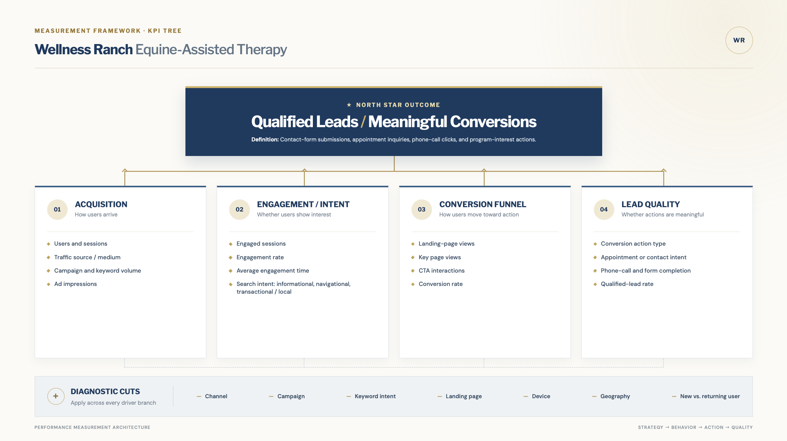

# Deliverable 1: Analytics Blueprint

## Client Context

**Wellness Ranch Equine-Assisted Therapy** is a 501(c)(3) nonprofit in Rancho Cucamonga, CA, that serves the Inland Empire. It offers equine-assisted, trauma-informed therapy for children, adults, couples, and groups, plus wellness education, community events, and internships.

- **Business model:** Therapy services, supported by donations and community programs.
- **North Star outcome:** **Qualified leads and meaningful conversions**. These include contact-form submissions, appointment inquiries, phone-call clicks, and program-interest actions.
- **Secondary goals:** Grow search visibility in the Inland Empire, launch Google Ad Grants campaigns that stay compliant, and increase donations.

**Current tracking (as of October 2026):**

- The site is on Wix at wellnessranchtherapy.org.
- GA4 is installed through an on-page Google tag.
- Tag Assistant, Realtime, and DebugView confirm the tag is firing.
- Events already showing: `page_view`, `session_start`, `first_visit`, `user_engagement`, `scroll`, `click`, `form_start`, and `generate_lead`.
- **No key events are marked yet**, so GA4 is not reporting conversions today.

## Key Definitions

| Term | Definition |
|---|---|
| **Meaningful Conversion** | Any `generate_lead` event (contact form, appointment inquiry, or program-interest form) or `click_to_call` event. |
| **Qualified Lead** | A `generate_lead` event that fires on the form's success message (not `form_start`) and matches a real submission in the Wix form inbox. Test and spam submissions are excluded. |
| **Lead Type** | The `lead_type` parameter on `generate_lead`: `contact`, `appointment`, or `program_interest`. |
| **Converting Session** | A session with at least one Meaningful Conversion. A session with both a call click and a form submission counts once. |

## Stakeholder Questions and KPIs

The questions follow the four driver branches in the KPI Tree (Deliverable 2): Acquisition, Engagement and Intent, Conversion Funnel, and Lead Quality.

### Q1. Which channels and campaigns bring in visitors who convert, so we know where to focus our time? (Acquisition)

| | |
|---|---|
| **KPI(s)** | Meaningful Conversions; Session Conversion Rate |
| **Definition** | **Meaningful Conversions** = count of `generate_lead` + `click_to_call` events. **Session Conversion Rate** = converting sessions ÷ total sessions × 100. |
| **Breakdown** | Session default channel group, source/medium, campaign, device category, city, new vs. returning users |
| **Data source** | GA4 UI (Traffic acquisition); BigQuery export; Looker Studio |
| **Assumptions / notes** | `generate_lead` and `click_to_call` must be marked as key events. Team and client test traffic must be excluded with an internal-traffic filter. Campaign data depends on UTM-tagged links (Deliverable 4, TC7). |

### Q2. Are visitors engaging with service pages and showing interest before they convert? (Engagement and Intent)

| | |
|---|---|
| **KPI(s)** | Engagement Rate; CTA Click Rate; Form Start Rate |
| **Definition** | **Engagement Rate** (GA4 standard) = engaged sessions ÷ sessions; an engaged session lasts 10+ seconds, has 2+ page views, or includes a key event. **CTA Click Rate** = sessions with a `select_content` event ÷ total sessions × 100. **Form Start Rate** = sessions with a `form_start` event ÷ total sessions × 100. |
| **Breakdown** | Landing page, page path, `cta_text`, `cta_location`, device category, new vs. returning users |
| **Data source** | GA4 UI (Pages and screens; Events); BigQuery export; Looker Studio |
| **Assumptions / notes** | `select_content` with `cta_text` and `cta_location` still needs to be set up (Deliverable 4, TC6). Main pages to watch: /, /our-mental-health-services, /contact, and /wellness-ranch-community-events. |

### Q3. Where are visitors dropping off before they complete an inquiry? (Conversion Funnel)

| | |
|---|---|
| **KPI(s)** | Form Completion Rate; Landing Page Conversion Rate |
| **Definition** | **Form Completion Rate** = `generate_lead` events ÷ `form_start` events × 100, by `form_id`. **Landing Page Conversion Rate** = converting sessions that start on a landing page ÷ sessions that start on that page × 100. |
| **Breakdown** | `form_id`, `form_name`, landing page, device category, channel group |
| **Data source** | GA4 UI (Funnel exploration: page view → `form_start` → `generate_lead`); BigQuery export |
| **Assumptions / notes** | `form_id` and `form_name` are not confirmed on Wix's built-in events yet (Deliverable 4, TC3). Refreshing the confirmation page must not fire a second `generate_lead` (TC8). |

### Q4. Which conversions are real, valuable leads? (Lead Quality)

| | |
|---|---|
| **KPI(s)** | Qualified Leads; Lead Mix by Type; Lead Match Rate |
| **Definition** | **Qualified Leads** = `generate_lead` events that match a real Wix form submission. **Lead Mix by Type** = share of qualified leads by `lead_type` (contact, appointment, program interest). **Lead Match Rate** = Wix form submissions ÷ GA4 `generate_lead` events × 100, compared monthly. |
| **Breakdown** | `lead_type`, `service_type`, channel group, device category |
| **Data source** | GA4 UI; BigQuery export; Wix form submissions (client CRM/inbox) |
| **Assumptions / notes** | Appointment inquiries are the highest-value lead type. A match rate far from 100% points to duplicate firing, spam, or missing events. `click_to_call` counts as a conversion but can't be confirmed as a completed call. |

### Q5. Once Google Ad Grants launch, which keyword intent groups produce the best click-through and conversion rates?

| | |
|---|---|
| **KPI(s)** | Ads CTR; Ads Conversions; Ads Conversion Rate |
| **Definition** | **Ads CTR** = ad clicks ÷ ad impressions × 100, account level, monthly (Ad Grants requires at least 5%). **Ads Conversions** = Meaningful Conversions from paid search sessions. **Ads Conversion Rate** = Ads Conversions ÷ ad clicks × 100. |
| **Breakdown** | Keyword intent group (informational, navigational, transactional/local), campaign, ad group, search term, landing page, device |
| **Data source** | Google Ads; GA4 (key events imported into Google Ads); Looker Studio |
| **Assumptions / notes** | No campaign data exists yet because the grant has not been approved. Google Ads must be linked to GA4, and key events imported, before launch. Falling below 5% CTR for two months in a row can suspend the account. |

## Key Events to Mark in GA4

| Event | Role | Key event? | Status today |
|---|---|---|---|
| `generate_lead` | Meaningful Conversion (form-based) | Yes | Firing; parameters not verified; not marked |
| `click_to_call` | Meaningful Conversion (phone) | Yes | Not tracked yet |
| `form_start` | Funnel step | No | Firing |
| `select_content` | CTA interest | No | Not tracked yet |

Event names and parameters match the Event/Parameter Map (Deliverable 3) and the test cases in Deliverable 4.

## Known Gaps to Fix First

1. Mark `generate_lead` and `click_to_call` as key events.
2. Add the `lead_type`, `form_id`, and `form_name` parameters to `generate_lead`.
3. Set up `click_to_call` and `select_content` events.
4. Set up an internal-traffic filter so team testing doesn't inflate the numbers.
5. Link Search Console and Google Ads to the GA4 property.
6. Confirm where donations are processed so donation tracking can be added in a later phase.
7. Consent mode is active (non-personalized ads), so some events may be modeled or missing. Treat small numbers with caution.

# Deliverable 2: KPI Tree / Metric Hierarchy Diagram

The North Star outcome for Wellness Ranch Equine-Assisted Therapy is qualified leads and meaningful conversions. These include contact-form submissions, appointment inquiries, phone-call clicks, and program-interest actions.

{width="100%" fig-cap="KPI tree showing the North Star outcome, driver branches, supporting metrics, and diagnostic cuts."}

### Diagram Explanation

The KPI tree illustrates how Wellness Ranch Equine-Assisted Therapy can connect digital marketing activity to qualified leads and meaningful conversions. The North Star outcome is placed at the top because it represents the primary business result: contact-form submissions, appointment inquiries, phone-call clicks, and program-interest actions.

The four driver branches identify the major stages that influence this outcome. Acquisition measures how users arrive at the website. Engagement and intent measure whether visitors interact with the website and demonstrate interest in Wellness Ranch services. The conversion funnel measures the steps users take before completing an action. Lead quality evaluates whether those actions represent meaningful and potentially valuable prospects.

The diagnostic cuts at the bottom will be applied across the driver branches. These include channel, campaign, keyword intent, landing page, device, geography, and new versus returning user status. Using these cuts will allow the team to compare performance and identify which marketing activities, website experiences, and audience segments produce the strongest results. The diagram supports the project’s research questions about meaningful engagement, keyword intent, click-through rates, and conversion rates.

# Deliverable 3: Event / Parameter Map

## Instrumentation Plan

<!-- Complete or revise the rows below. Use recommended GA4 event names when appropriate. -->

| KPI / Question Supported | Event Name | Trigger Definition | Required Parameters | Notes / Edge Cases |
|---------------|---------------|---------------|---------------|---------------|
| Meaningful conversions; RQ2 | `generate_lead` | User submits a contact or inquiry form successfully. | `form_id`, `form_name`, `page_location`, `page_referrer`, `lead_type` | Prevent duplicate events from refreshes or repeated clicks. Confirm embedded-form tracking. |
| Appointment inquiries; RQ2 | `generate_lead` | User submits an appointment or consultation request. | `form_id`, `lead_type`, `service_type`, `page_location` | Distinguish appointment inquiries from general contact forms. |
| Phone-call conversions; RQ2 | `click_to_call` | User clicks a phone number or call button on the website. | `phone_link`, `page_location`, `link_text` | A click does not confirm that a call was completed. |
| CTA engagement; RQ2 | `select_content` or custom CTA event | User clicks a primary call-to-action button. | `cta_text`, `cta_location`, `page_location`, `destination_url` | Avoid counting repeated clicks as separate conversions unless intended. |
| Search intent; RQ4 and H4 | Google Ads keyword data | Search term or keyword is classified as informational, navigational, or transactional/local. | `keyword`, `keyword_intent`, `campaign`, `ad_group` | Document the coding rules for each intent category. |
| Click-through rate; RQ4 | Google Ads metric | User clicks a Wellness Ranch advertisement after seeing it. | `campaign`, `ad_group`, `keyword`, `impressions`, `clicks` | CTR is calculated as clicks divided by impressions multiplied by 100. |
| Conversion rate; RQ4 and H4 | Google Ads / GA4 conversion data | A user completes a defined conversion after an ad interaction. | `campaign`, `keyword_intent`, `conversion_type`, `conversion_value` | Define the attribution window and conversion-counting method. |
| Website engagement; RQ2 | `page_view` / GA4 engagement metrics | User views a page and interacts with the website. | `page_location`, `page_title`, `page_referrer`, `engagement_time_msec` | Confirm that internal traffic and unwanted referrals are handled consistently. |

## Additional Events to Consider

<!-- Add any additional events your team believes are necessary. -->

| KPI / Question Supported | Event Name | Trigger Definition | Required Parameters | Notes / Edge Cases |
|---------------|---------------|---------------|---------------|---------------|
| <!-- Add KPI or question --> | <!-- Add event --> | <!-- Describe the trigger --> | <!-- List parameters --> | <!-- Add edge cases --> |
| <!-- Add KPI or question --> | <!-- Add event --> | <!-- Describe the trigger --> | <!-- List parameters --> | <!-- Add edge cases --> |

# Deliverable 4: Validation Checklist and Test Cases

## Validation Checklist

The purpose of this validation plan is to ensure that Google Analytics 4 (GA4) accurately collects website traffic, engagement, and lead-generation data for Wellness Ranch Equine-Assisted Therapy. Validation focuses on confirming that events are recorded correctly, required parameters are available, and data can support the team's marketing KPIs.

### Google Tag / GTM and Collection

-   [x] Confirm that the Google tag is connected to the Wellness Ranch website.
-   [x] Use Google Tag Assistant to verify that the website is sending data to GA4.
-   [x] Verify that `page_view` events are collected.
-   [x] Confirm that GA4 receives form-start and lead-generation events.
-   [ ] If GTM is used, verify individual tags and triggers in Preview mode.
-   [ ] Test for duplicate tags and conversion events.
-   [ ] Verify that custom CTA and phone-click events fire correctly.
-   [ ] Confirm that tracking follows the website's consent settings.

### GA4 DebugView and Realtime

-   [x] Verify that website activity appears in GA4 Realtime.
-   [x] Confirm that `page_view`, `session_start`, `first_visit`, `user_engagement`, `scroll`, and `click` events are received.
-   [x] Confirm that `form_start` and `generate_lead` appear in Realtime.
-   [x] Enable debugging through Google Tag Assistant.
-   [x] Verify that `page_view` events appear in GA4 DebugView.
-   [x] Confirm that `page_location`, `page_title`, and `page_referrer` contain appropriate values.
-   [ ] Verify that `generate_lead` includes the required form and lead parameters.
-   [ ] Confirm that lead-generation events are configured as GA4 key events.

### Reporting Sanity Checks

-   [x] Verify that GA4 identifies website pages, including the homepage and Contact page.
-   [x] Confirm that page titles and URLs match the pages visited during testing.
-   [ ] Verify that source, medium, campaign, and landing-page dimensions are recorded accurately.
-   [ ] Confirm that device and geographic dimensions populate correctly.
-   [ ] Verify that conversion rates use the correct numerator and denominator.
-   [ ] Compare successful Wix contact form submissions with GA4 lead events.
-   [ ] Investigate unusual event counts or possible duplicate conversions.

### BigQuery Export

The following checks will be completed if BigQuery export is enabled.

-   [ ] Confirm that GA4 data is exported to BigQuery.
-   [ ] Verify that events appear in the `events_*` tables.
-   [ ] Confirm that required event parameters can be extracted correctly.
-   [ ] Check event timestamps and user/session identifiers.
-   [ ] Compare BigQuery event counts with GA4 reporting.
-   [ ] Document export delays, missing parameters, or discrepancies.

## Validation Test Cases

The following test cases outline how the team will verify website tracking accuracy and completeness.

| Test Case | Steps to Perform | Expected Events | Expected Parameters / Dimensions |
|------------------|------------------|------------------|------------------|
| TC1: Homepage Visit | Open the Wellness Ranch homepage and verify the visit in GA4 Realtime and DebugView. | `page_view` | `page_location`, `page_title`, `page_referrer`, device category |
| TC2: Contact Page Visit | Navigate from the homepage to the Contact page and inspect the page-view event in DebugView. | `page_view` | `page_location`, `page_title`, `page_referrer`, `page_path` |
| TC3: Contact Form Submission | Complete and submit a test inquiry through the Contact page. Verify that the submission is accepted. | `form_start`, `generate_lead` | `form_id`, `form_name`, `lead_type`, `page_location` |
| TC4: Appointment Inquiry | Complete an appointment inquiry form, if available, and verify the event. | `generate_lead` | `lead_type=appointment`, `service_type`, `form_id`, `page_location` |
| TC5: Phone-Call Click | Open the website on a mobile device and click a phone number or call button. | `click_to_call` | `phone_link`, `page_location`, `link_text`, device category |
| TC6: CTA Button Click | Click a primary CTA button, such as Contact Us or Learn More. | `select_content` or approved custom CTA event | `cta_text`, `cta_location`, `destination_url`, `page_location` |
| TC7: Campaign Landing Page | Visit a landing page using a URL containing test UTM parameters and inspect acquisition dimensions. | `page_view`, `session_start` for a new session | Session source, session medium, session campaign, landing page |
| TC8: Duplicate Submission | Submit one valid test inquiry, then refresh the confirmation page and inspect GA4 events. | One intended `generate_lead` event | `form_id`, `form_name`, `lead_type`; no duplicate conversion |

The event names and parameters are based on the team's Event/Parameter Map in Deliverable 3. Any custom parameters that are not currently implemented will require additional configuration.

## Test Results and Issues

### Validation Results — October 11, 2026

Initial validation was conducted using the live Wellness Ranch website, Google Tag Assistant, GA4 Realtime, and GA4 DebugView.

| Date | Tester | Test Case | Result | Findings / Resolution |
|---------------|---------------|---------------|---------------|---------------|
| Oct. 11, 2026 | Kevin Bachez | Google tag connection | Pass | Verified that Wellness Ranch was listed in Google Tag Assistant and that GA4 was receiving website activity. |
| Oct. 11, 2026 | Kevin Bachez | GA4 Realtime collection | Pass | Confirmed that Realtime recorded active users, page views, and website engagement events. |
| Oct. 11, 2026 | Kevin Bachez | Homepage and website page tracking | Pass | GA4 Realtime recorded activity across the homepage, Volunteer page, Community Events page, and other website pages. |
| Oct. 11, 2026 | Kevin Bachez | Contact page tracking | Pass | Verified that the Contact page appeared in Realtime and DebugView. |
| Oct. 11, 2026 | Kevin Bachez | Page-view parameter validation | Pass | Confirmed that `page_location`, `page_title`, and `page_referrer` identified the correct website pages and navigation path. |
| Oct. 11, 2026 | Kevin Bachez | Contact form event collection | Partial Pass | After a test form submission, GA4 Realtime displayed one `form_start` and one `generate_lead` event. Form parameters and Wix submission records still require verification. |
| Oct. 11, 2026 | Kevin Bachez | DebugView connectivity | Pass | Enabled debugging using Google Tag Assistant and confirmed that `page_view` events appeared in the DebugView timeline. |
| Pending | Team | Custom CTA and phone-click tracking | Not Tested | Verify that custom events fire with the required parameters. |
| Pending | Team | Campaign attribution | Not Tested | Test UTM-tagged visits and verify source, medium, and campaign dimensions. |
| Pending | Team | BigQuery export | Not Tested | Confirm whether export is enabled before validating event tables. |

### Initial Findings

Initial testing confirmed that the Google tag is connected to the Wellness Ranch website and that GA4 receives website activity.

GA4 Realtime recorded page views, sessions, user engagement, scrolling, and click events. During contact form testing, GA4 also recorded one `form_start` event and one `generate_lead` event.

Google Tag Assistant was used to enable DebugView, where the team verified page-view events and inspected the `page_location`, `page_title`, and `page_referrer` parameters. These values correctly identified the Wellness Ranch Contact page.

Although basic website and lead-event collection were observed, additional testing is required to verify custom lead parameters, duplicate prevention, campaign attribution, and BigQuery export.

### Validation Conclusion

The initial validation results indicate that Wellness Ranch's GA4 implementation is successfully collecting website traffic, engagement, and lead-generation events.

The remaining validation activities will focus on ensuring that conversion events include the required parameters, that submissions are accurately represented, and that marketing performance can be analyzed by channel, campaign, landing page, and device.

These additional checks will improve data reliability for the team's future BigQuery analysis, Looker Studio dashboards, and marketing recommendations.

# Appendix: Project Links

-   [GitHub Repository](PASTE-GITHUB-REPOSITORY-LINK-HERE)
-   [GitHub Pages](PASTE-GITHUB-PAGES-LINK-HERE)