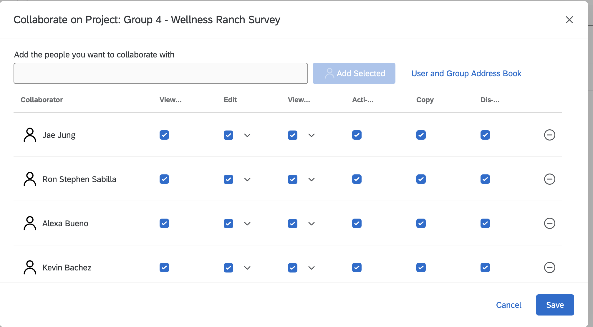

# Group 4 Survey Questionnaire

## Finding Wellness Support Online: An Inland Empire Community Survey

## Block 1: Cover Page and Consent

### Dear Participant

We are graduate students in the Master of Science in Digital Marketing and Analytics program at California State Polytechnic University, Pomona.

We are conducting a research study in collaboration with Wellness Ranch Equine Assisted Therapy, a nonprofit organization located in Rancho Cucamonga, California.

The purpose of this study is to understand how Inland Empire residents search for wellness and mental health services online, evaluate nonprofit websites, and make decisions about contacting organizations or making donations.

### Survey Duration and Voluntary Participation

This survey takes approximately 8–10 minutes to complete. Your participation is entirely voluntary. You may skip questions other than required eligibility and consent questions or stop participating at any time without penalty.

### Potential Risks and Benefits

Some questions involve personal experiences or opinions related to wellness services. You may experience minor discomfort answering these questions. There are no guaranteed direct benefits to participating. However, your feedback may help Wellness Ranch improve its online presence and make its services more accessible to the community.

### Privacy and Confidentiality

This survey is anonymous. We do not collect names, email addresses, IP addresses, or location data, and your answers cannot be linked back to you.

Results will be reported only in summary form for academic purposes and shared with Wellness Ranch Equine Assisted Therapy to help improve its online outreach. Data will be stored in a password-protected Qualtrics account accessible only to the research team and faculty advisor.

### Questions or Concerns

**Research Team:** Ron Sabilla, Kevin Bachez, Alexa Bueno, and Brian Vuong

**Contact Email:** \[Insert research team email\]

**Faculty Advisor:** Dr. Sonya Zhang

**Faculty Email:** \[Insert verified faculty email\]

### Consent to Participate

**Q1.** I have read the information above, I am 18 years of age or older, and I agree to take part in this survey.

-   Yes, I agree
-   No, I do not agree

> **Survey setting:** Force response. Skip logic: “No” → End of Survey.

## Block 2: Screening

**Q2.** Do you currently live in the Inland Empire, including Riverside County or San Bernardino County?

-   Yes
-   No
-   Not sure

> **Survey setting:** Force response. Skip logic: “No” → End of Survey.

**Q3.** In the past 12 months, have you used Google or another search engine to look for a health, wellness, or counseling service, for yourself or someone else?

-   Yes
-   No

> **Survey setting:** Force response. This question controls the display logic for Q5 and Q6.

## Block 3: Past Behavior and Experience

**Q4.** How often do you use a search engine to find local services, such as doctors, counselors, or gyms?

-   Never
-   Less than once a month
-   About once a month
-   Weekly
-   Daily

**Q5.** Think about the last time you searched online for a health, wellness, or counseling service. What were you mainly trying to do? Select all that apply.

-   Learn about a type of therapy or treatment
-   Find a provider near me
-   Look up a specific organization by name
-   Compare costs, insurance, or payment options
-   Other: \_\_\_\_\_\_\_\_\_\_\_\_\_\_\_\_\_\_\_\_

> **Survey setting:** Display only if Q3 = Yes. These choices map to informational, transactional, and navigational search intent.

**Q6.** In that search, which result did you click first?

-   A sponsored ad at the top of the page
-   The first regular non-ad result
-   A map or local business listing
-   A review site, such as Yelp
-   I do not remember

> **Survey setting:** Display only if Q3 = Yes.

**Q7.** Before today, how familiar were you with equine-assisted therapy, meaning therapy that involves working with horses?

-   Never heard of it
-   Heard of it, but not sure what it is
-   Somewhat familiar
-   Very familiar

**Q8.** Before today, had you heard of Wellness Ranch Equine Assisted Therapy?

-   Yes
-   No
-   Not sure

**Q9.** In the past 12 months, have you donated money to a nonprofit organization?

-   Yes, online
-   Yes, but not online
-   No

**Q10.** Have you or someone close to you ever looked for counseling or therapy services?

-   Yes
-   No
-   Prefer not to say

## Block 4: Main Questions

This block measures the focal constructs: search ad attitude, ad click intent, website clarity, trust, accessibility, ease of action, inquiry intention, and donation intention.

Unless otherwise noted, items use a 7-point scale:

1.  Strongly disagree\
2.  Disagree\
3.  Somewhat disagree\
4.  Neither agree nor disagree\
5.  Somewhat agree\
6.  Agree\
7.  Strongly agree

The codes in the first column are for the team’s Construct and Measurement Table and data file. Hide these codes in Qualtrics. Randomize item order within each matrix.

### 4A. Attitude Toward Search Ads

**Q11.** Please rate how much you agree with each statement about sponsored ads that appear at the top of Google results.

| Code | Statement |
|------------------------------------|------------------------------------|
| ATT1 | Sponsored search ads are often useful to me. |
| ATT2 | I trust sponsored search ads as much as regular results. |
| ATT3 | I usually skip sponsored ads and scroll to regular results. Reverse-coded. |

### 4B. Ad Copy Test

**Q12.** Imagine you searched “equine therapy near me” and saw these two ads. Which one would you be more likely to click?

**Ad A:** *What Is Equine Therapy? \| Healing With Horses in the IE.* Learn how working with horses supports mental wellness for kids and adults.

**Ad B:** *Equine Therapy in Rancho Cucamonga \| Sliding-Scale Rates Available.* Individual, couples, and group sessions. Call or book a visit today.

-   Ad A
-   Ad B
-   Neither

> **Survey setting:** Randomize the order of Ad A and Ad B. Ad A represents an informational appeal. Ad B represents an action and accessibility appeal.

**Q13.** Why did you choose that option?

`[Optional open-ended response]`

> **Survey setting:** Use piped text: “Why did you choose \${q://QID12/ChoiceGroup/SelectedChoices}?”

### 4C. Website Evaluation

Before Q14, show a screenshot of the Wellness Ranch homepage with the following instruction:

> Please take a moment to look at this nonprofit’s homepage, then answer the questions below.

Add a page timer so the screenshot remains on screen for at least 15 seconds.

**Q14.** Based on the homepage you just saw, please rate how much you agree with each statement.

| Code | Statement |
|------------------------------------|------------------------------------|
| CLR1 | It is clear what services this organization offers. |
| CLR2 | I can easily tell who these services are for. |
| CLR3 | The website explains its mission in a way I understand. |
| TRU1 | This organization seems trustworthy. |
| TRU2 | The website looks professional. |
| TRU3 | I believe this organization would handle my information responsibly. |
| TRU4 | This organization seems qualified to provide therapy services. |
| ACC1 | These services seem affordable for someone like me. |
| ACC2 | The location seems convenient for me to visit. |
| ACC3 | It is clear whether insurance or sliding-scale payment is accepted. |
| CHK1 | For quality purposes, please select “Somewhat agree” for this statement. |
| EAS1 | It would be easy to find how to contact this organization. |
| EAS2 | It would be easy to find how to donate to this organization. |
| EAS3 | It is clear what I should do next on this website. |

> **Survey setting:** CHK1 is an attention check. Responses that do not select “Somewhat agree,” coded as 5, can be screened out during data cleaning.

### 4D. Outcomes

**Q15.** Please rate how much you agree with each statement.

| Code | Statement |
|------------------------------------|------------------------------------|
| INQ1 | If I or someone close to me needed support, I would contact this organization. |
| INQ2 | I would consider requesting more information about this organization’s programs. |
| INQ3 | I would recommend this organization to a friend or family member. |
| DON1 | I would consider donating to this organization. |
| DON2 | I would be willing to make a small donation, such as \$10 to \$25, to support its services. |
| DON3 | I would share this organization’s donation page with others. |

> **Survey setting:** Force response on Q15. INQ items measure Inquiry Intention, or DV1. DON items measure Donation Intention, or DV2.

## Block 5: Lifestyle and Attitudes

### Control Variables

**Q16.** Please rate how much you agree with each statement.

Use the following 7-point scale:

1.  Strongly disagree\
2.  Disagree\
3.  Somewhat disagree\
4.  Neither agree nor disagree\
5.  Somewhat agree\
6.  Agree\
7.  Strongly agree

| Code | Statement |
|------------------------------------|------------------------------------|
| OPN1 | I am open to trying wellness approaches outside of a traditional office setting. |
| OPN2 | Hands-on or outdoor activities help me feel better. |
| OPN3 | I would consider a non-traditional therapy if a licensed professional recommended it. |
| ANI1 | I enjoy being around animals. |
| ANI2 | I would feel comfortable being around horses. |
| SOC1 | People important to me would support me if I chose to use therapy services. |
| SOC2 | People important to me support donating to local causes. |

**Q17.** Where do you usually go first for information about local services?

-   Google or another search engine
-   Social media, such as Instagram, Facebook, or TikTok
-   Friends or family
-   A doctor, school, or other professional referral
-   Other: \_\_\_\_\_\_\_\_\_\_\_\_\_\_\_\_\_\_\_\_

**Q18.** Which device do you use most when searching online?

-   Smartphone
-   Computer or laptop
-   Tablet

## Block 6: Open-Ended Questions

**Q19.** If you were searching online for therapy that involves horses, what words or phrases would you type into Google?

`[Open-ended response]`

> These responses support keyword research and the development of negative keyword lists.

**Q20.** What would make you more likely to contact or donate to a local wellness nonprofit after visiting its website?

`[Open-ended response]`

## Block 7: Demographics

**Q21.** What is your age?

-   18–24
-   25–34
-   35–44
-   45–54
-   55–64
-   65 or older

**Q22.** What is your gender?

-   Woman
-   Man
-   Non-binary
-   Prefer to self-describe: \_\_\_\_\_\_\_\_\_\_\_\_\_\_\_\_\_\_\_\_
-   Prefer not to say

**Q23.** Which city do you live in?

-   Rancho Cucamonga
-   Ontario
-   Fontana
-   Upland
-   Riverside
-   San Bernardino
-   Other Inland Empire city: \_\_\_\_\_\_\_\_\_\_\_\_\_\_\_\_\_\_\_\_

**Q24.** Are you a parent or guardian of a child under 18?

-   Yes
-   No

**Q25.** What type of health insurance do you have?

-   Private, through an employer or purchased
-   Medi-Cal or Medicare
-   No insurance
-   Not sure
-   Prefer not to say

**Q26.** What is the highest level of education you have completed?

-   High school or less
-   Some college or associate degree
-   Bachelor’s degree
-   Graduate degree

**Q27.** What is your annual household income?

-   Under \$35,000
-   \$35,000–\$74,999
-   \$75,000–\$124,999
-   \$125,000 or more
-   Prefer not to say

**Q28.** Which best describes your race or ethnicity? Select all that apply.

-   Asian
-   Black or African American
-   Hispanic or Latino
-   Native American or Alaska Native
-   Native Hawaiian or Pacific Islander
-   White
-   Other: \_\_\_\_\_\_\_\_\_\_\_\_\_\_\_\_\_\_\_\_
-   Prefer not to say

## Thank You Page

Thank you for completing our survey. Your answers will help Wellness Ranch make its services easier to find for people across the Inland Empire.

If you or someone you know is looking for support, you can learn more at \[Wellness Ranch website\].

# Team Notes

## Survey Logic and Qualtrics Settings

These notes are for building the survey in Qualtrics and are not shown to respondents.

| Question | Function | Setting |
|------------------------|------------------------|------------------------|
| Q1 | Force response and skip logic | “No” → End of Survey |
| Q2 | Force response and skip logic | “No” → End of Survey |
| Q3 | Force response | Controls display of Q5 and Q6 |
| Q5 and Q6 | Display logic | Show only if Q3 = Yes |
| Q12 | Randomization | Randomize the order of Ad A and Ad B |
| Q13 | Piped text | Carries forward the ad chosen in Q12 |
| Q14 | Timer and attention check | 15-second minimum on screenshot page; CHK1 must equal 5 |
| Q11, Q14, Q15, and Q16 | Randomization | Randomize statement order within each matrix |
| Q15 | Force response | Both dependent variables are required |
| Q19 and Q20 | Text entry | Optional |

## Construct Map for the Construct and Measurement Table

| Construct                        | Role                 | Items     |
|----------------------------------|----------------------|-----------|
| Inquiry Intention                | Dependent Variable 1 | INQ1–INQ3 |
| Donation Intention               | Dependent Variable 2 | DON1–DON3 |
| Website Clarity                  | Independent Variable | CLR1–CLR3 |
| Perceived Trust                  | Independent Variable | TRU1–TRU4 |
| Perceived Accessibility          | Independent Variable | ACC1–ACC3 |
| Ease of Action                   | Independent Variable | EAS1–EAS3 |
| Attitude Toward Search Ads       | Independent Variable | ATT1–ATT3 |
| Ad Appeal, Ad A versus Ad B      | Independent Variable | Q12       |
| Openness to Experiential Therapy | Control Variable     | OPN1–OPN3 |
| Attitude Toward Animals          | Control Variable     | ANI1–ANI2 |
| Social Influence                 | Control Variable     | SOC1–SOC2 |
| Search Intent and Past Behavior  | Control Variable     | Q4–Q10    |
| Demographics                     | Control Variable     | Q21–Q28   |

## Pretest Checklist

-   [ ] Each member takes the survey once on a phone and once on a computer.
-   [ ] Choosing “No” on Q1 and Q2 ends the survey.
-   [ ] Q5 and Q6 are hidden when Q3 = No.
-   [ ] Q13 pipes in the correct advertisement.
-   [ ] Completion time is under 10 minutes.

## Survey Link

[Preview the Qualtrics Survey](https://cpp.pdx1.qualtrics.com/jfe5/preview/previewId/0beb3e60-b02e-4bda-a92d-f2356a617323/SV_emqFZ0Yr9Z2fgrk?Q_CHL=preview&Q_SurveyVersionID=current)

# Appendix

[GitHub Repository](https://github.com/brianvuong1/CEP-Group-4)

[Published Article Notes on GitHub Pages](https://brianvuong1.github.io/CEP-Group-4/group-4-revise-survey.html)

[Measurment Table](https://docs.google.com/document/d/1Y27DsO9x2OFT71ipNMHRLTjvJTlpeoeT/edit?usp=sharing&ouid=102053154635546890348&rtpof=true&sd=true)

{width="100%"}